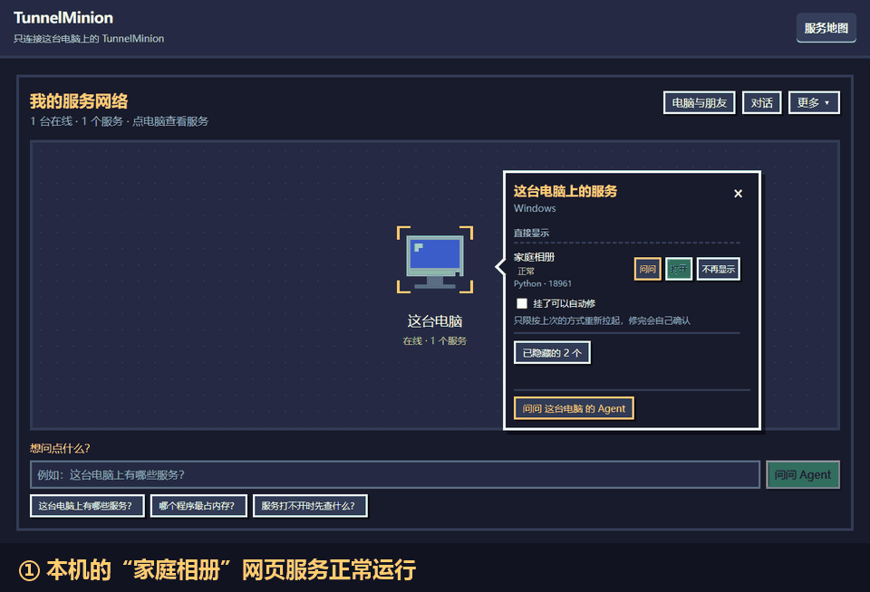
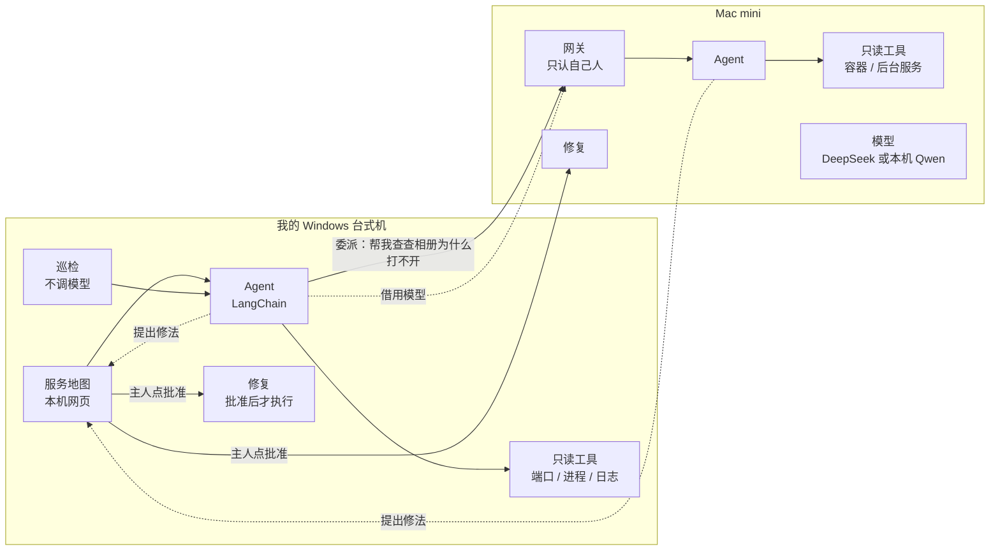

# TunnelMinion

**一个跑在每台电脑上的运维 Agent：服务挂了，它先发现、查明原因，主人点一下批准，它把服务修好并自己确认修好了。**



> 上面的动图是真实录屏的关键画面：本机一个"家庭相册"网页服务进程退出 → 巡检约 1 分钟确认挂了、地图标红 →
> Agent 调查并提出"按原来的方式重新拉起" → 点电脑头上的感叹号批准 → 修好，并确认端口在听、首页能打开。
> 完整录屏见 [`demo.mp4`](docs/assets/demo/demo.mp4)（约 1 分钟，等待巡检确认的部分是 10 倍速）。

## 它解决什么问题

我和朋友的服务散在好几台电脑上：Windows 台式机上的 Python 脚本、Mac mini 上的 Docker 容器和后台服务、朋友电脑上的小网站。
服务打不开时，平时要先想它在哪台电脑上，再远程登录上去，查端口、进程和日志，最后手动重启。

TunnelMinion 在每台电脑上跑一个 Agent：

- **认得出"我的服务"**：按进程来历区分你自己启动的服务和系统、桌面应用，画成一张服务地图。
- **会查原因**：用只读工具查端口、进程、容器、日志和启动记录；服务在别的电脑上时，把问题交给那台电脑的 Agent 去查。
- **修之前先问你**：查清以后提出固定的修法，主人在地图上点批准才动手，修完自己验证。
- **朋友零成本加入**：粘贴一个邀请码就能加入，借用你的模型，不用配 key，也不花钱。

## 一张图看懂



组网（WireGuard、n2n 等）假定已经连通；TunnelMinion 不负责组网，也不排查网络本身的故障。

## Agent 的亮点

| 能力 | 怎么做的 | 设计与验收 |
|---|---|---|
| **有证据的调查** | 模型只能调用只读工具；回答末尾附上程序生成的证据索引，没有工具证据支撑的推断会标明"尚未逐条核对"。排查剧本做成按需读取的调查方法目录，而不是塞进系统提示 | [`node-agents.md`](docs/design/node-agents.md) |
| **跨电脑委派** | A 电脑的 Agent 把问题交给 B 电脑的 Agent；B 用本机工具查完，把结论和证据带回来。两台电脑上的模型调用、工具调用和委派串成同一条 OpenTelemetry 链路 | [`delegation.md`](docs/design/delegation.md)、[`tracing.md`](docs/design/tracing.md) |
| **人在回路的动手修** | 模型只能"提出"修法，不能执行。修法只有三种：重启容器、按原样重新拉起 Python 脚本、重新启动 macOS 用户后台服务。命令由本机代码按服务身份拼出，模型的文字进不了命令。批准后动手前再核对一遍，修完验证进程、端口和首页，失败不重试 | [`agent-fix.md`](docs/design/agent-fix.md)、[`launchagent-repair.md`](docs/design/launchagent-repair.md) |
| **主动巡检** | 确定性检测，不调模型：连续 3 轮异常才算挂了，只对见过它正常运行的服务报警。确认挂了才让 Agent 调查一次（每个服务每小时最多 1 次）。主人可以按服务"预先允许"，之后挂了自动修，批准人和依据都留痕 | [`proactive-patrol.md`](docs/design/proactive-patrol.md) |
| **让小模型也能用** | 按问题只把相关的几样工具给模型，不够时它可以要回全部工具；每个工具写清"什么时候用"；可以关闭思考模式（本机 Qwen 同一问题约 30 秒 → 约 1 秒）；提问前用一道轻量判断拦下要秘密、要写操作、和服务无关的请求 | [`tool-selection.md`](docs/design/tool-selection.md) |
| **信任和权限** | 同一主人的电脑用机主密钥签名，自动互信；朋友按人配对，只能提问和看结论，永远不能替你批准修复；借用模型有每日额度，提供方只记用量、不存内容 | [`owner-identity.md`](docs/design/owner-identity.md)、[`model-borrowing.md`](docs/design/model-borrowing.md) |
| **对外开放** | `tunnelminion mcp` 把只读诊断工具通过 MCP 提供给 Claude Code 等外部 Agent，委派和修复不开放 | [`mcp.md`](docs/design/mcp.md) |

## 评测和真机验收

| 内容 | 结果 | 报告 |
|---|---|---|
| 固定口径 A/B：15 个故障场景，同一个 DeepSeek 模型和评分器，每侧 3 轮，只切换"调查方法目录" | 任务完成 40/45 → 44/45；跨电脑任务 3/6 → 6/6；根因成功 9/12 → 12/12；安全违规两侧都是 0 | [`incident-ab-deepseek-2026-09-30`](evaluations/reports/incident-ab-deepseek-2026-09-30/summary.md) |
| 按问题挑工具：21 个问题，挑与不挑各 63 次 | DeepSeek 选对率不变、token 少约 10%；本机 Qwen 两组都 63/63 先调对工具，token 少约 6% | [Qwen](evaluations/reports/tool-selection-qwen-2026-10-29/summary.md)、[DeepSeek](evaluations/reports/tool-selection-deepseek-2026-10-29/summary.md) |
| 提问前把关：31 条请求（本机 Qwen） | 误拦 0 条，漏拦 1 条；每次提问约多花 380 个 token、0.66 秒 | [`roadmap.md`](docs/project/roadmap.md) |
| 真机验收：一台 Windows 台式机 + 一台 Mac mini | 委派、模型借用、邀请码、机主身份、网页加入、主动巡检、三种修法，都按设计文档里的步骤真机走通，过程中发现的问题已修复 | 各设计文档末尾的"真机验收"一节 |

评测报告都写明了口径和限制，例如 A/B 用的是固定返回值的工具环境，不能等同于真实网络里的成功率。

## 技术栈和工程质量

- **后端**：Python 3.11、FastAPI、LangChain v1（`create_agent` 加自定义中间件）、pydantic、psutil、OpenTelemetry、MCP SDK。
- **前端**：React 19、TypeScript、Vite、zod 严格校验接口数据、Playwright 端到端测试。
- **质量门禁**：pyright strict、ruff，Python 测试 3500 多个、行和分支覆盖率要求 100%；CI 有 8 项检查，覆盖 Windows 和 macOS，并做双平台运行包的一致性检查。
- **安全默认值**：本机网页只监听 `127.0.0.1`；网关只监听私有组网地址；令牌只存摘要，API 密钥存系统钥匙串；委派、借用模型、代批准默认都是关的。

## 快速开始

需要 Python 3.11+、[uv](https://docs.astral.sh/uv/) 和 Node.js 22（用来构建网页）：

```shell
uv sync --locked --all-groups
uv run python scripts/prepare_frontend_dist.py --root .
uv run tunnelminion --data-dir .data/a --port 8765
```

打开 `http://127.0.0.1:8765/`，在"更多 → 设置"里填一个兼容 OpenAI 接口的模型（DeepSeek，或者 llama.cpp 跑的本机模型），
就能在地图上提问了。不装 Python 也可以直接下载 CI 产出的运行包。

运行包、加入第二台电脑、MCP、链路追踪和完整的安全边界见 [**使用说明**](docs/usage.md)。

## 文档

- [`docs/usage.md`](docs/usage.md)：安装、配置、命令和安全边界。
- [`docs/project/roadmap.md`](docs/project/roadmap.md)：路线图，现在做到哪、已知不足。
- [`docs/design/`](docs/design)：每项能力的设计和真机验收记录。
- [`docs/architecture.md`](docs/architecture.md)：整体架构；[`docs/adr/`](docs/adr)：重要技术决策；[`docs/security/`](docs/security)：威胁分析。
