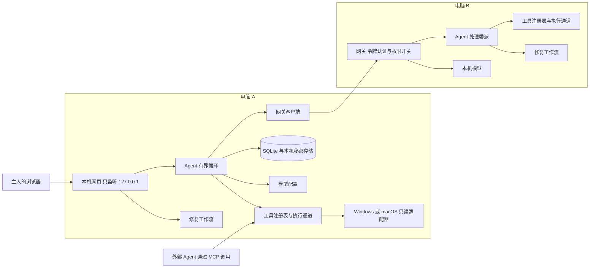
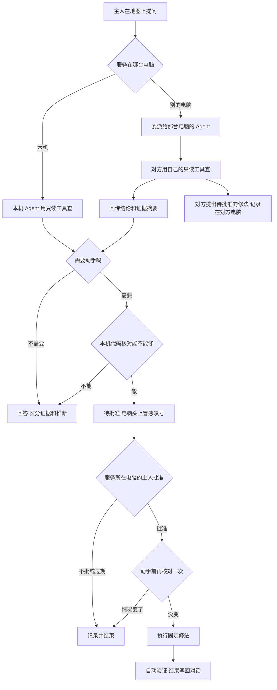

# TunnelMinion 架构

本文按当前代码描述 TunnelMinion 由哪几部分组成、各部分的边界在哪里。每项能力的细节和真机验收记录见
[`design/`](design)，产品进度见 [`project/roadmap.md`](project/roadmap.md)。

## 每台电脑上有什么

每台电脑跑同一套程序，分成两个进程：

- **本机网页（local）**：服务地图、对话、设置都在这里，只监听 `127.0.0.1`。Agent、服务观察、修复的执行都在这个进程里。
- **网关（gateway）**：电脑之间唯一的入口，只监听配置好的私有组网地址，不能绑定环回地址、`0.0.0.0` 或公网地址。
  所有请求都要带配对令牌。



离线复核用的 SVG：[架构图](assets/architecture/architecture-01.svg)。SVG 由脚本里固定版本的
Mermaid CLI 和[离线配置](mermaid-config.json)生成，并校验源图摘要，确认里面没有脚本、HTML、外链和事件处理器。
复核不需要 Node.js 或网络；改了本页的 Mermaid 源图以后运行：

```powershell
uv run python scripts/validate_mermaid_docs.py docs/architecture.md --svg-dir docs/assets/architecture --config docs/mermaid-config.json --write
```

## 各部分做什么

| 部分 | 代码位置 | 职责 |
|---|---|---|
| 服务观察 | `agent/service_observation.py`、`agent/service_tiers.py`、`platforms/` | 定时看本机有哪些程序在监听端口，按进程来源（终端、容器、桌面应用、系统）分档，决定哪些出现在地图上；用户的"是我的服务 / 隐藏"标记按程序身份长期保存 |
| Agent | `agent/runtime.py`、`agent/conversation.py` | 基于 LangChain 的有界循环：轮数、工具次数、时长都有上限，可以取消。回答里区分有证据的结论和推断 |
| 工具 | `tools/registry.py`、`tools/runtime.py` | 工具都要先注册，带风险等级和参数 schema。执行通道统一负责参数校验、超时、结果大小上限和审计；模型只能调用只读工具 |
| 委派 | `agent/delegation.py`、`agent/delegation_tool.py`、网关 `/v1/delegations` | A 只把问题和相关服务发给 B，B 用自己的本机工具查完，只回传结论、事实和证据摘要；原始输出留在 B |
| 修复 | `repair/` | Agent 只能提出"待批准的修法"。批准以后的核对、执行、验证和收场都由固定代码完成，模型不参与 |
| 模型 | `model/` | 兼容 OpenAI 接口的模型配置，带"关闭思考模式"开关；也可以借用另一台电脑的模型（网关 `/v1/model:complete`） |
| 邀请与加入 | `agent/invites.py`、`agent/join.py`、网关 `/v1/invites:accept` | 一次性邀请码完成两台电脑的配对 |
| 网关 | `gateway/` | 令牌认证、按对端区分的权限开关（委派、借用模型）、频率和额度限制；还提供服务清单 `/v1/services` 和只读工具调用 `/v1/tools/{name}:call` |
| 网页后端 | `web/` | 本机网页的接口，其中 `web/service_map.py` 汇总本机和配对电脑的服务地图，`web/repairs.py` 负责修复的列表、批准和拒绝 |
| 网页前端 | `frontend/` | React 单页应用，服务地图是唯一主页面，对话在右侧抽屉里 |
| MCP | `mcp_server.py` | 通过标准输入输出把只读工具提供给外部 Agent，和 Agent 共用同一条工具执行通道 |
| 链路追踪 | `telemetry.py` | OpenTelemetry，默认关闭；跨电脑请求用 W3C `traceparent` 接到同一条链路上 |
| 运行管理 | `runtime/` | 运行包的 `runtime configure/start/status/stop`、后台进程管理和启动前检查 |

数据都存在本机数据目录里：SQLite 存对话、调查、修复记录、委派记录和用量；模型 API 密钥和配对令牌存在本机秘密存储里：
Windows 存在凭据管理器，Mac 存在只有本账户能读的 `~/.tunnelminion/secrets/secrets.json`（`model/secrets.py`
的 `FileSecretVault`）；Windows 上没有图形界面的会话可以改存到数据目录里只有本人可读的文件。

## 一次提问到修好



离线复核用的 SVG：[提问到修复流程图](assets/architecture/architecture-02.svg)。

要点：

- **委派只发问题，不发命令。** B 的网关先核对对方身份和"允许委派"开关；B 处理委派时不能再转给别的电脑。
  每次委派的轮数、工具次数和时长上限由 B 决定，A 改不了。
- **修法只在服务所在的电脑上建立和执行。** B 提出的修法记录在 B 上，默认在 B 的本机网页批准；A 只能看到摘要。
  B 的主人可以为 A 打开"允许替我批准修复"（默认关闭），之后 A 的地图上点感叹号即可批准：批准经 B 的网关
  `/v1/repairs/{编号}:approve` 交给 B，只带修复编号；B 照常做过期检查和执行前核对，记录里写明由 A 代为批准。
  见 [`design/agent-fix.md`](design/agent-fix.md)。
- **模型只参与诊断和提出修法。** 修法只有三种（重启 Docker 容器或 compose 组、按启动记录重新拉起退出的 Python 脚本、
  在 macOS 上重新启动当前用户已退出的后台服务），实际命令由本机代码根据服务身份、启动记录和 launchd 状态拼出来，
  模型写的文字不会进入命令。后台服务的规则见 [`design/launchagent-repair.md`](design/launchagent-repair.md)。
- **自动调查有频率限制。** 服务出现或消失照常记录，但只对显示在地图上的服务和标成"是我的服务"的服务自动调查，
  同一个服务 1 小时内最多自动调查一次。

## 安全边界由谁负责

| 决定什么 | 由谁说了算 |
|---|---|
| 下一步查什么 | Agent 和模型 |
| 工具存不存在、是不是只读、适不适合当前平台 | 工具注册表 |
| 参数、超时、并发和结果大小 | 工具执行通道 |
| 对方是谁、允不允许委派和借用模型、频率和额度 | 网关 |
| 一个服务能不能修、怎么修 | 修复资格检查和固定修法代码 |
| 修不修 | 服务所在电脑的主人，在本机网页上批准 |
| 修好了没有 | 修复工作流里的自动验证，不采信模型的说法 |

网关只保存配对令牌的 SHA-256 摘要，比对时用常量时间比较。追踪记录和借用模型的记账都不保存消息内容。

## 仓库里还有、但不在当前主线上的代码

下面这些代码还在仓库里，但不属于当前产品主线，默认不启用：

- **受管组网**：Coordinator 控制面（`coordinator/`）和受管 WireGuard（`network/`）。当前产品默认组网已经连通，不做组网。
- **临时共享本机 HTTP 服务**：`operation/` 和网关的 `/v1/operations*` 接口。接口一直注册着，但只有 macOS 网关加了
  `--enable-safe-sharing`、并且给对端单独允许了这个操作时才能用。

它们是否保留、是否清理，待核实后在路线图里决定。

## 相关决策与安全文档

- [ADR-0001：远端工具传输](adr/0001-remote-tool-transport.md)
- [ADR-0002：工具风险与执行边界](adr/0002-tool-risk-and-execution-boundary.md)
- [ADR-0003：上下文、checkpoint 与长期记忆](adr/0003-context-checkpoint-and-memory.md)
- [ADR-0004：跨节点应用认证](adr/0004-cross-node-application-authentication.md)
- [ADR-0005：临时 HTTP 共享](adr/0005-temporary-http-sharing.md)（对应上面不在主线的临时共享）
- [ADR-0006：Coordinator 身份、目录与数据面分离](adr/0006-coordinator-identity-and-directory.md)（对应受管组网）
- [ADR-0007：受管连接 Provider 与路径发现](adr/0007-managed-connectivity-provider-and-path-discovery.md)（对应受管组网）
- [威胁模型](security/threat-model.md)
- [数据分类与保留](security/data-classification.md)
