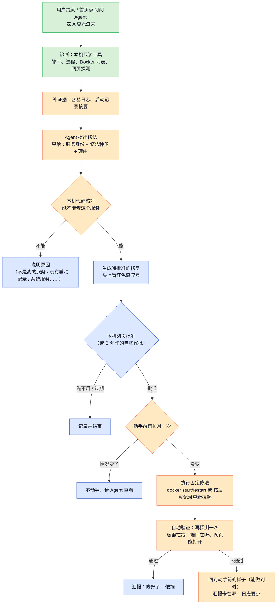

# Agent 动手修服务：提出修法、本机批准、自己验证

> 状态：已确认，4 个 PR 均已实现。总体方向见 [`node-agents.md`](node-agents.md)，委派见 [`delegation.md`](delegation.md)。
> 界面草图：[`mockups/agent-fix.html`](mockups/agent-fix.html)（数据是假的）。

## 一句话

Agent 查出"相册打不开，是容器停了"以后，不再只说一句"建议你重启"，而是**提出一个具体修法**，在那台电脑的网页上弹出一个大白话的批准框。主人点"批准并修复"，Agent 就去重启，然后**自己再探测一次**，确认网页能打开了，才说"修好了"；没修好就说清楚卡在哪、接下来怎么办。

## 现在已经有什么（以代码为准）

仓库里已经有一套"先计划、再批准、再执行、再验证"的框架，但它是为"临时把本机网页共享给另一台电脑"做的，不能原样拿来修服务。

| 现有部分 | 在哪 | 修服务能不能直接用 |
|---|---|---|
| 状态机：计划 → 等批准 → 已批准 → 执行中 → 验证中 → 成功 / 回滚 / 拒绝 / 过期，非法跳转直接拒绝 | `operation/contracts.py` 的 `OperationStatus`、`transition_operation` | **能用** |
| 批准、拒绝、取消、批准过期；只认本机控制面（`local_control`） | `operation/policy.py` 的 `AuthorizationService` | **能用** |
| 风险分级 L0～L4，等级由注册表决定、不信模型说的；L2 默认要本机逐次批准 | `operation/policy.py` 的 `OperationPolicy`、`tools/registry.py` | **能用**，两种修法注册为 L2 |
| 只把只读工具（L0）交给模型 | `ToolRegistry.model_tools` | **能用**，模型永远拿不到修法的执行入口 |
| 本机网页的批准、拒绝、取消接口；只认本机环回地址和同源请求 | `web/operations.py`、`web/request_guard.py` | **能用** |
| 网页批准确认框 | `frontend/src/features/operations/ActionConfirmationDialog.tsx` | 要改：现在要用户自己填过期时间、填理由，普通朋友看不懂 |
| 命令行批准 `tunnelminion operation-approve` | `cli.py` | 保留作备用 |
| 计划内容和执行流程 | `OperationPlan`、`OperationWorkflow`、`http_sharing.py` | **不能直接用**：计划必须带"开放哪个端口给哪台电脑多久"，执行会建临时入口和访问令牌，验证由另一台电脑从网络那头做。修服务一样都不需要 |
| 预授权 | `Preauthorization` | 不直接用：只会匹配共享端口和时长 |
| 跨电脑接口 `/v1/operations:*` | `gateway/api.py` | 第一版不用，那是共享网页走的路 |
| 只读工具：端口、进程、Docker 列表（`docker ps -a`，停掉的容器也看得到）、本机摘要、网页标题探测 | `platforms/windows`、`platforms/macos` | **能用**；**还缺容器日志** |
| "是我的服务 / 隐藏"标记，挂在稳定身份上（如 `docker:compose:penpot`、`python:app.py@8000`） | `agent/service_marks.py` | **能用**，作为"能修谁"的依据 |
| 委派：B 用本机工具查，有轮数、次数、时长上限；结论里可以带建议 | `agent/delegation.py` | **能用**；现在规定"只查不修" |

另外有三处空白，修服务必须补上：

1. **脚本退出以后，现在没人记得它是怎么启动的。** 为了不泄露路径，Python 进程的启动参数只保留入口文件名，完整命令和工作目录既不存也不出本机。
2. **首页现在看不到"已停止"。** 停掉的容器按规则归到"不显示"，退出的脚本根本不在端口清单里。
3. **没有容器日志工具**，Agent 判断"容器为什么挂"时缺最重要的一条证据。

## 第一批修法：只做两种

| 修法 | 适合的情况 | 第一批 |
|---|---|---|
| ① 重启 Docker 容器或 compose 组 | 容器停了、反复不健康、端口在但网页没反应 | 做 |
| ② 重新拉起从终端启动、已经退出的 Python 脚本 | 脚本崩了、终端被关了、电脑重启后没起来 | 做 |
| ③ 重启应用自带的服务 | 应用注册的后台服务 | **不做**，原因见下 |

两种修法共用一条规则：**Agent 只说"修哪个服务、用哪种修法、为什么"，不写命令。** 具体执行什么，由本机固定的代码根据服务身份算出来。

### ① 重启 Docker 容器或 compose 组

**需要的信息**：服务身份（`docker:<容器名>` 或 `docker:compose:<项目名>`），以及从 `docker ps -a` 读到的容器编号、状态、发布的端口。全部是现有工具已经能读到的。

**怎么做**（Windows 和 macOS 一样，都走 `docker` 命令，Docker Desktop、OrbStack 都适用）：

- 按标签 `com.docker.compose.project=<项目名>` 找出这个组的所有容器；单个容器就只有它自己。
- 已经停了的用 `docker start`，还在跑但不正常的用 `docker restart`，一个组的容器放在同一条命令里，按 Docker 自己的顺序处理。
- 不用 `docker compose up`、不拉镜像、不重建容器、不删任何东西。这样不需要找 compose 文件，也不会因为镜像更新把服务改成别的版本。

**做不到的情况**：

| 情况 | Agent 怎么说 |
|---|---|
| Docker 本身没在运行 | "Docker 没开，请先打开 Docker Desktop / OrbStack"，不替用户开 |
| 容器已经被删了 | "这个容器已经不存在，需要重新部署"，不去重建 |
| 一启动就退出（日志里有报错） | 修一次，验证失败就停，把最后几十行日志的要点告诉用户；不反复重启 |

### ② 重新拉起已经退出的 Python 脚本

**原命令和工作目录从哪来**：新增本机的**启动记录**。脚本还活着的时候，每次服务观察（打开首页、Agent 查看本机）顺手记下：

- 解释器的完整路径（用的是虚拟环境里的 Python，就记虚拟环境里的那个）；
- 完整启动参数、工作目录、监听的端口、运行它的账户。

启动记录挂在服务身份上（如 `python:app.py@8000`），**只存在本机数据库里**，不发给别的电脑，也不原样交给模型。模型只看到摘要，例如"有启动记录：入口 app.py，上次在 8000 端口"。只为"是我的服务"和规则判定直接显示的脚本记录；环境变量一律不记，因为里面常有密码和 key。

**怎么做**：用原来的解释器、原来的参数、原来的目录重新启动。重新拉起的脚本在后台运行，不会回到原来那个终端窗口；输出写到 TunnelMinion 数据目录下这次修复专用的日志文件。

| | Windows | macOS |
|---|---|---|
| 启动方式 | 新进程组、不弹窗口，TunnelMinion 退出后脚本照常运行 | 新会话（`start_new_session`），TunnelMinion 退出后脚本照常运行 |
| 运行账户 | 和 TunnelMinion 同一个账户，不提权 | 同左，不用 `sudo` |

**做不到的情况**：

| 情况 | Agent 怎么说 |
|---|---|
| 没有启动记录（脚本在装 TunnelMinion 之前就退出了，或者从没被看到过） | "我不知道它原来是怎么启动的"，请用户自己在终端里重新运行一次，之后就有记录了 |
| 入口文件或工作目录已经不在了 | 说明哪个不在了，不尝试 |
| 原来那个端口现在被别的程序占了 | 说明被谁占了，不尝试 |
| 原来是别的账户运行的，或者是交互式的 `python`、`python -c` | 不支持 |
| 脚本依赖在终端里临时设置的环境变量 | 可能启动失败；验证失败时日志里通常能看出来，照实告诉用户 |

### ③ 应用自带的服务：第一批不做

- Windows 上应用注册的服务归系统服务管理器管，重启要管理员权限，正好落在"绝不碰系统服务"的范围里。
- macOS 上用户级的后台服务（LaunchAgent）技术上可以用 `launchctl kickstart` 重启，但从一个监听端口可靠地找到它对应哪个后台服务，现在还做不到。
- 这类服务按现有规则大多本来就不显示。等前两种修法在真机上跑通，再评估是否把"macOS 用户级 LaunchAgent"作为第二批。

## 安全边界

1. **只能修这些对象**：用户标记为"是我的服务"的，或者规则判定直接显示的（发布了端口的容器、从终端启动的程序）。"可能是服务"和"隐藏"的一律不修；想修，先在首页标成"是我的服务"。
2. **永远不碰**：系统进程和系统服务、桌面应用、TunnelMinion 自己、Docker 运行环境本身、WireGuard 和任何组网、防火墙、系统设置。不删数据、不改文件、不装东西、不提权。
3. **没有"执行任意命令"这一种修法。** 修法是固定的两种，执行的命令由本机代码根据服务身份和启动记录拼出来，模型提供的任何文字都不会进入命令。
4. **每次动手前都要本机批准。** 一次批准只修一次，10 分钟内有效，过期作废。唯一的例外是主人在本机为某个服务打开的"挂了可以自动修"：巡检确认它挂了以后代主人批准一次，其余步骤不变，见 [`proactive-patrol.md`](proactive-patrol.md)。
5. **执行前再核对一次。** 批准后、动手前重新看一遍：容器编号还是不是那个、脚本是不是已经自己起来了、端口有没有被别人占。情况变了就不动手，告诉用户"情况变了，Agent 重新看一下"。
6. **不会修个没完。** 一台电脑同时只执行一个修复；同一个服务 1 小时内最多修 3 次；验证失败不自动重试。
7. **失败了怎么收场**：
   - 重启本身没法"撤销"，所以失败后的做法是**尽量回到动手前的样子，再说清楚**。
   - 脚本：如果我们拉起的进程还在、但端口一直没起来，就把这个进程停掉（只停我们自己拉起的那个，按进程号加启动时间确认），回到"已停止"，附上日志要点。
   - 容器：不再动它，报告它现在的状态和日志要点，告诉用户下一步可以怎么做。
8. **全程留记录，记录留在本机**：谁提出的（哪次对话或哪次委派、依据的证据）、谁批准的、什么时候、实际执行了什么、验证结果、最后的结论。完整命令和路径只在本机的记录里；对别的电脑和对模型只给摘要。

## 批准：普通朋友点按钮就行

批准默认只在**服务所在那台电脑的本机网页**上做。本机网页只认本机地址和同源请求，别的电脑点不到这个按钮；例外只有下面"跨电脑"一节的代批准。

**用户看到的**（见草图）：

1. 那台电脑头上冒出红色感叹号，服务框里"需要处理的事"写着："相册打不开，Agent 建议重启。"
2. 点"看看怎么修"，弹出批准框，框里只有五件事：
   - **要做什么**："重启 Docker 容器组 photos（2 个容器）"；
   - **为什么**：Agent 的一句结论加几条依据，例如"两个容器 13 分钟前都退出了"；
   - **会有什么影响**："重启大约需要半分钟，这期间相册打不开；正在上传的照片可能要重新传"；
   - **怎么确认修好**："重启后我会再打开一次相册首页"；
   - **没修好怎么办**："我会停下来，告诉你卡在哪，不会反复重启"。
3. 两个按钮：**批准并修复**、**先不用**。框底部写"10 分钟内有效"。不需要填时间、填理由、看命令；想看具体命令的，展开"高级"。
4. 点批准以后，框里显示进度：正在重启 → 正在确认 → 修好了 / 没修好；结果同时写回原来那次对话。

### 跨电脑：B 的 Agent 想修 B 上的服务

A 把问题委派给 B，B 的 Agent 查出原因、提出修法。修法**一定建在 B 上，由 B 执行**，A 不能在 B 上执行任何东西，这一点不变。谁来点"批准"按方案二：**默认 B 本机批准；B 的主人可以为信任的对端打开"允许替我批准修复"，默认关闭。**下表是选它的理由。

| 方案 | 怎么批准 | 好处 | 问题 |
|---|---|---|---|
| 一：只能 B 本机批准 | A 上告诉用户"Mac mini 提出了修法，请到 Mac mini 上批准" | 最安全，规则最简单 | Mac mini 这种平时没人坐在前面的电脑很不方便 |
| **二（采用）：默认 B 本机批准，B 可以给信任的电脑开"替我批准"** | B 的主人在 B 上为某台对端打开"允许替我批准修复"，默认关闭，和"允许委派"一样。打开后 A 的网页上弹出同一个批准框，A 的用户点批准，批准经 Gateway 发给 B | 我自己的几台电脑之间用起来顺手；朋友的电脑不打开就和方案一一样 | 要多一个 Gateway 接口；A 被攻破时，能做的也只是"重启 B 上那几个可修的服务" |
| 三：B 预先授权"出问题就自动修" | B 的主人事先允许某些服务出问题时自动重启 | 半夜挂了也能自己恢复 | 违背"每次动手前都要批准"；已由主动巡检按服务逐个、默认关闭地提供，见 [`proactive-patrol.md`](proactive-patrol.md) |

选方案二的理由：既保住了"B 决定能不能动手"，又照顾到无人值守的电脑。不管谁点的批准，B 都照样做第 5 条的执行前核对，并在记录里写明"由某台电脑代为批准"。

**代批准的实现**（以代码为准）：

| 环节 | 做法 |
|---|---|
| 开关 | B 的对端配置 `allow_proxy_repair_approval`，默认关闭，只能在 B 本机改：`invite --allow-proxy-approval`、`gateway-configure --allow-proxy-approval`，或对已配对的电脑运行 `peer-proxy-approval <对端编号> on/off`（重启后生效）。Gateway 上没有任何能改这个开关的接口 |
| B 的网关接口 | `GET /v1/repairs/{编号}` 看修复摘要和进度；`POST /v1/repairs/{编号}:approve`、`:reject` 批准或拒绝。只认路径里的修复编号，不读请求体。没开开关 403，编号不存在或不属于 B 404，不在等批准或已过期 409 |
| 对端看到什么 | 五件事、状态、批准截止时间、是否由对端批准、验证是否通过、错误说明；没有命令、路径、启动参数和容器编号 |
| 记录 | 批准人记为 `peer:<对端编号>`，审计写"由 <B 给这台电脑起的名字>（编号）代为批准了修复"；名字取 B 本机配置，不信对方自报 |
| A 这边 | 本机接口 `/api/peers/{对端}/repairs/{编号}`（及 `/approve`、`/reject`）转发给 B，只认本机同源请求；批准框打开时每 3 秒问一次进度。对方没开开关或是旧版本时，框里仍显示"请到对方地图上批准" |
| 新旧版本 | 新字段只出现在新接口里；邀请码在开关关闭时不写出新字段，旧版本照常能用。开关打开的邀请码要求加入方也是新版本 |

## 完整流程

图例：绿色 = 复用现有代码；橙色 = 新写；蓝色 = 在现有代码上改。

| 环节 | 复用 | 新写 / 要改 |
|---|---|---|
| 提问、委派、诊断 | Agent 主循环、委派、现有只读工具 | — |
| 补证据 | — | 新只读工具"读容器最后几十行日志"；启动记录（采集、存储、给模型的摘要） |
| 提出修法 | 工具注册表、"只给模型 L0 工具"的规则 | 新工具"提出修法"：模型只能填服务身份、修法种类、理由，它只生成一条待批准记录，不执行任何东西 |
| 核对能不能修 | 服务标记、分档规则 | 修复对象资格检查（安全边界第 1、2 条） |
| 待批准、批准、拒绝、过期 | 状态机、`AuthorizationService`、本机网页接口和请求守卫 | 修复专用的计划内容（不带"开放端口"那些字段）；网页上的感叹号和大白话批准框 |
| 执行、验证、收场 | 状态机里的执行中、验证中、回滚中 | 修复工作流（不经过模型）、两种修法的执行代码、本机验证、限次 |
| 委派时 | 委派的边界和结果格式 | 委派结果里多一项"B 提出了一个待批准的修法"；"允许替我批准修复"的代批准接口 |
| 首页"已停止" | 服务地图 | 有标记或有启动记录、但现在不在跑的服务，显示为"已停止" |

**模型在哪一步停下**：模型只参与"诊断"和"提出修法"。批准之后的核对、执行、验证、收场全是固定代码，模型不参与，也改变不了。

## 怎么算做完

**自动测试覆盖**（全部用假的 Docker 和假的进程，不碰真机器）：

- 资格：标记"是我的服务"的能修；规则显示的能修；"可能是服务""隐藏"、系统进程、TunnelMinion 自己、Docker 运行环境都被拒绝。
- 模型不能塞命令：提出修法的工具只接受身份、种类、理由；理由里写了命令也不会被执行；修法执行入口不在模型拿到的工具里。
- 批准：只有本机网页或命令行能批准；别的电脑直接调本机接口被拒绝；10 分钟过期；拒绝后什么都不做；同一个修复批准两次只执行一次。
- 执行前核对：容器编号变了、脚本已经自己起来、端口被占，都不动手。
- 容器：停了的用 start、在跑的用 restart；compose 组一次处理所有容器；Docker 没开、容器已删的说明正确；一启动就退出时验证失败、不重试、带回日志要点。
- 脚本：按启动记录原样拉起；没有记录、入口不在、交互式 Python 都拒绝；拉起后端口不起来时只停掉自己拉起的那个进程；环境变量不进记录；Windows 和 macOS 的启动参数分别正确。
- 限次：同一台电脑同时一个；同一个服务 1 小时最多 3 次。
- 记录：每一步都有记录；对别的电脑和模型的摘要里没有完整路径和命令。
- 委派：B 的 Agent 能提出修法，B 本机能批准，A 不能执行；B 没有为 A 打开"允许替我批准修复"时，A 的代批准被拒绝。

**真机验收**（**要另外经你同意才做**，设计阶段不碰任何真实机器）：

1. Mac mini 容器：起一个专门用来测试的小容器（发布一个高端口），标成"是我的服务"，再手动停掉它。在这台电脑上问"Mac mini 上那个测试服务打不开"。看到：委派给 Mac mini → Mac mini 提出重启 → 批准 → 重启 → Agent 自己确认网页能打开 → 汇报"修好了"。Mac mini 本机能查到完整记录。测完删掉测试容器。
2. Windows 脚本：在一个临时目录里从终端运行 `python -m http.server <测试端口>`，标成"是我的服务"，关掉终端窗口。问"那个测试网页打不开"。看到：提出重新拉起 → 批准 → 拉起 → 确认能打开。测完停掉它。
3. 反面：对一个"可能是服务"的程序要求修，Agent 拒绝并说明"先标成是我的服务"。

## 代批准真机验收结果（2026-10-28）

这台 Windows 电脑和 Mac mini 用 `invite --allow-delegation --allow-proxy-approval` 重新配对。Mac 用本机 Qwen，已打开"关闭思考模式"；这台电脑用 DeepSeek。

1. 在 Mac 上起一个测试容器，标成"是我的服务"，然后停掉。
2. 在这台电脑的地图上问"Mac 上的测试服务打不开"。问题交给了 Mac，Mac 查明容器是正常退出的，没有报错。
   - 第一次 Mac 的 Agent 嘴上说要重启，但没有真正提出修法。这台电脑的回答如实写了"这个修法这次并没有真正生成，我不会替你假装已经提出"。这说明声称和实际不符时，检查会把它纠正过来，跨电脑也一样。
   - 追问一句"请提出修法"之后，Mac 真正提交了修复，这台电脑地图上 Mac 头上出现了感叹号。
3. 在**这台电脑**上点 Mac 头上的感叹号，弹出完整的批准框，标着"由 Mac 提出 · Mac 允许这台电脑代批准"，下方写"批准后由 Mac 动手修。动手前 Mac 会再核对一次，情况变了就不修"。点"批准并修复"后显示"修好了"，Mac 上的容器恢复运行。
4. Mac 的修复记录里，批准人是 `peer:<这台电脑的节点编号>`，审计写明"由 Windows 电脑代为批准了修复"，状态变化的原因是"目标节点已授权的对端代为批准"。

验收后，Mac 上的临时环境和测试容器都已删除。

**观察到的一点**：本机 Qwen 关掉思考后，有时会用文字描述修法，却不调用 `propose_repair` 工具。好在不会被误报成已经提出了修法。DeepSeek 在同类场景下能直接提出修法。

## 拆成几个 PR

| 顺序 | PR | 交付什么 | 你能看到什么 |
|---|---|---|---|
| 1 | 修复核心 | 修复计划和记录（复用现有状态机和批准服务）、修复对象资格检查、启动记录、两种修法在 Windows 和 macOS 上的执行代码、执行前核对、本机验证、失败收场、限次、本机记录；本机接口 `/api/repairs`（列表、详情、批准、拒绝） | 用命令行批准一个修复，看到容器或脚本被修好、记录完整 |
| 2 | Agent 接入 | "读容器日志"只读工具、启动记录摘要、"提出修法"工具、提示词里加两份排查剧本（容器挂了、脚本退出了）；委派结果里带待批准的修法 | 在对话里问"相册打不开"，Agent 查明原因并提出修法 |
| 3 | 网页批准 | 首页"已停止"的服务、红色感叹号和"需要处理的事"、大白话批准框、执行进度和结果、结果写回对话 | 不敲命令，在网页上点批准就能修好 |
| 4 | 跨电脑代批准（已实现） | 对端开关"允许替我批准修复"、Gateway 代批准接口、A 网页上的同一个批准框 | 在这台电脑上批准 Mac mini 上的修复 |

第 3 个 PR 合并后申请做真机验收 1～3；第 4 个 PR 合并后，在这台电脑上代批准，再验一次 1。

## 明确不做

- 执行任意命令、改配置文件、删数据、装软件、提权。
- 系统服务、防火墙、WireGuard 和组网的任何排障或修改。
- 没有主人预先允许就自动修。预先允许的自动修见 [`proactive-patrol.md`](proactive-patrol.md)。
- 替用户打开 Docker Desktop、OrbStack 这类桌面应用。
- 重建容器、拉新镜像、`docker compose up`。

