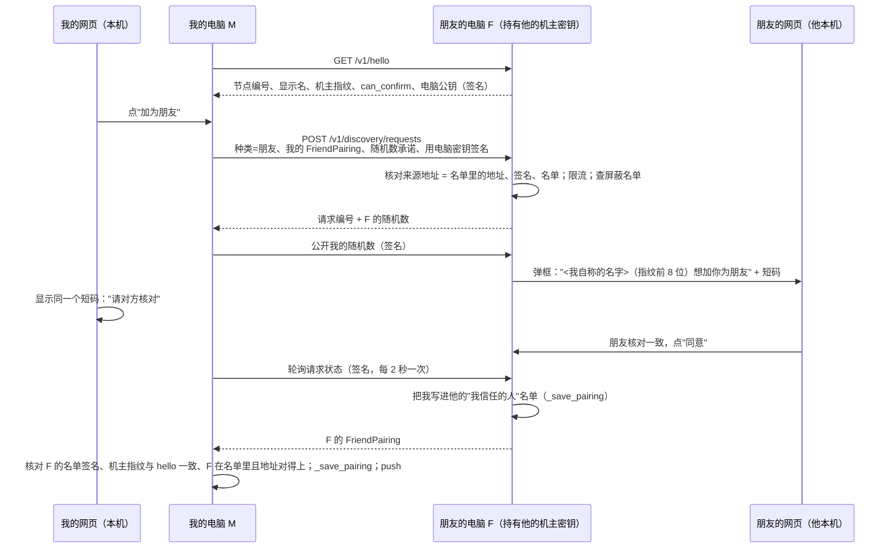
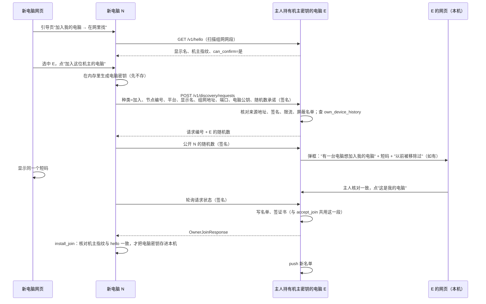

# 自动发现：同一个网里的电脑自动出现，点一下加朋友、加自己的电脑

> 状态：设计中，未实现。设计已经主人确认，结论见文末"已决定"。排在稳定期之后（见 [`../project/stages/2026-11-03-stabilization.md`](../project/stages/2026-11-03-stabilization.md)），稳定期结束后才写代码。
> 相关设计：机主身份、朋友配对和签名名单见 [`owner-identity.md`](owner-identity.md)，网页上的邀请与加入见 [`web-onboarding.md`](web-onboarding.md)，地图见 [`map-workspace.md`](map-workspace.md)。

## 一句话

在网页上点"找找网里的电脑"，本机只在组网网卡（WireGuard、n2n）的网段里，挨个问一下 TunnelMinion 网关端口"你是谁"。回答了的电脑以虚线框出现在地图边上。点"加为朋友"，对方电脑弹出确认框，双方屏幕上显示同一串 6 位数字，对方核对后点"同意"才算数。新电脑也一样：它在网里找到主人的电脑，点"加入"，再由主人那台持有机主密钥的电脑点"这是我的电脑"。之后仍然用现在的签名名单和通行证，权限、撤销规则一条不变。

## 用户影响

| 谁 | 现在 | 做完以后 |
|---|---|---|
| 加熟人当朋友 | 我生成配对码 → 用聊天软件发给朋友 → 朋友打开网页粘贴 | 我在地图上点朋友那台电脑的"加为朋友"→ 朋友网页弹框，看一眼数字一致，点"同意" |
| 主人加一台新电脑 | 老电脑生成加入码 → 抄到新电脑 → 新电脑粘贴 | 新电脑网页点"在网里找我的电脑"→ 选中主人的电脑点"加入"→ 主力电脑弹框，数字一致，点"这是我的电脑" |
| 网里的陌生人 | 看不到我（`/v1/trust:sync` 的例外见下文"现状里的一个问题"） | 只能看到我的显示名和机主指纹前几位；发请求必须有人在我电脑前点同意；刷请求会被限流和屏蔽 |

不变的东西：邀请码和配对码继续能用，作为网不通、或者对方不在同一个网时的办法；权限分"我的电脑"和"朋友"两档、朋友不能代批准、按身份查权限表、撤销（`owner remove` / `friend remove`）都不变。

## 已确定的规矩

主人已同意，设计必须遵守：

1. **"在网里"只用来发现，不用来授权。** 回答"你是谁"不需要任何凭据，但回答里的内容都只是对方自称，不能拿来给任何权限。
2. **加朋友**：主人点"加为朋友"，对方电脑弹出确认，对方同意才算数。
3. **加自己的电脑**：由一台已经在用的"我的电脑"点"这是我的电脑"确认；新电脑不能自己声称是主人的。
4. **短码**：两边显示同一串短码，看一眼一致再同意，防止网里有人冒名。短码必须核对，理由见"冒名"。
5. **签名通行证**：每个请求照旧用签名通行证，能撤销，权限分"我的电脑"和"朋友"。

## 现在是什么样（以代码为准）

### 已经能"自动出现"的部分

- **我的电脑之间已经不用发现。** 新电脑加入后，持有机主密钥的电脑签一份新名单，推给名单上所有在线的电脑（`trust/devices.py` 的 `OwnDevicesService.accept_join`、`push`）；名单里有每台电脑的组网地址和端口，地图据此显示。所以自动发现要解决的只有两件事：**还没加入的新电脑**，和**还没配对的朋友**。
- **朋友配好以后也不用发现。** 朋友的电脑名单在配对时交换，之后两边接触时同步（`FriendsService._save_pairing`、`OwnDevicesService.receive`）。

### 加入和配对现在怎么走

- 加入我的电脑：`owner invite` 生成一次性加入码（`JoinCode`：种类、邀请方节点编号、机主指纹、地址、端口、令牌、24 小时有效），新电脑 `owner join` 时带着令牌 `POST /v1/owner:join`，附一段用新电脑密钥签的应答 `JoinProof`。邀请方核对"来源地址 = 报上来的地址"、应答签名、令牌摘要，然后在锁里把新电脑写进名单、签证书（`OwnDevicesService.accept_join`）。新电脑核对名单上的机主指纹和加入码里的一致，才把电脑密钥存进本机（`install_join`）。
- 和朋友配对：`friend invite` 生成配对码，朋友带着令牌 `POST /v1/friends:pair`，双方交换 `FriendPairing`（机主公钥、恢复密钥指纹、显示名、签名的电脑名单），各自写进自己签名的"我信任的人"名单（`trust/friends.py` 的 `accept_pair`、`install_pair`、`_save_pairing`）。
- 两种码都只存令牌摘要、原子消费一次（`memory/sqlite.py` 的 `owner_invites`、`friend_invites` 表，`UPDATE … RETURNING`）；失败统一回答"邀请码无效、已过期或已被使用"；按来源地址每分钟最多 10 次（`gateway/api.py` 的 `limited`）。

**也就是说，"一次性令牌"在现在的流程里起两个作用：证明"机主同意了"，以及让对方知道该连哪个地址。** 自动发现要做的，是把第一个作用换成"对方电脑前的人点了同意"，把第二个作用换成"在网里问到的地址"。签名、名单、通行证这些后半段都不用动。

### 网关在哪里听

- 网关只绑定一个明确的私有地址，不允许绑 `0.0.0.0`、回环或组播地址（`gateway/security.py` 的 `GatewayBindConfig`）。实际用的是本机的组网地址，默认端口 8787。
- 本机网页只绑 `127.0.0.1`，其他电脑访问不到（`owner-identity.md`"四种身份"）。
- 所以**能在网里被发现的，只有已经启动了网关的电脑**；被发现的地址就是网关绑定的那一个组网地址。电脑同时有 WireGuard 和 n2n 时，网关只在其中一个上听。

### 认得出 WireGuard 和 n2n 网卡

`web/peer_network.py`（#229）按"去某个地址走哪块网卡"判断连线类型：Windows 用 `GetBestInterfaceEx` + `GetAdaptersAddresses` 读网卡描述，macOS 用 `/sbin/route -n get`；描述或名字含 `wireguard` 算 WireGuard，含 `n2n`、`tap-windows` 或以 `tap` 开头算 n2n（`classify_interface`）。这一步只读，不发包，不要管理员权限。

`trust/local.py` 的 `address_candidates` 用 `psutil.net_if_addrs()` 列出本机网卡上能给网关用的私有地址，`psutil` 同时给出子网掩码。两者合起来就能得到"本机的组网网卡和它们的网段"。

### 现状里的一个问题（不在本设计里修）

`POST /v1/trust:sync` 对没有凭据的陌生请求方也会回本机签名的"我的电脑"名单。这个问题在稳定期修复里处理，本设计不依赖这个行为。

## 复用什么、新写什么

| 要做的事 | 落在哪个现有机制上 | 新写什么 |
|---|---|---|
| 判断哪些网卡是组网网卡 | `web/peer_network.py` 的 `classify_interface`；`trust/local.py` 的 `address_candidates`（`psutil.net_if_addrs`） | 把两者合成"列出本机组网网卡及网段"的函数；Windows 需要按网卡把 `psutil` 的名字和 `GetAdaptersAddresses` 的描述对上 |
| 问"你是谁" | 网关路由（`gateway/api.py`）、按来源限流的 `limited`、按用途签名的 `trust/signatures.py` 的 `seal` | 新接口 `GET /v1/hello`，回答用电脑密钥签名（新用途 `tm-hello`） |
| 扫描 | `httpx` 客户端用 `local_address` 指定出口地址的写法（`trust/join.py`、`devices.py` 的 `sync`） | 有并发、超时、总次数上限的扫描器 |
| 发起请求、证明持有电脑密钥 | `JoinProof` 的做法：请求里带公钥，用私钥签"发给谁、什么时间、什么地址" | 新用途 `tm-discovery-request`，签名内容见"授权流程" |
| 对方确认前的暂存 | `owner_invites`/`friend_invites` 表的"只存摘要 + 原子消费"写法；`BEGIN IMMEDIATE` 短事务 | 新表 `discovery_requests`（待确认请求，10 分钟过期）和 `discovery_blocks`（屏蔽名单） |
| 加入我的电脑（主人点了"这是我的电脑"之后） | `OwnDevicesService.accept_join` 里"写名单、签证书、返回 `OwnerJoinResponse`"那一段；新电脑侧的 `install_join` | 把"核对令牌"和"写名单签证书"拆开，两条路共用后一段；`install_join` 改成接收"机主指纹 + 邀请方节点编号"，不再必须传 `JoinCode` |
| 和朋友配对（朋友点了"同意"之后） | `FriendsService.pairing`、`_verify_pairing`、`_save_pairing`、`push` | 同上，把"消费配对码"换成"消费已同意的请求" |
| 以前被移除过的电脑 | `own_device_history` 表（只记"曾经是我的电脑"的节点编号） | 确认框里标出"这台电脑以前被移除过" |
| 网页确认框 | `web/request_guard.py`（只认本机、同源写请求）、`frontend/src/shared/useDialogFocusTrap.ts` | 地图上的"网里发现的电脑"区域、确认弹框、等待弹框 |
| 权限、通行证、撤销 | 全部不变：`trust/passes.py`、`GatewaySecurityPolicy.authenticate`、`identity_permissions` | 无 |

协调服务器（`src/tunnelminion/coordinator/`）已经有节点目录（[ADR-0006](../adr/0006-coordinator-identity-and-directory.md)），但它是"中心服务器登记 + 签发断言"的模型，而且已经冻结、没有在用（`owner-identity.md`"协调服务器里哪些能复用"）。点对点发现不需要中心目录，**不复用协调服务器**。

## 怎么发现：几种方式比较

| 方式 | 要什么权限 | 多久能发现 | 防火墙 | 对网络的打扰 | Windows / macOS 差异 | 结论 |
|---|---|---|---|---|---|---|
| ① 在组网网段里问网关端口 | 无，普通账户就行 | 一个 /24 网段（最多 254 个地址）并发 32、每个最多等 1.5 秒，最坏约 12 秒；待真机核实 | 发起方只出站，不需要规则；被问的一方要放行网关端口入站，这和现在其他电脑访问网关的要求一样 | 每扫一遍最多 254 次 TCP 连接；在"一台服务器做中转"的网里，中转服务器会看到这些连接，像一次端口扫描 | 一样。Mac 访问不了自己的组网地址，扫描时跳过本机地址即可 | **主方案** |
| ② 局域网 mDNS | 要监听 UDP 5353，需要新依赖（如 `zeroconf`）；Windows 首次可能弹防火墙提示，待核实 | 秒级 | 要放行 UDP 5353 入站 | 低，但会把组网地址广播到物理局域网（咖啡馆、公司网都能听到） | 两边都有系统自带的 mDNS 服务，第三方库与之共存的方式不同，待核实 | **不做**，见下 |
| ③ 读 WireGuard 对端列表 | Windows：要以管理员身份提权运行；macOS：要 root（`sudo`）；App Store 版 WireGuard 可能完全读不到，待核实 | 即时 | 不涉及 | 无 | 见下 | **不作为必需**，以后可作为"优先问这几个地址"的提示 |
| ④ 读 n2n 对端信息 | 要知道 edge 的管理端口和密码；是否只能在本机读，待核实 | 即时 | 不涉及 | 无 | 两边都一样走 UDP 管理接口，但 n2n 版本之间接口不同 | **不作为必需**，同上 |
| ⑤ 已加好友的电脑互相转告名单 | 无 | 取决于接触频率 | 不涉及 | 无 | 一样 | "我的电脑"之间已经在做；**"朋友的朋友"不显示** |

### ① 在组网网段里问网关端口（推荐）

- **只问组网网卡的网段。** 只扫被认成 WireGuard 或 n2n 的网卡（`classify_interface`），物理网卡（家里路由器、公司网）一律不扫。网段大于 /24（超过 254 个地址）时不扫整段，只问已知地址（下面的"候选地址"）。只扫 IPv4。
- **只问一个端口**：默认 8787，加上本机已知名单里出现过的其他网关端口。
- **什么时候扫**：只在主人点"找找网里的电脑"、以及新电脑的引导页打开时扫一次，不在后台定时扫。
- **限额**：并发最多 32；单个地址连接最多等 1.5 秒；两次扫描至少隔 1 分钟；同一页面一次只跑一个扫描。
- **候选地址优先**：先问已知地址（本机名单、朋友名单、旧式配对里出现过、但节点编号对不上的地址），再问整段。
- **问什么**：`GET /v1/hello`，回答只包含：
  - 节点编号、平台、显示名（对方自称）；
  - 机主指纹（没有建立身份时为空）；
  - `can_confirm`：本机是否持有机主密钥，即能不能确认"加入我的电脑"和"加朋友"；
  - 网关地址和端口、签发时间；
  - 电脑公钥，整份回答用这把电脑密钥签名（用途 `tm-hello`）。

  签名只证明"回答者手里有这把电脑密钥"，不证明它属于谁，所以回答里的东西都不授予任何权限。
- **被问的一方可以关掉**：设置里有"让网里的电脑发现我"，默认打开，关掉后 `/v1/hello` 回 404。
- **打扰和风险**：在"一台服务器做中转"的 WireGuard 网里，中转服务器会转发这些连接；如果中转服务器上装了入侵检测或 fail2ban 一类的工具，可能把扫描的电脑当成攻击者。WireGuard 对没有对端负责的地址怎么处理（直接丢弃还是回"不可达"），决定了扫一遍要多久，待真机核实。

### ② 局域网 mDNS（不做）

- **WireGuard 上用不了。** WireGuard 是三层隧道，按"目标地址属于哪个对端的 AllowedIPs"把包交给唯一一个对端（[WireGuard 白皮书](https://www.wireguard.com/papers/wireguard.pdf)"Cryptokey Routing"一节）。mDNS 用的组播地址最多落到一个对端，没有"发给所有人"这回事。这是按原理推断的，待真机核实 Windows 会不会在 WireGuard 网卡上发 mDNS。
- **n2n 上要每台电脑都改配置。** n2n 是二层（TAP 网卡），但 edge 默认丢掉组播包，要加 `-E` 才收（[n2n `edge.8`](https://github.com/ntop/n2n/blob/dev/edge.8)："these multicast packets are discarded as most users do not need or understand them"）。这要改每个人的 n2n 配置，TunnelMinion 不改组网（[路线图](../project/roadmap.md)"不做组网"）。
- **物理局域网上不对路。** 网关不在物理网卡上听，在局域网里广播组网地址，只会把它告诉咖啡馆、公司网里的陌生人；而"在同一个局域网"也不代表"在同一个组网里"。
- 还要新增依赖、多开一个 UDP 端口。综合下来不做。

### ③ 读 WireGuard 对端列表（可选提示，不作为必需）

- **Windows**：`wg.exe` 通过 WireGuardNT 驱动的设备读状态，这个设备只对 SYSTEM 和内置管理员组开放，并且要求高完整性级别，即"以管理员身份运行"（[wireguard-windows `attacksurface.md`](https://git.zx2c4.com/wireguard-windows/tree/docs/attacksurface.md)：`O:SYD:P(A;;FA;;;SY)(A;;FA;;;BA)S:(ML;;NWNRNX;;;HI)`）。所以普通账户、以及没提权的管理员账户都读不了。官方的 `LimitedOperatorUI` 只是让"网络配置操作员"组的成员在图形界面里启停隧道，看不到密钥，也不开放命令行读取（[`adminregistry.md`](https://git.zx2c4.com/wireguard-windows/tree/docs/adminregistry.md)）。现有代码已经按这个情况处理：读失败时报"当前账户无权读取 peer 统计"（`platforms/windows/adapters.py` 的 `WireGuardStatusAdapter`）。
  - 本机核实：这台电脑上装着 `wireguard-tools v1.0.20260223`，在**已提权的管理员会话**里 `wg show interfaces` 能列出隧道名。用受限令牌（`runas /trustlevel:0x20000`）复现普通账户的尝试没有成功执行，**普通账户被拒这一点待真机核实**。
- **macOS**：命令行版 WireGuard（`wireguard-go`）把控制 socket 放在 `/var/run/wireguard/`，创建时把 umask 设成 `0o077`，只有 root 能连（[wireguard-go `ipc/uapi_unix.go`](https://git.zx2c4.com/wireguard-go/tree/ipc/uapi_unix.go)），所以普通账户要 `sudo wg show`。App Store 版 WireGuard 走系统的网络扩展，可能根本没有这个 socket，`wg` 看不到它的隧道，待 Mac 上核实。现有 macOS 适配器同样处理了"无权读取"（`platforms/macos/adapters.py`）。
- **就算读得到，用处也有限。** 常见的"一台服务器做中转"布置里，普通电脑只有一个对端（中转服务器），它的 AllowedIPs 是整个网段，读出来的只是网段而不是各台电脑。只有中转服务器自己能看到全部对端，而它通常不装 TunnelMinion。
- 结论：只在"刚好读得到"时把对端的单个地址（`/32`）当候选地址优先问，读不到就当没有。不为此要求提权。

### ④ 读 n2n 对端信息（可选提示，不作为必需）

- n2n edge 有一个 UDP 管理接口，默认端口 5644，`r <标签> peer` 可以列出对端；有个默认值为 `n2n` 的管理密码，可用 `--management-password` 改；`-t 0` 可以整个关掉（[n2n `ManagementAPI.md`](https://github.com/ntop/n2n/blob/dev/doc/ManagementAPI.md)、[`edge.8`](https://github.com/ntop/n2n/blob/dev/edge.8)）。
- 它是不是只在本机回环地址上听、读 `peer` 是否需要密码、2.x 和 3.x 的格式差多少，文档没写清，待核实。这台电脑上有 TAP-Windows 网卡，但 `PATH` 里没有 `edge.exe`，没法在本机试。
- 结论同 ③：读得到就当候选地址，读不到不影响。

### ⑤ 互相转告名单

- **"我的电脑"之间已经在转告**：名单同步就是这件事（`OwnDevicesService.push`、`receive`）。
- **"朋友的朋友"不显示。** 现有规则是"信任不传递"（`owner-identity.md`），朋友的名单只在我的电脑之间同步，不会发给别的朋友（`message(include_private=…)`）。如果把朋友的朋友当成"可以加"的候选显示出来，等于把朋友的社交关系和他朋友的电脑地址告诉了我，而朋友的朋友本人并没有同意。还会被拿来刷请求：一个人加了很多朋友，就能把请求送到所有朋友的朋友面前。
- 真要认识朋友的朋友，用现有的配对码，或者等大家在同一个网里时用 ① 自己发现。

## 授权流程

### 短码：两边看到同一串数字

请求方和确认方都按下面的方式算出一串 6 位数字，各自显示在屏幕上：

> 短码 = 取 `SHA-256(用途标签 ‖ 双方机主指纹 ‖ 双方电脑公钥 ‖ 请求方随机数 ‖ 确认方随机数)` 的前几位，换成 6 位十进制数。

为了防止网里的冒名者反复换密钥、试出一串碰巧相同的数字，请求方先只发送自己随机数的摘要（承诺），拿到确认方的随机数以后才公开自己的随机数。这样冒名者在看到对方随机数之前就已经被锁定，凑中的机会只有一百万分之一。这是蓝牙"数字比较"配对和 ZRTP 通话核对短码常用的做法。

### 加朋友

我（M，持有机主密钥）在地图上发现朋友的电脑 F，点"加为朋友"。

- 双方都要持有自己的机主密钥，和现在的配对码一样（`FriendsService.pairing` 调 `owner_key()`）。F 的回答里 `can_confirm` 为假时，地图上把它和同一机主的其他电脑归到一张"人"的卡片下，只在能确认的那台上显示"加为朋友"；都不在线时显示"他持有机主密钥的电脑现在不在线"。
- 朋友点"同意"只是把请求标成"已同意"。**等我这边来取结果的那一刻，F 才写名单**，并把结果缓存起来，我这边重复来取都拿到同一份。这样我中途关掉网页时，F 不会平白多出一个朋友。
- 结果发出后我这边写名单失败、或者断网没拿到，留下的半配对状态和现在的配对码一样：F 的"朋友"列表里有我、我这边没有 F。F 的网页上显示"对方没有完成"，可以重新发请求或在朋友列表里移除。

### 加自己的新电脑

新电脑 N 还没有身份，网关也可能还没启动。它**只当请求方**，不需要先开放任何入站端口。

- **双方都要有人点。** 主人在 E 上点"这是我的电脑"，满足"新电脑不能自己声称是主人的"；新电脑上也要有人选中"加入这位机主"。如果只有 E 点、新电脑不点，网里任何一个机主都能把一台新装的电脑收进自己的名单，从而能替它批准修复，所以新电脑这一侧的选择不能省。
- **只有持有机主密钥的电脑能确认。** 只有它能签名单和证书（`OwnDevicesService.owner_key`）。其他"我的电脑"收到请求时只回答"请到持有机主密钥的电脑上确认"，名单不变。
- 和朋友一样，E 在新电脑来取结果时才写名单；新电脑拿到响应、核对通过之前，电脑密钥只在内存里，失败就丢掉，不留下半截身份（沿用 `join_owner` 的做法）。
- 新电脑记住 hello 里的机主指纹，用它核对响应里的名单（和现在核对加入码里的 `owner_fingerprint` 是同一个检查）。冒名者能不能在这一步骗过新电脑，取决于主人有没有核对短码，所以短码在这里不能省略。

### 各种情况怎么处理

| 情况 | 处理 |
|---|---|
| **对方不在线** | 扫描时就不会出现在列表里；已经在列表里但发请求时连不上，提示"对方电脑现在不在线，等它开机后再试"，不排队、不在后台重试。 |
| **对方没人点** | 请求 10 分钟后过期，双方都显示"对方没有回应"。确认方的网页要打开才会弹框：网页没开时请求先挂在地图上的待处理角标里，10 分钟内打开还能处理。不做系统通知。 |
| **对方拒绝** | 请求方显示"对方没有同意"，不说原因。确认方还可以选"不再提示这台电脑"，加入本机屏蔽名单（按机主指纹和节点编号），以后它的请求直接回"对方没有同意"。屏蔽名单在"电脑与朋友"页面能看到、能解除。 |
| **重复请求** | 同一个请求方对同一台电脑同时只能有一个待确认请求，重复发返回同一个请求编号。已经是朋友、已经在我的名单里的，不再显示"加"按钮；对方仍然发来时直接回"已经配对"。 |
| **刷请求** | `/v1/hello` 按来源地址每分钟 30 次；发请求按来源地址每分钟 10 次（和加入码一样，用现有的 `limited`）；全机同时最多 5 个待确认请求，满了回"对方暂时收不了新请求"；被拒绝后同一请求方 24 小时内再发直接回"对方没有同意"；轮询按请求编号每 2 秒最多 1 次。 |
| **撤销** | 不变：朋友用 `friend remove`，我的电脑用 `owner remove`（网页上"电脑与朋友"页面也有）。移除以后对方仍可能出现在发现列表里，标成"已移除"；对方再发请求，要重新走一遍确认，确认框里标出"以前被移除过"。 |
| **冒名** | 显示名是对方自称，地图和确认框里一律同时显示机主指纹前 8 位，并显示短码。WireGuard 里，对端的来源地址由它的 AllowedIPs 绑定，很难冒用别人的地址（白皮书"Cryptokey Routing"）；n2n 是二层网络，同一社区里的电脑可以冒用别人的地址，来源地址核对挡不住，只能靠短码。所以短码**必须核对**：确认按钮旁边写"两边的数字一样才点"。 |
| **地址变了** | 发现时如果看到"已知节点编号出现在新地址"，只标"这台电脑的地址好像变了"，**不自动改名单**，因为 hello 回答不能当授权依据。现在的名单没有"改地址"操作（`devices.py` 只有加入、移除、收紧权限），要改仍按现有办法移除再加入；如果以后要做"签名的改地址"，另开设计。请求进行中地址变了，轮询会因为来源地址对不上而失败，请求过期后重发即可。 |
| **对方是旧版本** | 没有 `/v1/hello` 的旧版本回 404，不显示在列表里；仍可用邀请码。 |

## 网页上长什么样

### 地图

- 地图右上角加一个按钮"找找网里的电脑"，旁边写上次找的时间。点了以后按钮变成"正在找…（已问 120/254）"，可以取消。
- 找到的、还没有关系的电脑以**虚线框**显示在地图边上的"网里发现的电脑"区域，不连线，不进入正式的服务地图。同一个机主的几台电脑归成一张卡片，卡片上写：
  - 对方自称的名字，后面跟"（自称）"字样；
  - 机主指纹前 8 位；
  - 平台图标、组网地址、走的是 WireGuard 还是 n2n（沿用 #229 的连线标签）；
  - 一个按钮："加为朋友"。没有能确认的电脑在线时，按钮换成灰色说明。
- 已经是"我的电脑"或朋友的电脑不在这个区域重复出现；已移除、已屏蔽的默认收起，点"显示已隐藏的"才看得到。
- 地址变了的已知电脑，在它原来的正式节点上加一个小提示"网里在另一个地址看到它"。

### 确认弹框（被加的一方）

- 本机网页任何页面都会弹，用现有的弹框焦点管理（`useDialogFocusTrap`）。
- 内容：谁（自称名、机主指纹前 8 位、来源地址、平台），想做什么（"加你为朋友"或"加入你的电脑"），一行加粗的大号短码，一句"请和对方屏幕上的数字核对，一样才点同意"，还剩多少时间。
- 按钮：加朋友时是"同意 / 拒绝 / 不再提示这台电脑"；加入我的电脑时是"这是我的电脑 / 不是"。
- 弹框关掉不等于拒绝：地图顶部留一个"待处理 1"角标，10 分钟内点回来还能处理。

### 等待弹框（发起的一方）

- 显示同一串短码、"请对方在他的电脑上核对并同意"、倒计时、"取消"。
- 对方同意 → 弹框变成"已加为朋友"/"已加入"，地图上的虚线框变成正式节点。

### 新电脑引导页

- 现有的三选一（`web-onboarding.md`）里，"加入我的电脑"展开后有两种办法：**"在网里找"（默认）**和"粘贴加入码"。
- "在网里找"先让用户确认本机组网地址（沿用现在的地址建议），然后扫描，列出所有 `can_confirm` 为真的机主卡片；选中一张，点"加入"，进入等待弹框。
- 本机还没启动网关不影响：新电脑只发请求、取结果，加入成功后再按现在的提示启动网关。
- "我是朋友"那一项暂时只保留配对码。新装的朋友电脑要先建立自己的机主身份、启动网关，才能被我发现。也可以让朋友在网里找到我、由他发起，流程就是上面的"加朋友"反过来。

## 拆成几个 PR

按"先只看、再加朋友、再加自己的电脑"的顺序，每一步都能单独在真机上验收：

| 顺序 | PR | 交付什么 | 用户能看到的变化 |
|---|---|---|---|
| 1 | 只读发现 | `GET /v1/hello`（签名、限流、可关）；列出本机组网网卡和网段；有上限的扫描器；本机网页接口 `/api/discovery`；地图上"网里发现的电脑"区域，只显示，不能加 | 点"找找网里的电脑"，能看到网里其他装了 TunnelMinion 的电脑 |
| 2 | 点一下加朋友 | `discovery_requests` / `discovery_blocks` 表；发请求、确认、轮询三个接口；短码（承诺后公开）；限流和屏蔽；`FriendsService` 拆出可复用的保存步骤；确认弹框、等待弹框 | 点"加为朋友"，对方弹框同意后成为朋友 |
| 3 | 新电脑在网里加入我的电脑 | 种类为"加入"的请求；`accept_join` 拆出写名单签证书的公共部分；`install_join` 不再必须传 `JoinCode`；新电脑引导页的"在网里找"；`own_device_history` 提示 | 新电脑不用抄加入码，主力电脑点"这是我的电脑"即可 |
| 4（可选） | 候选地址提示 | 读得到 WireGuard、n2n 对端时，优先问这些地址；读不到时不提示错误 | 大网段（大于 /24）里也能找到电脑 |

第 2 步依赖第 1 步；第 3 步只依赖第 1 步，和第 2 步共用请求表，排在第 2 步之后，免得两条路同时改同一张表。

## 怎么算做完

### 自动测试要覆盖

- 扫描只扫组网网卡、只扫 IPv4、网段大于 /24 时不扫整段；并发、超时、扫描间隔上限生效。
- `/v1/hello` 关掉后回 404；回答签名用途必须是 `tm-hello`，挪去冒充别的用途会被拒；回答里没有任何令牌、密钥和名单。
- 请求的来源地址和报上来的地址不一致、签名不对、用途不对、时间超出范围，一律拒绝。
- 没有人点同意之前，对方名单和"我信任的人"名单都没有变化；请求过期后也没有变化。
- 请求方中途消失：确认方不写名单。请求方重复来取：拿到同一份结果，名单版本只加一次。
- 短码：双方算出的一致；请求方公开的随机数和承诺对不上时整个请求作废。
- 限流：超过每分钟次数回 429；全机待确认请求满 5 个后拒收新请求；被拒绝后 24 小时内同一请求方再发直接拒绝；屏蔽名单生效且能解除。
- 新电脑：只有持有机主密钥的电脑能确认；没确认之前新电脑不把电脑密钥写进秘密存储；响应里的机主指纹和 hello 不一致时拒收。
- 朋友：双方都持有机主密钥才能完成；已经是朋友时回"已经配对"；朋友的朋友不出现在发现列表里。
- 权限不变：通过发现加的朋友，和用配对码加的朋友权限完全一样（不能代批准、不能直接调只读工具）。

### 真机验收计划（稳定期后执行）

用这台 Windows 电脑、Mac mini 和一台笔记本，三台在同一个 WireGuard 网里。"朋友"放在笔记本上的单独数据目录，用默认网关端口 8787，这样不改扫描端口也能被找到。地址、节点编号在记录里只写占位（`<PC 组网地址>` 等）。

1. **只读发现**：PC 网页点"找找网里的电脑"，在 15 秒内列出 Mac 和笔记本，显示名和机主指纹前 8 位正确，走的网络标成 WireGuard；Mac 上做同样的事，结果对称。在笔记本上关掉"让网里的电脑发现我"，PC 再找一次，笔记本不再出现。记下扫一遍的实际耗时。
2. **不扫物理网卡**：扫描期间，用 PC 本机的连接记录（`Get-NetTCPConnection`）确认发出的连接只到组网网段。
3. **加朋友**：笔记本上的"朋友"建立自己的机主身份并启动网关；PC 网页上点它的"加为朋友"；笔记本网页弹框，两边短码一致，点"同意"。两边 `friend list` 都能看到对方；朋友向 Mac 提问能拿到结论；朋友去批准 Mac 的修复被拒（403），和 `owner-identity.md` 第 5 步结论一致。
4. **拒绝、屏蔽、限流**：再用一个新的朋友数据目录发请求，PC 点"拒绝"，对方显示"对方没有同意"；对方马上重发，直接被拒；PC 点"不再提示"后，对方 24 小时以后再发也被拒；在 PC 的"电脑与朋友"页面解除屏蔽后能再发。用命令行连发 15 次 hello，第 11 次起回 429。
5. **对方不在线、没人点**：停掉笔记本网关后发请求，提示"对方电脑现在不在线"；重新启动笔记本网关、发请求后不点，10 分钟后两边都显示过期，笔记本的名单版本没有变化。
6. **新电脑加入**：笔记本上再开一个全新的数据目录（不建立身份），引导页选"在网里找"，列出 PC（`can_confirm` 为真）；选中、点"加入"；PC 弹框，短码一致，点"这是我的电脑"。三台的 `owner status` 名单一致；Mac 的地图上出现这台新电脑。再用命令行把同样的请求直接发给 Mac（不持有机主密钥），回答应是"请到持有机主密钥的电脑上确认"，Mac 的名单不变。
7. **新电脑中途放弃**：重复第 6 步，但在 PC 点确认之前关掉新电脑的网页；确认后名单版本不变，新电脑的秘密存储里没有留下电脑密钥。
8. **撤销**：在 PC 上移除第 6 步加入的电脑；它再次发请求时，PC 的确认框标出"以前被移除过"。

验收结束后删掉笔记本上的验收数据目录，停掉临时网关。

## 已决定

主人已确认以下五条：

1. **只在需要时扫**：只在主人点"找找网里的电脑"和新电脑引导页打开时扫，不在后台定时扫。这样中转服务器上不会周期性出现"端口扫描"，网里的打扰只发生在主人主动找的那一刻。
2. **`/v1/hello` 默认打开，设置里可以关**：熟人网里不用先去别人电脑上开开关就能被找到；回答里只有自称名、机主指纹、能否确认和签名，不授予任何权限，不想被找到的电脑可以随时关掉。
3. **只有持有机主密钥的电脑能点"这是我的电脑"**：只有它能签名单和证书，确认和签名在同一台电脑上完成，不需要新增"转给主力电脑签名"的环节。
4. **6 位短码必须核对**：n2n 是二层网络，来源地址可以冒用，只有短码挡得住网里的冒名者；WireGuard 网里也统一核对，规则只有一条。
5. **不显示"朋友的朋友"**：信任不传递，显示出来会泄露朋友的社交关系和他朋友的电脑地址，还会被拿来把请求送到所有朋友的朋友面前。

## 待核实

| 事项 | 为什么没核实 | 怎么核实 |
|---|---|---|
| Windows 普通账户、没提权的管理员运行 `wg show` 被拒 | 本会话是已提权的管理员；用 `runas /trustlevel` 模拟受限令牌没有执行成功。结论目前来自官方安全文档里的设备权限 | 在普通账户下运行 `wg show interfaces` |
| 正式实例运行时有没有提权 | 不碰正式实例 | 看任务管理器里进程的"已提升"列 |
| macOS 普通账户读不了 `wireguard-go` 的 socket；App Store 版 WireGuard 没有 socket | 不 ssh 到 Mac | 在 Mac 上 `ls -l /var/run/wireguard/`、普通账户 `wg show` |
| WireGuard 网卡上发不出、收不到 mDNS | 按原理推断 | 在两台电脑的 WireGuard 网卡上抓 UDP 5353 |
| n2n 管理接口只在本机听吗；读 `peer` 要不要密码；2.x 与 3.x 差异 | 本机没有 n2n edge 程序 | 在装了 n2n 的电脑上看 `edge -h` 和 `netstat` |
| 扫一个 /24 实际要多久；WireGuard 对无人负责的地址是直接丢弃还是回"不可达" | 不做网络扫描 | 真机验收第 1 步 |
| 中转服务器（如果有）会不会把扫描当攻击 | 不碰中转服务器 | 看中转服务器上有没有入侵检测、fail2ban 一类的规则 |
| 新装电脑第一次被扫到时，Windows 会不会弹防火墙提示 | 这台电脑的 WireGuard 网卡被 Windows 归为"公用网络"，网关能被访问靠的是按程序放行的入站规则（本机没有按 8787 端口放行的规则）；新电脑上第一次启动网关时是否弹框没试过 | 在一台新装的 Windows 上启动网关 |
