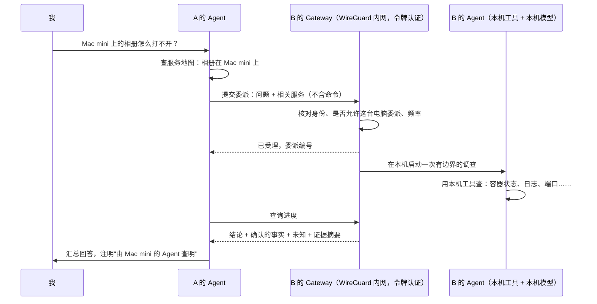

# 委派设计：把一件事交给另一台电脑的 Agent

> 状态：已确认。总体方向见 [`node-agents.md`](node-agents.md)。

## 一句话

我在 A 电脑上问"Mac mini 上的相册怎么打不开"，A 的 Agent 不去远程翻 Mac 的东西，而是把这个问题**交给 Mac mini 自己的 Agent**。Mac 的 Agent 在本机用本机的工具查清楚，把结论和证据摘要交回 A。

## 和现在有什么不同

现在跨电脑的做法是"远程调工具"：A 的 Agent 一步一步地让 B 执行"列出端口""列出进程"，原始结果全部传回 A，判断都在 A 上做。

| | 现在：远程调工具 | 委派 |
|---|---|---|
| 谁来判断查什么 | A 的 Agent | B 的 Agent |
| 原始数据（端口列表、进程、日志） | 全部传回 A | 留在 B，只回传结论和证据摘要 |
| B 能用的工具 | A 允许的那几个只读工具 | B 自己的全部本机工具 |
| 一次要来回几趟 | 每个工具一趟 | 一趟 |
| 以后要动手修 | A 发命令给 B | B 自己提方案，B 本机批准 |

**这正是面试要讲的点**：权限和数据都留在本机，A 只说"我遇到了什么问题"，不说"你去执行什么"。

## 一次委派的过程

## 关键规则

1. **只发意图，不发命令。** 委派的内容只有三样：一句问题、可选的相关服务（服务清单里的身份，例如 `docker:compose:penpot`），以及预算。B 不执行 A 写的任何命令。
2. **B 决定能不能接。** B 的 Gateway 配置里，每个对端多一个开关"允许委派"，默认关闭。没打开就拒绝。
3. **有边界。** 每次委派都有上限，由 B 执行，A 改不了：
   - 模型最多想 8 轮，工具最多调 12 次，总时长最多 90 秒；
   - 同一台电脑同时只能有一个委派在跑。
4. **不会无限转手。** B 在处理委派时，自己不能再委派给别的电脑，只能用本机工具。
5. **原始数据不出本机。** 回传的是结论、确认的事实（每条都带证据编号）、推断、未知，以及证据摘要（哪个工具、什么时候、成功与否）。原始输出只留在 B 的审计记录里。
6. **B 的记录 B 看得见。** 每次委派存进 B 本机的数据库：谁问的、问了什么、查了什么、结论。以后 B 的界面可以列出"别的电脑问过我什么"。
7. **这一版只查不修。** B 可以在结论里给出修复建议；真正动手（重启容器等）要等"本机修复工具"那一步，而且要在 B 本机批准。
8. **B 没配模型时优雅退回。** B 回复"模型不可用"，A 退回现在的"远程调工具"方式查，并告诉用户。模型借用（其他电脑不用配 key）是紧接着的下一步。

## 这一版要做的事

| 内容 | 说明 |
|---|---|
| Windows 也能"接活" | 现在只有 macOS 有 Gateway 服务端，Windows 只能去问别人。补一个 Windows 的 Gateway |
| Gateway 新接口 | `POST /v1/delegations` 提交，`GET /v1/delegations/{id}` 查进度和结果，`DELETE` 取消。沿用现有的令牌认证、限流和"只绑定内网地址" |
| B 端执行 | Gateway 在本机读模型配置、启动一次有边界的 Agent 调查；结果和过程存进本机数据库 |
| A 端发起 | A 的 Agent 多一个工具"交给某台电脑处理"，由模型决定什么时候用；首页"问问这台电脑的 Agent"也直接走委派 |
| 进度事件 | A 的一次对话里记录"已交给 Mac mini""Mac mini 已完成"，以后像素首页的数据包动画就用它 |
| 配置 | 对端配置加"允许委派"开关，由命令行设置 |

**复用的现有部分**：Gateway 的认证、限流和内网绑定，Agent 主循环和预算，"结论 + 事实 + 未知 + 证据"的结果格式，以及模型配置。

## 怎么算做完

- 自动测试覆盖：认证失败、未开启委派、超出预算、取消、B 无模型、禁止再次委派、结果里不含原始输出。
- **真机验收**：在 Mac mini 上开启 Gateway 并允许这台电脑委派，在这台电脑上问一个 Mac 上的问题，看到由 Mac 的 Agent 查明的回答，Mac 本机也能查到这次委派的记录。

## 已确定

1. **委派默认关闭**，在被委派的那台电脑上用一条命令为某个对端打开。自己的电脑和朋友的电脑同样处理。
2. **这一版 B 用自己配的模型**；B 没配就退回远程调工具。紧接着做"模型借用"，让 B 可以借 A 的模型。
