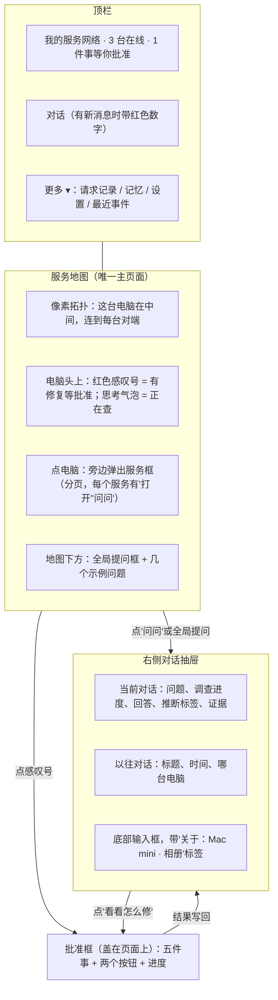
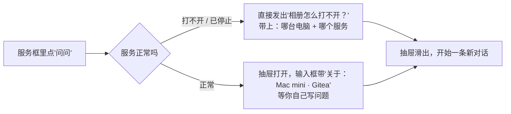
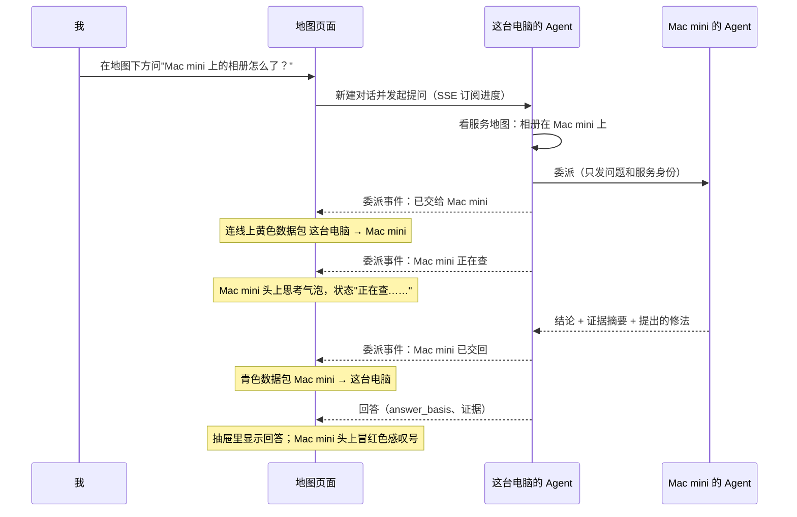
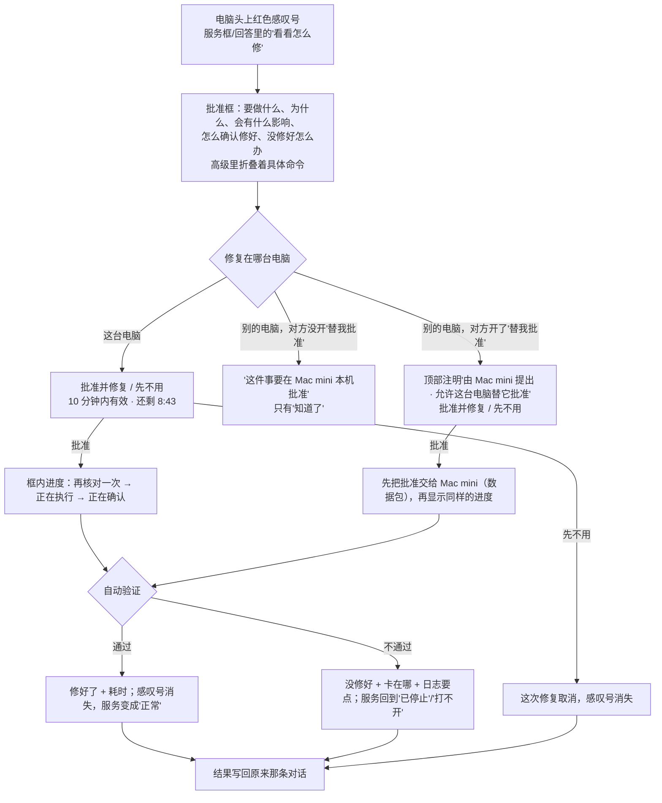

# 地图即工作台：问、委派、批准修复都在服务地图上完成

> 状态：已确认，按 4 个 PR 实现。
> 界面草图：[`mockups/map-workspace.html`](mockups/map-workspace.html)（数据是假的，顶部"草图控制"一栏只在草图里有）。
> 相关设计：修复见 [`agent-fix.md`](agent-fix.md)，委派见 [`delegation.md`](delegation.md)，像素拓扑见 [`node-agents.md`](node-agents.md)。

## 一句话

只留**服务地图**一个主页面。看到哪台电脑的哪个服务不对，就在它旁边点"问问"；对话从右侧滑出，Agent 需要时把问题交给那台电脑，两台电脑之间的连线上能看到数据包走过去、对方"正在查"；查出修法后，那台电脑头上冒红色感叹号，点开是大白话批准框，点"批准并修复"，在框里看着它修好。全程不切页面、不敲命令。

## 现在是什么样（以代码为准）

### 两个页面，内容重复

| 页面 | 在哪 | 有什么 |
|---|---|---|
| 服务地图 `/app/map`（首页） | `frontend/src/features/service-map/` | 像素拓扑，**只画"这台电脑"一个节点**；点开是本机服务框，有分页、"是我的服务 / 隐藏"标记。数据来自 `/api/services/local`，只有本机 |
| 工作台 `/app/overview`、`/app/chat` | `features/workspace/WorkspacePage.tsx`、`features/overview/`、`features/chat/` | 可折叠的"程序与待办"（设备与服务、技术清单、需要你处理的请求、最近事件和调查详情、运行基础四张卡）；对话（可带服务上下文）；"线程"列表；请求记录入口 |

看到地图上某个服务有问题，要切到工作台才能问 Agent；工作台里又有一份服务清单。

### 后端已经有什么、缺什么

| 能力 | 现状 | 地图要用时缺什么 |
|---|---|---|
| 本机服务 | `/api/services/local`：名字、类型（docker / python / program）、分档、标记、网页标题、端口 | **不返回已停止的服务**：停掉的容器被分到"隐藏"、退出的脚本根本不在端口清单里；只有标成"是我的服务"的停掉的容器例外 |
| 其他电脑是谁 | `/api/ui/overview` 的 `nodes`：名字、平台、在线状态、`evidence_at`、服务数 | 数据**只来自 coordinator 目录**。只用邀请码配对时，对端写在本机 Gateway 配置里，但这份配置**没有显示名**，网页也读不到，所以地图上看不到对端。另外没有"走哪种网络"的字段，也不知道对端之间怎么连 |
| 其他电脑上有什么服务 | 配了 coordinator 时，本机调对方 Gateway 的只读工具（列端口、列 Docker）再拼成清单，90 秒内有效 | Gateway **没有"列出你的服务"接口**；拼出来的清单没有对方的"是我的服务 / 隐藏"标记，也没有对方的分档判断 |
| 对话 | `/api/threads`、`/api/threads/{id}/runs`、`/api/runs/{id}/events`（SSE，支持 `after` 续传）；回答带 `answer_basis`：`checked` / `inferred` / `none`，界面上 `inferred` 显示"推断 · 尚未逐条核对" | 线程列表每项只有编号、时间、消息数，**没有标题**，也不知道问的是哪台电脑的哪个服务 |
| 委派 | `delegate_to_node` 是一个普通工具：工具内部提交给对方并等结果，最后返回 `answered_by` | 对话事件只有 goal / tool / finished / failed / interrupted 五种；委派工具的事件里 `target_node_id` 填的是**本机**，被委派的电脑只在工具参数里。所以前端**不知道交给了谁、对方什么时候开始查、什么时候查完**，画不了数据包动画 |
| 修复 | `/api/repairs` 列表、详情、批准（返回 202，后台执行）、拒绝；待批 10 分钟过期；详情里有影响、怎么确认、没修好怎么办三段说明，`origin` 里有来源对话的 `thread_id` | 前端**还没有任何修复界面**，现在只能用命令行批准。列表项没有来源对话，进度只能轮询详情。修复结果**不会写回对话** |
| 别的电脑提出的修复 | 记录在那台电脑本机；本机只在委派结果的 `proposed_repairs` 里看到摘要（最多 3 条），摘要里叫用户到那台电脑的地图上点感叹号批准，命令行只作后备 | "允许替我批准修复"（代批准）**还没实现**，见 [`agent-fix.md`](agent-fix.md) 第 4 个 PR |

## 页面结构

- **宽屏（≥1100px）**：抽屉打开时地图往左让出位置，委派动画仍然看得见；关掉后地图恢复原样，选中的电脑、服务框的页码都不变。
- **中等宽度**：抽屉盖在地图右侧，地图不缩小。
- **手机宽度**：服务框排在地图下方；抽屉和批准框占满整屏。不出现横向滚动。
- 服务框、抽屉、批准框共用醒目的粗滚动条（沿用现在服务地图的样式），内容放不下时底部有"▼ 下面还有"。服务多时分页，不长滚动。
- 风格沿用 `pixel.html`、`agent-fix.html` 和现在的服务地图：同一套像素配色、像素电脑、粗边框，不加载外部字体和脚本。

## 每个交互怎么走

### ① 点电脑看服务

和现在的服务地图一样：点电脑，旁边弹出服务框，按"打不开 → 已停止 → 正常"排序，超过一页就分页（◀ ▶ 或键盘左右键）。新增三点：

- 每个服务一行多一个"**问问**"按钮；正常的服务还有"打开"。
- 有待批准的修复时，服务框顶部是红框"需要处理的事"和"看看怎么修"。
- 别的电脑的服务框底部注明"清单由 Mac mini 报来 · 2 分钟前"；离线的电脑只显示"离线，上次在线 3 天前"，不能问。

### ② 点服务"问问"

问题带上的上下文就是现有对话已经支持的服务上下文（服务身份 + 所在电脑），Agent 不用再猜是哪台的哪个服务。电脑框底部的"问问 Mac mini 的 Agent"同理，只带电脑。

### ③ 全局提问与委派

- 抽屉里的"调查进度"逐条打勾：看服务地图 → 交给 Mac mini → Mac mini 正在查（查了什么）→ 交回结论。
- 回答框标明"Mac mini 的 Agent（受这台电脑委派）"；`inferred` 时显示"推断 · 尚未逐条核对"；证据默认折叠。
- 回答里提到的修法，附一个"看看怎么修"按钮，和点感叹号打开的是同一个批准框。
- 对方离线：Agent 直接回答"Mac mini 现在不在线，我联系不上它"，不发数据包。
- 关掉抽屉，提问照常在后台进行；回答到了，顶栏"对话"按钮出现红色数字，点开直接是那条对话。

### ④ 感叹号 → 批准 → 进度

- 批准框的五件事和文案沿用 [`agent-fix.md`](agent-fix.md)，数据来自 `/api/repairs/{id}` 详情的 `action_summary`、`reason`、`impact`、`verification`、`failure`。
- "先不用"就是拒绝；右上角 × 和 Esc 只是关掉框，修复还在等批准。执行过程中不能关框。
- 修复执行时，那台电脑的指示灯快闪、状态显示"正在修……"。
- 别的电脑提出的修复：本阶段先做"请到 Mac mini 上批准"这一种（对方没开"替我批准"）；代批准由 [`agent-fix.md`](agent-fix.md) 第 4 个 PR 交付后，同一个框直接显示批准按钮，地图不用再改。

### ⑤ 以往对话、关闭抽屉

- 抽屉有两页："当前对话"和"以往对话"。以往对话每条显示标题（第一个问题）、时间、问的是哪台电脑，点一下就回到那条对话、可以接着问。条数多时分页（每页 20 条），不长滚动。
- "新对话"按钮清空当前对话。
- 关闭：右上角 ×、Esc，或再点一次顶栏"对话"。关掉后地图原封不动。

## 复用、新写和后端要补的

### 前端

| 部分 | 复用 | 新写 / 要改 |
|---|---|---|
| 拓扑、像素电脑、服务框、分页、标记 | `features/service-map/` 的 `ComputerNode`、`ServicesPanel`、滚动条样式 | 从一个节点改成多个节点 + 星形连线；服务行加"问问"；离线电脑；感叹号、思考气泡、指示灯快闪；数据包动画 |
| 对话 | `features/chat/` 的 `api.ts`、`contracts.ts`、`eventReducer.ts`、`useRunEvents.ts`（SSE 续传）、推断标签和证据的展示 | 抽屉外壳、全局提问框、上下文标签；`ChatPage.tsx` 拆出"消息列表 + 输入框"给抽屉用；处理新的委派事件 |
| 以往对话 | `GET /api/threads` | 标题、电脑、分页 |
| 批准框 | `shared/useDialogFocusTrap.ts`；`agent-fix.html` 草图的版式 | 修复接口的前端封装、批准框、进度轮询、三种状态（本机 / 请到对方批准 / 代批准） |
| 路由和导航 | `app/router.tsx` | 去掉"工作台"导航和 `WorkspacePage`；`/app/overview`、`/app/chat` 跳转到 `/app/map`；顶栏"更多"菜单 |

### 后端

| 要补的 | 为什么 | 怎么补 |
|---|---|---|
| **委派进度事件** | 数据包动画和"正在查"要知道交给了谁、什么时候开始、什么时候结束 | 对话事件新增一种 `delegation`，字段：`delegation_id`、`peer_node_id`（被委派的电脑）、`phase`（`submitted` 已交给 / `investigating` 正在查 / `answered` 已交回 / `failed` 失败 / `cancelled` 取消）。由 `delegate_to_node` 在提交、轮询到对方开始、拿到结果时发出，经现有 SSE 推给前端，`after` 续传照常可用。只放电脑编号和阶段，不放对方的原始数据 |
| **对端清单** | 地图要画出邀请码配对的电脑 | 新本机接口 `GET /api/peers`：读 Gateway 配置里的对端，给出编号、显示名、平台、能不能连上、最后一次连上的时间、是否允许委派。显示名在 `join` 报到时交换（默认用平台名，如"Mac"），本机可以改名；配了 coordinator 时和 `nodes` 合并 |
| **对端的服务清单** | 远端服务要和本机一样有名字、状态、分档 | Gateway 新接口 `GET /v1/services`：对方返回**自己已经分好档**的清单（只有"显示"档和"是我的服务"，"可能是服务"和"隐藏"不出本机），字段和 `/api/services/local` 一样再加状态。沿用现有令牌认证和限流。本机定时拉取，前端只读缓存 |
| **已停止的服务** | 感叹号旁边要看到"已停止" | `/api/services/local` 每项加 `state`（`running` / `stopped`）。标成"是我的服务"或曾经直接显示过、现在停了的容器，以及有启动记录、现在退出了的脚本，都返回为 `stopped`。这就是 [`agent-fix.md`](agent-fix.md) 第 3 个 PR 里的"首页已停止" |
| **修复列表补字段** | 感叹号要知道挂在哪台电脑、结果写回哪条对话 | `/api/repairs` 列表项加 `node_id` 和 `origin`（含 `thread_id`）；执行中的进度沿用轮询详情（每秒一次），不新增推送 |
| **修复结果写回对话** | 关了网页也要能在对话里看到"修好了 / 没修好" | 修复走到终态（成功、失败、拒绝、过期）时，后端往来源对话追加一条消息，写结论和验证依据 |
| **别的电脑提出的修复** | 感叹号要冒在 Mac mini 头上 | 委派结果里的 `proposed_repairs` 摘要存进本机，附在对端节点上，状态"等对方批准"；对方批准或过期后随下一次服务清单更新消失 |
| **线程标题和上下文** | 以往对话要能认出来 | `GET /api/threads` 每项加 `title`（第一个问题的前 40 个字）和 `context`（电脑、服务身份，可空） |

## 删掉工作台以后，旧功能去哪

| 旧功能 | 去向 |
|---|---|
| 对话 | 右侧对话抽屉 |
| 线程列表 | 抽屉"以往对话" |
| 设备与服务（"我的程序"） | 地图上每台电脑的服务框 |
| 技术清单（端口、地址等明细） | 服务框每行的小字；完整明细放进"设置 › 高级" |
| 需要你处理的请求 | 修复：地图上的感叹号；其他请求：顶栏"更多 › 请求记录"（`/app/operations` 原样保留） |
| 最近事件、调查详情 | "更多 › 最近事件"（新路由 `/app/incidents`），组件原样搬过去，页面左上角有"← 回到地图" |
| 运行基础四张卡（本机、模型、Coordinator、网络路径）、数据来源 | "设置"页（模型已经在那里） |
| 记忆 | "更多 › 记忆"（`/app/memories` 原样保留） |
| `/app/overview`、`/app/chat` | 跳转到 `/app/map`；带 `?thread=` 的旧链接跳到地图并打开那条对话 |

## 能做到和做不到的

| | 能做到 | 做不到 / 这一阶段不做 |
|---|---|---|
| 连线 | 这台电脑到每台对端：能连上 / 当前连不上 | 对端之间的连线；每条线走 WireGuard、局域网还是 n2n。这台电脑不知道这些，所以拓扑画成以这台电脑为中心的星形，不画网络类型颜色 |
| 远端服务 | 对方报来的、对方已经分好档的服务；名字、类型、端口、状态、是不是"是我的服务"；报来的时间 | 对方"可能是服务""隐藏"的程序；实时状态（有几十秒延迟）；在这台电脑上给对方的服务打标记 |
| 离线电脑 | 名字、最后在线时间 | 它上面的服务、向它提问 |
| 委派动画 | 交给谁、对方正在查、交回结论 | 对方具体在跑哪个工具（原始过程留在对方本机） |
| 远端修复 | 感叹号、批准框内容、"请到 X 的地图上点感叹号批准" | 在这台电脑上替对方批准，等 [`agent-fix.md`](agent-fix.md) 第 4 个 PR |

## 怎么算做完

**自动测试**（前端用假数据，后端用假的 Gateway 和假的 Docker，不碰真机器）：

- 地图：多台电脑和星形连线；离线电脑不能问；服务框分页和键盘翻页；服务多时不出现长滚动。
- 提问：点"问问"带上电脑和服务；不正常的服务直接发出问题；全局提问新建对话；关掉抽屉后回答到了，顶栏出现红色数字，点开就是那条对话。
- 委派事件：委派工具依次发出已交给 / 正在查 / 已交回；对方失败、取消、超时都有终态；事件里只有对端编号和阶段；SSE 断线后用 `after` 续上不丢不重。
- 修复：本机修复的感叹号、批准、拒绝、过期、执行进度、成功、失败；执行中不能关框；结果写回来源对话；别的电脑的修复只显示"请到对方批准"。
- 服务清单：`/v1/services` 不返回"可能是服务"和"隐藏"；未认证、不允许的对端被拒绝；`/api/services/local` 返回已停止的服务。
- 路由：`/app/overview`、`/app/chat` 跳到地图；带 `?thread=` 的打开对应对话；"更多"里三个入口都能进、能回。
- 无障碍：电脑、感叹号能用键盘打开；抽屉和批准框锁定焦点、Esc 关闭；手机宽度下没有横向滚动。

**真机验收**（**要另外经你同意才做**；用这台电脑和 Mac mini）：

1. 这台电脑打开地图，看到 Mac mini 和它报来的服务。
2. 在 Mac mini 上起一个专门测试的小容器（发布一个高端口），标成"是我的服务"，再手动停掉。在这台电脑地图上问"Mac mini 上那个测试服务打不开"：看到数据包过去、Mac mini 正在查、数据包回来、回答和 Mac mini 头上的感叹号。
3. 点感叹号，看到"请到 Mac mini 的地图上点感叹号批准"；到 Mac mini 的地图上点感叹号批准，看到修好了，这台电脑上的感叹号随后消失。
4. 在这台电脑上从终端运行一个测试网页并标成"是我的服务"，关掉终端：地图上它变成"已停止"、问一句后冒感叹号，点批准，在框里看着它修好，结果写回对话。
5. 测完删掉测试容器、停掉测试网页。

## 拆成几个 PR

| 顺序 | PR | 交付什么 | 你能看到什么 |
|---|---|---|---|
| 1 | 对话搬进地图 | 后端：线程标题和上下文。前端：右侧抽屉、全局提问、点服务"问问"、以往对话、"更多"菜单、删除工作台和跳转 | 不离开地图就能问这台电脑上的服务 |
| 2 | 修复批准上地图 | 后端：已停止的服务、修复列表补字段、结果写回对话。前端：感叹号、批准框、进度和结果（本机修复） | 不敲命令，在地图上点批准修好这台电脑上的服务 |
| 3 | 其他电脑上地图 | 后端：`/api/peers`、`join` 交换显示名、Gateway `/v1/services`、定时拉取。前端：多台电脑、星形连线、远端服务框、离线电脑 | 地图上看到邀请码配对的电脑和它们的服务 |
| 4 | 委派看得见 | 后端：`delegation` 对话事件、别的电脑提出的修复存进本机。前端：数据包、"正在查"、对方头上的感叹号和"请到对方批准" | 问 Mac mini 的问题，看着它被交过去、查完、交回来 |

1 和 3 互不依赖，可以并行；2 在 1 之后（结果要写回对话）；4 在 1 和 3 之后（动画画在对端节点上）。全部合并后申请真机验收。代批准仍按 [`agent-fix.md`](agent-fix.md) 第 4 个 PR 单独做。

## 已确定

1. **拓扑画成以这台电脑为中心的星形**，连线只分"能连上 / 连不上"。这台电脑只知道自己到每台对端的情况，不画对端之间的连线，也不画网络类型颜色。
2. **别的电脑的服务清单跟着"允许委派"走**：对方允许这台电脑委派，就也允许它看服务清单；只给"显示"档和"是我的服务"，不单独加开关。
3. **代批准不并入本阶段。** 别的电脑提出的修复显示"请到 X 的地图上点感叹号批准"；代批准按 [`agent-fix.md`](agent-fix.md) 第 4 个 PR 单独做，批准框已经留好位置。
4. **宽屏时抽屉让地图往左让出位置**，委派动画始终看得见；中等宽度和手机上盖在地图上面。
5. **点正常服务的"问问"只带上下文**，等用户自己写问题；不正常的服务直接发出"它怎么打不开？"。
6. **"最近事件"收进"更多 › 最近事件"**，原样保留，不并进以往对话。
7. **修复进度在执行中每秒轮询一次详情**，不新增修复进度的推送。

## 真机验收

用这台电脑（Windows，模型 DeepSeek）和 Mac mini（本机 Qwen，经 llama-server，开启"关闭思考模式"）按上面"怎么算做完"的 5 步验收，全部通过。第 1、4 步在 `656116e` 上验收，第 2、3 步在 `2d3898e` 上验收。

| 步骤 | 结果 |
|---|---|
| 1 看到对方电脑 | 配对后，这台电脑的地图上出现 Mac mini 和它报来的服务 |
| 2 委派看得见 | 在这台电脑上问"Mac 上的 tm-test-svc 打不开"：连线上有数据包过去，Mac 头上显示"正在查……"，不到 30 秒显示"已交回"。Mac 查明是容器正常退出，提出"重启 Docker 容器 tm-test-svc"；这条修复记录在 Mac 本机（来源为委派）。这台电脑地图上 Mac 头上出现"! 有 1 件事要在 Mac 上批准"，回答写"请到 Mac 的地图上点感叹号批准"。全程约 1 分钟 |
| 3 到对方批准 | 在 Mac 的地图上点感叹号直接打开批准框；点"批准并修复"后显示"修好了 · 所有容器都在运行 · 端口 18960 在听"，容器状态为运行中 |
| 4 本机脚本修好 | 本机从终端运行的测试网页停掉后，地图显示"已停止"，问一句后冒感叹号，点批准在框里看着修好，结果写回对话 |
| 5 清理 | 测试容器、临时程序和预览都已删除；Mac 的 llama-server 按用户要求保持运行 |

关闭思考模式的效果：Mac 上同一个问题，开启思考约 30 秒、913 个 token；关闭后约 1 秒、31 个 token。

待修：Mac 批准并修好后，这台电脑地图上 Mac 头上的感叹号要等 10 分钟过期才消失，没有随下一次服务清单同步消失（#189）。
