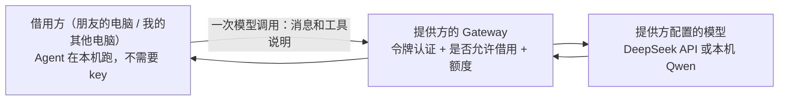

# 模型借用与邀请码：其他电脑零配置使用 Agent

> 状态：已确认，实现中。总体方向见 [`node-agents.md`](node-agents.md)，委派见 [`delegation.md`](delegation.md)。

## 一句话

网络里一台电脑提供模型（例如持有 DeepSeek key 的电脑，或跑着本机 Qwen 的 Mac mini），其他电脑**不配任何 key**，经同一条已认证的内网通道借用它的模型。朋友的电脑粘贴一个邀请码就能加入。

## 为什么需要

- 委派已经做好了，但被委派的电脑得自己配模型，否则只能回答"模型不可用"。
- 朋友不会配 API，也不愿意花钱买 token。
- 把 key 复制到每台电脑上既不安全，也不好管。

## 怎么做

- **借用的只是"想一想"这一步。** Agent 的循环、工具调用、判断和动手都还在借用方本机。借用方每次需要模型时，把这一轮的消息和工具说明发给提供方，提供方用自己的模型算完，把回复原样返回。
- **对 Agent 透明。** 借用方的模型配置多一种"借用某台电脑的模型"。选了它以后，Agent 拿到的是一个"远端模型"，用法和本机模型完全一样，Agent 代码不用改。
- **key 只在提供方。** 不分发、不复制，借用方完全碰不到。

## 规则

1. **默认关闭，由提供方打开。** 提供方的对端配置多一个开关"允许借用模型"，用 `gateway-configure --allow-model-borrowing` 为某个对端打开。
2. **额度。** 提供方给每个对端设每日 token 上限，默认 20 万；用完当天拒绝，第二天自动恢复。同一个对端同时最多 2 个调用。
3. **提供方只记账，不存内容。** 只记录每个对端每天用了多少 token、调用了几次，不保存消息内容。
4. **借用方要知情。** 借用时，借用方发出去的这一轮消息（问题、工具结果摘要）会经过提供方。如果提供方用的是外部 API，还会经过那家服务商。借用方的设置页会明确写"正在使用某某电脑的模型"。自己的电脑之间无所谓；朋友加入时，邀请流程里会写清楚这一点。
5. **超时分开算。** 模型调用比工具调用慢得多（本机 Qwen 一轮可能要几十秒），所以单独设上限，默认 180 秒，不受工具调用 30 秒上限的限制。

## 邀请码

现在两台电脑配对，要在两边各敲一条带节点 ID、地址、令牌的长命令。邀请码把它变成"一边生成、一边粘贴"：

1. **提供方**运行 `tunnelminion invite --allow-delegation --allow-model-borrowing`，得到一串邀请码。邀请码里有：提供方的内网地址和端口、节点 ID、平台、一次性令牌，以及允许了什么。命令同时会在提供方登记"等待这个邀请码加入"。
2. **加入方**运行 `tunnelminion join <邀请码>`。它把提供方登记为对端，把模型配置成"借用提供方"，再用一次握手把自己的节点 ID、地址和平台报给提供方，提供方据此完成登记。
3. 邀请码 24 小时内有效，只能用一次。

组网本身（WireGuard 或 n2n）仍然假定已经通了，邀请码只解决"Agent 之间怎么认识"。

## 分两个 PR

| PR | 内容 |
|---|---|
| 一：模型借用 | 提供方 Gateway 接口 `POST /v1/model:complete`；允许开关、额度、记账；借用方"远端模型"和对应的模型配置；`gateway-configure --allow-model-borrowing` |
| 二：邀请码 | `invite` / `join` 命令、一次性令牌和握手 |

## 怎么算做完

- 自动测试覆盖：未认证、未允许借用、超额度、并发上限、提供方模型不可用、超时、取消，以及提供方不保存消息内容。
- **真机验收**：
  1. Mac mini 提供本机 Qwen，这台电脑不配模型，只配"借用 Mac 的模型"；
  2. 在这台电脑上提问，确认它用的是借来的模型；
  3. 再把 Mac 上的问题委派给 Mac，看整条链路能不能走通；
  4. 看 Mac 上的记账，有调用次数和 token，但没有消息内容。
