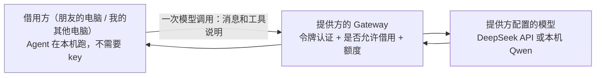

# 模型借用与邀请码：其他电脑零配置使用 Agent

> 状态：模型借用与邀请码都已实现。总体方向见 [`node-agents.md`](node-agents.md)，委派见 [`delegation.md`](delegation.md)。

## 一句话

网络里一台电脑提供模型（例如持有 DeepSeek key 的电脑，或跑着本机 Qwen 的 Mac mini），其他电脑**不配任何 key**，经同一条已认证的内网通道借用它的模型。朋友的电脑粘贴一个邀请码就能加入。

## 为什么需要

- 委派已经做好了，但被委派的电脑得自己配模型，否则只能回答"模型不可用"。
- 朋友不会配 API，也不愿意花钱买 token。
- 把 key 复制到每台电脑上既不安全，也不好管。

## 怎么做

- **借用的只是"想一想"这一步。** Agent 的循环、工具调用、判断和动手都还在借用方本机。借用方每次需要模型时，把这一轮的消息和工具说明发给提供方，提供方用自己的模型算完，把回复原样返回。
- **对 Agent 透明。** 借用方的模型配置多一种"借用某台电脑的模型"。选了它以后，Agent 拿到的是一个"远端模型"，用法和本机模型完全一样，Agent 代码不用改。
- **key 只在提供方。** 不分发、不复制，借用方完全碰不到。

## 规则

1. **默认关闭，由提供方打开。** 提供方的对端配置多一个开关"允许借用模型"，用 `gateway-configure --allow-model-borrowing` 为某个对端打开。
2. **额度。** 提供方给每个对端设每日 token 上限，默认 20 万；用完当天拒绝，第二天自动恢复。同一个对端同时最多 2 个调用。
3. **提供方只记账，不存内容。** 只记录每个对端每天用了多少 token、调用了几次，不保存消息内容。
4. **借用方要知情。** 借用时，借用方发出去的这一轮消息（问题、工具结果摘要）会经过提供方。如果提供方用的是外部 API，还会经过那家服务商。借用方的设置页会明确写"正在使用某某电脑的模型"。自己的电脑之间无所谓；朋友加入时，邀请流程里会写清楚这一点。
5. **不能转借。** 本机的模型如果也是借来的，就不再借给别人，避免两台电脑互相借用、绕成一个圈。
6. **超时分开算。** 模型调用比工具调用慢得多（本机 Qwen 一轮可能要几十秒），所以单独设上限，默认 180 秒，不受工具调用 30 秒上限的限制。

## 邀请码

以前两台电脑配对，要在两边各敲一条带节点 ID、地址、令牌的长命令。邀请码把它变成"一边生成、一边粘贴"：

1. **发邀请的电脑**运行 `tunnelminion invite --allow-delegation --allow-model-borrowing [--daily-quota 200000]`，得到一行以 `tmi1_` 开头的邀请码。本机网关还没配置时，要加上 `--bind-host <本机组网地址>`。然后保持网关运行。
2. **加入的电脑**运行 `tunnelminion join <邀请码>`。它会：
   - 自动认出自己的组网地址（就是连向对方时系统选用的那个地址）；
   - 向对方报到，报上自己的节点 ID、平台和地址；
   - 对方核对通过以后，才在本机把对方登记为对端；
   - 如果对方允许借用模型，而本机还没配过模型，就自动改用对方的模型，并做一次自检。用 `--keep-model` 可以保留原来的模型，用 `--use-borrowed-model` 可以强制改用对方的模型。
3. 对方的网关会立刻认这台新电脑，不用重启。

**规则：**
- 邀请码 24 小时内有效，只能用一次。
- 发邀请的电脑只保存令牌的摘要，不保存令牌本身。
- 报到时，请求的来源地址必须和报上来的地址一致。
- 邀请码无效、过期、已用过，或者来源地址不符，对方得到的都是同一句"邀请码无效、已过期或已被使用"，没法靠反复试探来猜。报到请求每分钟最多 10 次。
- 加入成功后，邀请码里的令牌就是两台电脑之间长期使用的配对令牌。
- 邀请码里带着令牌，相当于一把钥匙，只发给要加入的人。

组网本身（WireGuard 或 n2n）仍然假定已经通了，邀请码只解决"Agent 之间怎么认识"。

## 分两个 PR

| PR | 内容 |
|---|---|
| 一：模型借用 | 提供方 Gateway 接口 `POST /v1/model:complete`；允许开关、额度、记账；借用方"远端模型"和对应的模型配置；`gateway-configure --allow-model-borrowing` |
| 二：邀请码 | `invite` / `join` 命令、一次性令牌和报到 |

## 怎么算做完

- 自动测试覆盖：未认证、未允许借用、超额度、并发上限、提供方模型不可用、超时、取消，以及提供方不保存消息内容。
- **真机验收**：
  1. Mac mini 提供本机 Qwen，这台电脑不配模型，只配"借用 Mac 的模型"；
  2. 在这台电脑上提问，确认它用的是借来的模型；
  3. 再把 Mac 上的问题委派给 Mac，看整条链路能不能走通；
  4. 看 Mac 上的记账，有调用次数和 token，但没有消息内容。

## 怎么用（模型借用部分）

1. 提供方为某个对端打开借用：`tunnelminion gateway-configure ... --allow-model-borrowing [--daily-quota 200000]`，然后启动网关。
2. 借用方切换到借用：`tunnelminion model-borrow --from <提供方节点 ID>`。切换前会先借对方的模型做一次能力自检，自检不通过就保持原来的配置不变。之后设置页会显示"正在使用某某的模型"。
3. 提供方查看今天的用量：`tunnelminion model-usage`，每个对端一行，只有次数和 token 数。

借用方重新配置本机模型时，借用会自动取消。

## 真机验收结果（2026-10-25）

- 这台电脑没有配置任何模型，只配置了借用 Mac mini。设置页显示"正在使用 node_cfa8371 的模型"，状态为可用。
- 在工作台提问"这台电脑上 8000 端口是什么程序？"，Agent 用借来的模型在本机做了 4 次检查。这次提问在 120 秒的单次提问上限处停下，没有给出结论。
- 同一个简单请求分别直连 Mac 的 Qwen 和通过借用调用，耗时分别是 38～57 秒和 28～72 秒。两者差别来自 Qwen 每次思考的长短，借用这一层几乎不增加耗时。所以上面那次提问超时，原因是本机 Qwen 开着思考模式、太慢，不在借用。
- Mac 的记账为：这台电脑当天调用 6 次，共 11325 个 token。在 Mac 的数据库里搜问题中的词，一个都搜不到，说明没有存消息内容。
- "把 Mac 的问题委派给 Mac"这一步没有重做，委派本身在上一阶段已经验收过。

**待办：** 用本机 Qwen 时，单次提问经常超过 120 秒。可选的办法有两个：对这类模型关闭思考模式，或者按模型调整时长上限。这件事不在本 PR 范围内。

## 邀请码真机验收结果（2026-10-25）

- Mac mini 从一个空数据目录开始，运行 `invite --bind-host 10.77.0.1 --allow-delegation --allow-model-borrowing --daily-quota 50000`，然后启动网关。网关在一个对端都没有的情况下正常启动。
- 这台电脑用一个全新的空数据目录运行 `join`，31 秒完成。其中大部分时间花在借 Mac 的 Qwen 做模型自检上。具体结果如下：
  - 自动生成了节点身份；
  - 自动认出本机组网地址 10.77.0.5；
  - 登记了 Mac，并改用 Mac 的模型。
- Mac 登记了这台电脑，权限是"可委派、可借模型、每天 5 万 token"。网关没有重启，这台电脑的自检调用就已经计入 Mac 的账：2 次，703 个 token。
- 用同一个邀请码再加入一次，被拒绝，提示"邀请码无效、已过期或已被使用"。
