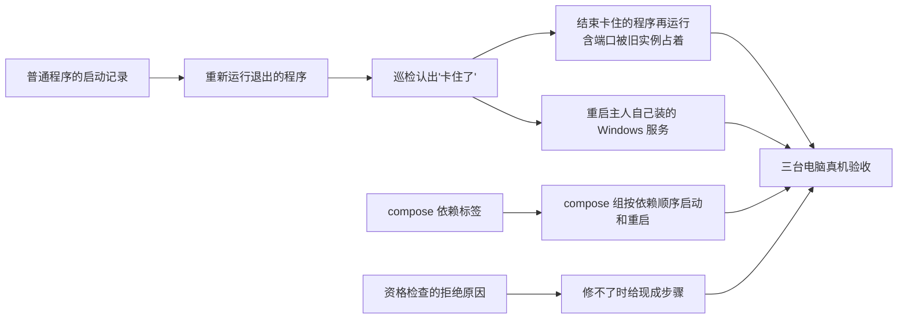

# 更多修法：重新运行和重启主人自己的命令行程序

> 状态：已实现（#233），Windows 和 macOS 用测试程序部分真机验收通过，未验收项和已知问题见文末“结果”。
> 相关设计：修复的提出、批准、执行前核对和验证见 [`agent-fix.md`](agent-fix.md)；巡检和"挂了可以自动修"见
> [`proactive-patrol.md`](proactive-patrol.md)；macOS 后台服务修法见 [`launchagent-repair.md`](launchagent-repair.md)。

## 一句话

现在能修的只有三种，而且都是"重新启动"：重启 Docker 容器、重新运行 Python 脚本、重新启动 macOS 用户后台服务。
主人自己从终端跑起来的普通程序（Node、Go、Rust 写的小服务，`gost` 这类转发工具，`ssh -L` 端口转发，本地模型
服务）退出了，Agent 只能说"请你自己重启"；程序还在但卡住不响应，Agent 什么也做不了。本阶段补上几种修法：
**重新运行退出的命令行程序**、**结束卡住的程序再重新运行**、**重启主人自己装的 Windows 服务**、
**compose 组按依赖顺序启动**；修不了的情况给主人现成的步骤。

## 为什么现在做

三台电脑真机试用时，地图上直接显示的服务一共约 20 个：

| 种类 | 个数 | 现在能不能修 |
|---|---|---|
| Docker 容器 | 7 | 能（重启容器） |
| Python 脚本 | 4 | 能（重新运行） |
| 普通程序 `program:` | 9 | **不能** |

普通程序占了将近一半，却没有任何修法；用户的直观感受是"修服务只有重启一个手段，或者根本没有手段"。卡住不响应
的情况（进程在、端口在听、但请求一直超时）三种现有修法都不处理，路线图里也记着"卡住的 macOS 后台服务暂时不修"。

## 用户影响

| 现在 | 做完以后 |
|---|---|
| 终端里跑的 `gost`、`node server.js` 退出了，地图标"已停止"，Agent 只能建议你自己重新运行 | Agent 提出"按上次的启动方式在后台重新运行 gost（端口 805）"，点批准就修好；打开过"挂了可以自动修"的，巡检直接修 |
| 程序还在、端口在听，但网页一直转圈 | 巡检连续几轮请求超时后标"卡住了"；Agent 提出"结束卡住的 xxx 再按原方式运行"，批准后先礼貌结束、等一会儿再强制结束，然后重新运行并验证 |
| 重新运行时报"端口被占用" | 占着端口的就是记录里那个程序：不重复运行，说明"它已经自己起来了"；它在但不响应时，等巡检确认卡住后用"结束卡住的程序再运行"。占着端口的是别的程序时不动它，只说明是谁占着，并给出现成步骤 |
| 卡住的 macOS 后台服务没法修 | 用 `launchctl kickstart -k` 结束并重新拉起 |

## 现在已经有什么（以代码为准）

| 现有部分 | 在哪 | 这次怎么用 |
|---|---|---|
| 修法框架：资格检查、计划、批准、执行前核对、执行、验证、收场、限次、审计 | `repair/` | 原样复用，加两种修法 |
| 修法登记为 L2，模型拿不到执行入口；模型只能用 `propose_repair` 填服务身份、修法种类和理由 | `repair/definitions.py`、`repair/agent_tools.py` | 新修法同样登记为 L2，枚举里多两个值 |
| Python 脚本的启动记录：活着时记下解释器、参数、工作目录和用户，不记环境变量 | `repair/launch_records.py` | 推广到普通程序：记可执行文件、参数、工作目录、用户、启动时间 |
| 进程来历判断（终端、用户目录、系统、桌面应用） | `platforms/process_origin.py` | 用它判断哪些程序允许修 |
| 巡检：连续 3 轮异常才确认挂了，按服务种类补提固定修法 | `patrol/` | 新增"卡住了"这种异常，对应新修法 |

## 规则

### 1. 重新运行退出的命令行程序（`relaunch_program`）

- **哪些程序能修**：身份是 `program:<名字>@<端口>`；进程以当前用户身份运行；从主人的终端或用户目录启动（沿用
  进程来历判断）；在地图上直接显示，或标过"是我的服务"。
- **一律不修**：系统目录里的系统程序（但主人在终端里用系统自带的 `ssh` 开的端口转发算主人的程序）；Windows
  系统服务；有窗口的桌面应用；组网工具（WireGuard、n2n/n3n、Tailscale、ZeroTier 等，路线图不碰组网）；
  TunnelMinion 自己。
- **启动记录**：程序活着、而且在地图上直接显示或标过"是我的服务"时，巡检用操作系统提供的进程信息读出它的
  可执行文件完整路径、参数、工作目录、运行它的账户和启动时间，按服务身份存进本机数据库（数据目录下的
  `runtime.sqlite3`，`launch_records` 表），每次看到都更新一次。不记环境变量；参数里看起来像密钥的部分
  （`--token=`、`--password` 等）不进工具输出、不给模型、不发给别的电脑，只在本机执行时使用。
- **以什么身份运行**：TunnelMinion 自己以主人的普通账户运行，不用 sudo，也不以管理员身份运行；重新运行的程序
  同样是这个普通账户、同样的工作目录和参数。
- **要管理员或 root 的程序不修**：原来以别的账户、root 或 Windows 管理员身份（提升权限）运行的程序，普通账户
  读不全它的启动信息，也没法用同样的权限把它拉起来，资格检查直接拒绝，说明"它需要管理员权限，请你自己重启"。
  TunnelMinion 不保存、也不索要 sudo 或管理员密码。唯一的例外是第 3 条的 Windows 服务：由主人对单个服务一次性
  授权。
- **执行**：执行前再核对一遍：可执行文件还在、和记录时是同一个文件（大小和修改时间一致）、端口现在没人占。
  然后用同样的参数、同样的工作目录在后台重新运行，和终端脱离，输出写进 TunnelMinion 自己的日志目录。
- **验证**：进程起来、端口在听；记录里有网页的，首页能打开。没修好就结束刚拉起的进程，不留半截状态。
- **写回启动记录**：重新运行的程序不再是从终端起来的，地图刷新时不会再更新它的记录。验证通过后，把端口上
  和记录对得上的那个进程的进程号和启动时间写回启动记录，之后它卡住了才认得出来；记录在这期间被改过，或者
  端口上的进程对不上时不写。
- **TunnelMinion 关掉或重启不影响这些程序**：启动记录存在本机数据库里，TunnelMinion 重启后还在；重新运行的
  程序和 TunnelMinion 脱离（Windows 上用独立进程组并脱离作业对象，macOS 上用新会话），TunnelMinion 退出时
  不会把它们一起带走。TunnelMinion 没在运行的那段时间里退出的程序，等它下次启动、巡检确认以后照样能修。
  这一点作为真机验收项专门测。

### 2. 结束卡住的程序再重新运行（`restart_stuck_program`）

- **怎么算卡住**：只拿服务**自己以前的样子**比。巡检记下每个服务平时的表现：首页能打开的，记"有网页"；
  连上端口会马上回话的（比如 SSH 会先报版本号），记"会回话"；连上以后本来就不说话、等客户端先开口的，
  只记"端口在听"。之后只有"以前能打开、现在连续 3 轮（约 1.5 分钟）都不回应"或者"以前会回话、现在连续 3 轮
  不回话"才算卡住。本来就不回应的服务永远不会被判成卡住。
- **"不回应"的实际阈值**：巡检只连本机地址（先 `127.0.0.1`，连不上再试 `::1`），连接最多等 2 秒。
  - 有网页的端口：发一次首页请求，连上以后 **10 秒内一个字节都没回**才算这一轮不回应。回了 HTTP 就看状态码；
    很快回了不是 HTTP 的内容或直接断开时，改试一次 HTTPS（最多等 5 秒），读不出状态码只算这一轮看不清。
    超时以后不再改试 HTTPS。
  - 会回话的端口：连上以后什么都不发，**10 秒内**对方一个字节都没说才算不回话。
  - 连不上（例如服务只听组网地址、不听本机地址）、探测出错、或者整次探测 30 秒内没有结果，都只算这一轮看不清，
    不算不回应；只是慢、但在 10 秒内回了的服务不会被判成卡住。
  - 探测在后台线程里做，每一步都有自己的超时，到点线程自己结束，不会每轮留下卡着的探测线程。
- **适用范围**：普通程序和 Python 脚本，资格规则同第 1 条；macOS 用户后台服务改用 `launchctl kickstart -k`。
  Docker 容器卡住沿用现有的重启容器。
- **结束谁**：只结束和启动记录对得上的那个进程：普通程序要求同一个账户、同一个可执行文件、同样的参数和
  工作目录；Python 脚本要求同一个账户、同样的参数和工作目录，不比对解释器路径（Windows 虚拟环境里的
  `python.exe` 只是转发器，真正监听端口的是它拉起的另一个解释器）；两者的进程号和启动时间都要和记录一致。
  对不上就拒绝，说明"占着端口的不是记录里的那个程序"。动手前再核对一次，然后先礼貌结束，等 10 秒还在再强制
  结束，再按第 1 条重新运行并验证。
- **端口被占着时重新运行**：重新运行（第 1 条）前发现端口被占，占着的就是记录里那个程序时不重复运行，说明
  "它已经自己起来了"，它在但不响应的，等巡检确认卡住后用本条修法；占着的是别的程序时不动它，只告诉主人是谁
  占着，并给出现成步骤。

### 3. 重启主人自己装的 Windows 服务（`restart_windows_service`）

有些程序装好以后以 Windows 服务的形式常驻，例如串流软件、自己用 NSSM 包装的小服务。它们停了或卡住时，
用 Windows 自带的服务管理把这一个服务启动或重启。

- **怎么认出是 Windows 服务**：监听端口的进程本身就是服务进程，或者它的直接父进程是 NSSM、WinSW 这类包装器
  （名字里带 nssm、winsw，或旁边有同名的 WinSW 配置文件 `.xml`）。从 sshd、计划任务等系统服务往下拉起的
  程序不算那个服务。
- **哪些服务能修**：标过"是我的服务"；启动类型不是"已禁用"（主人禁用的不替你打开）；不在保护名单里。
  保护名单按服务名、显示名和程序路径判断，没有做数字签名校验：
  - 程序在 `C:\Windows` 下、由 `svchost.exe` 承载，或者路径不是带盘符的绝对路径（`%SystemRoot%`、`\??\`
    这类写法先展开再判断）；
  - 名字或路径里有组网和代理（WireGuard、Tailscale、ZeroTier、n2n、OpenVPN、Clash、v2ray、sing-box、frp 等）、
    虚拟化和容器（Docker、WSL、Hyper-V、VMware、VirtualBox）、远程控制（向日葵、Parsec、ToDesk、TeamViewer、
    AnyDesk、RustDesk）、杀毒和安全软件、微软自己的组件（路径或名字里带 Microsoft、WindowsApps、ClickToRun、
    EdgeUpdate、GamingServices）的关键词，或者是 TunnelMinion 自己。
- **权限**：TunnelMinion 以普通用户身份运行，默认没有启停服务的权限。主人在服务框里打开"允许 Agent 重启这个
  Windows 服务"时，开关旁边写明实际的服务名和程序路径；只有标成"是我的服务"、不在保护名单里的服务才能打开。
  打开时弹一次 Windows 管理员确认，只给**这一个服务**加上"当前用户可以查询、启动和停止"的权限（`LCRPWPRC`）；
  关掉时撤回。Windows 读回权限时会重排权限字母，撤回按权限集合认出这一条，撤回后重新读一次，确认真的没了
  才算成功；权限是主人自己另外加的、不是这一条时不动它，开关报告撤回失败。已经授权、后来不再符合条件的服务
  只能撤回，不能再打开。不会让 TunnelMinion 整体以管理员身份运行。
- **执行与验证**：停了的就启动，卡住的（判断方法同第 2 条）就重启；等服务状态变成"正在运行"、端口在听、
  有网页的首页能打开。
- 路线图里"不修改系统服务"这条非目标已同步改成：不碰系统自带服务，主人自己装的 Windows 服务只在主人标过、
  并对这一个服务打开授权后才启停。

### 4. compose 组按依赖顺序启动和重启（改进现有的 `restart_containers`）

现有的"重启容器"遇到 compose 组，已经会把组里所有容器一起启动或重启，但用一条 `docker start` / `docker restart`
同时处理，不管谁依赖谁；网站容器常常在数据库容器准备好之前就起来，然后又挂掉。

- **依赖从哪来**：只读 compose 写在每个容器上的标签 `com.docker.compose.depends_on`，不读、不改 compose 文件。
  读不出标签或依赖成环时，退回现在的一次全部启动。
- **怎么做**：按依赖分层，先启动被依赖的容器，等它变成"运行中"（有健康检查的等到"健康"，最多等 60 秒），
  再启动依赖它的；重启时反过来先停依赖方。不删除、不重建容器，不拉新镜像。
- **只坏了一个时**：网站容器挂了，而它依赖的数据库容器也停了，计划里一并写明"先启动数据库，再启动网站"，
  主人批准的是整个计划。依赖的容器都正常时，只动坏的那一个。
- **验证**：沿用现有验证，组里每个容器都在运行、端口在听、有网页的首页能打开。

### 5. 修不了时给主人现成的步骤

资格检查拒绝修复时（需要管理员或 root、别的账户的程序、主人禁用的服务、端口被别的程序占着等），不只说
"请你自己处理"，同时给出可以照抄的步骤。

- **步骤由本机代码按固定模板生成，不由模型编写**，例如"以管理员身份打开 PowerShell，运行
  `Restart-Service <服务名>`"、"运行 `sudo launchctl kickstart -k system/<标签>`"、"在 `<工作目录>` 里重新运行
  `<原来的命令>`"。模型只能引用这些步骤，不能改写成别的命令。
- 步骤里不带密钥：原命令参数里像密钥的部分换成"（原来的值）"。
- 完整命令带着路径和参数，只交给本机界面显示，不给模型：`propose_repair` 的结果里只有一个
  `has_manual_steps` 标记，模型只说一句"可以照着下面的步骤自己处理"；委派到别的电脑时连这个标记也不给，
  步骤不会离开这台电脑。
- 只显示、不执行；对话里和修复框里各有一个复制按钮。
- 没有固定模板的情况，就只说明原因，不硬编步骤。

### 6. 安全边界（所有新修法都适用）

- 只能由主人批准后执行，或由巡检按主人事先打开的"挂了可以自动修"代批准；卡住的修法默认**不**跟着
  "挂了可以自动修"自动执行，要单独打开。
- 不提供"执行任意命令"；模型不能改参数、路径和工作目录，只能指向一条已有的启动记录。
- 不改配置文件、不删文件、不清日志、不改系统设置；系统服务只按第 3 条处理主人自己装的那些。
- 限次沿用现有规则：同一时间只修一个，同一服务 1 小时最多修 3 次；自动修失败立刻暂停，等主人看过再说。
- 每次执行都写审计：谁批准的、结束了哪个进程、怎么重新运行的、验证结果。

## 本阶段不做

- Windows 自带的系统服务、macOS 系统级后台服务。
- 有窗口的桌面应用（例如网盘客户端、聊天软件）：不修，也不该出现在地图上；现在个别桌面应用的后台进程仍被
  显示出来，按服务识别的问题另行修正。
- 组网工具（WireGuard、n2n/n3n 等）。组网通道断了的多方会诊和修复另做一个阶段，见下一节。
- 改配置、清理磁盘和日志、回滚版本、`docker compose up` 重建容器、拉新镜像。
- 发现问题改成事件驱动（单独一个阶段）。

## 后续阶段（规划）

- **发现问题改成事件驱动**：订阅 Windows 服务状态变化、Docker 容器事件、macOS 后台服务退出，服务一挂马上知道；
  30 秒一次的快照比对留作兜底。
- **组网通道故障的多方会诊（SOP，暂不排期）**：几台电脑发现和组网服务器之间连不上一段时间后，先通过另一条还通的线路
  互相确认"是不是大家都连不上"，确认后选一台去问组网服务器所在的电脑；那台电脑查组网服务的状态、试着连
  其他成员，确认是服务本身出问题后，提出"重启组网服务"这个固定修法，经主人批准执行。前提是电脑之间还有
  第二条线路可用；只有一条组网时，断了就谁也联系不上，只能等恢复后补查。需要同步修改路线图里"不做组网、
  不排查组网故障"这条非目标。

## 依赖与顺序

## 完成标准

- [x] 地图上的普通程序退出后，Agent 能提出"重新运行"，批准后修好并自己验证；打开"挂了可以自动修"的由巡检直接修。
- [x] 程序卡住时巡检标"卡住了"，批准后先结束再运行，验证通过；结束的一定是记录里的那个进程。
- [ ] 主人自己装的 Windows 服务停了或卡住，打开这种修法后能启动或重启；授权只针对这一个服务，关掉修法后撤回。
- [x] 本来就不回应的服务不会被判成卡住。
- [x] compose 组按依赖顺序启动和重启；依赖读不出或成环时退回一次全部启动；不删除、不重建容器。
- [x] 需要管理员或 root 等修不了的情况，给出本机代码生成、不含密钥、可复制的步骤；没有模板时只说明原因。
- [ ] 关掉再启动 TunnelMinion 后，之前重新运行的程序还活着，启动记录还在（待真机验收）。
- [x] Windows 自带的系统服务、桌面应用、组网工具、TunnelMinion 自己即使标成"是我的服务"也拒绝修，并说明原因。
- [x] 参数里的密钥不出现在工具输出、模型输入、审计摘要和跨电脑响应里。
- [x] Windows 和 macOS 各用测试程序真机验收：退出后重新运行、卡住后结束再运行、端口被占着时拒绝并给步骤。
      验收不碰主人正在用的服务。
- [x] 质量门禁通过（后端覆盖率 100%），路线图和本页结果已回写。

## 实现要点（以代码为准）

- 修法种类：`repair/contracts.py` 新增 `relaunch_program`、`restart_stuck_program`、`restart_windows_service`，
  均登记为 L2；`restart_launch_agent` 在巡检确认卡住时带 `-k`。
- 启动记录：`repair/launch_records.py` 只给来历是"终端"或"用户目录"的普通程序记启动方式
  （`ProgramLaunchRecord`）；读不全参数（以管理员身份运行）时只记端口并标 `elevated`；由 Windows 服务拉起的
  程序只记服务名和端口（`WindowsServiceRecord`）。Lima、Colima 替虚拟机转发端口的 `limactl` 和它拉起的 `ssh`
  归为容器运行环境，不记启动方式。重新运行成功后由 `repair/workflow.py` 把新进程写回启动记录。
- "卡住"：`patrol/service.py` 记住每个服务以前能打开的网页端口（`web_ports`）和连上就先回话的端口
  （`talk_ports`），只有这两类端口连续 3 轮不回应才判"卡住了"；本来就不说话的端口记成 `quiet_ports`，之后不再探。
  探测用 `repair/processes.py` 的 `SocketLocalVerifier.patrol_web_status` 和 `talks_first`，阈值见第 2 节；
  看不清的端口不参与判断。"卡住了也自动修"是单独的开关。
- Windows 服务：`repair/windows_services.py`。授权时用 `sc.exe sdshow` 读权限，加一条只给当前用户的
  `LCRPWPRC` 权限，经一次管理员确认用 `sc.exe sdset` 写回；撤回时按权限集合去掉这一条，再读一次确认。
  保护判断在 `repair/eligibility.py` 的 `check_windows_service_protected`，授权接口和修复资格检查共用。
- 现成步骤：`repair/manual_steps.py` 按固定模板生成，参数里像密钥的部分换成"（原来的值）"；对话消息
  （`manual_steps`）、巡检服务框（`repair_refusal`、`manual_steps`）和修复框（`error.manual_steps`）里都是同一份，
  前端各有复制按钮；模型拿到的 `propose_repair` 结果里只有 `has_manual_steps`。
- 桌面应用：Windows 上进程本身或它的非系统祖先是图形界面程序时归为桌面应用，即使标成"是我的服务"也不显示。

## 结果

2026-10-30 在 Windows 台式机和 Mac mini 上用运行包 69d2c63 验收。只用自己写的测试程序：普通程序在 Windows 上
是一个编译好的 exe、在 macOS 上是一个编译好的 C 程序，Python 脚本用标准库写；参数里都带一个假密钥。没有碰主人
正在用的服务，验收后测试进程和目录都已清掉。

| 验收项 | Windows | macOS |
|---|---|---|
| 从终端启动（参数里带一个假密钥）后记下启动方式 | 通过 | 通过 |
| 退出后"按上次的启动方式在后台重新运行"，端口在听、首页能打开 | 通过 | 通过 |
| 给模型的启动记录摘要、计划、拒绝结果和审计里没有那个假密钥，也没有完整命令 | 通过：假密钥只在本机启动记录和修复计划里（执行要用） | 通过 |
| 端口被别的程序占着：拒绝，并给出现成步骤，密钥换成占位 | 通过 | 通过 |
| 巡检没确认卡住时提"结束再运行"被拒绝；首页只是慢（10 秒内回了）不判卡住 | 通过：首页慢 6 秒时连续多轮都算正常 | 通过 |
| 卡住后连续 3 轮不回应；结束的是记录里那个进程，再运行后首页能打开 | 通过：约 80 秒确认，普通程序和 Python 都通过 | 通过：普通程序和 Python 都通过 |
| 重新运行过的程序再次卡住，仍能认出并结束它 | 通过：普通程序和 Python 都通过 | 普通程序通过；系统自带 Python 跑的脚本失败，见下 |
| 关掉 TunnelMinion（换一个新进程）后，重新运行的程序还活着，启动记录还在 | 未验收 | 未验收 |
| 以管理员身份运行的程序被拒绝并给出步骤 | 未验收：需要主人在管理员确认框上点 | 不适用 |
| Windows 服务：授权、撤回（撤回后重新读权限确认没了）、启动和重启 | 未验收：需要一个主人自己装的测试服务 | 不适用 |
| macOS 后台服务卡住时 `launchctl kickstart -k` | 不适用 | 未验收 |

已知问题（待修）：

- macOS 上用系统自带 `/usr/bin/python3` 跑的脚本，被重新运行以后从地图上消失：系统自带解释器的路径在
  `Python.app/Contents/` 里，进程来历判断先把它当成桌面应用。之后启动记录停在旧进程号，巡检一直显示"卡住了"，
  再次卡住也认不出来。
- 每次修复的审计里"已验证"记了两条。
- 测试服务停掉以后，它的巡检记录和启动记录留在地图上，显示为一条已停止的服务，网页上没有删除的办法。
