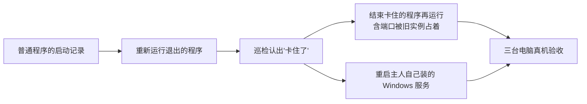

# 更多修法：重新运行和重启主人自己的命令行程序

> 状态：规划，范围待主人确认后实现。
> 相关设计：修复的提出、批准、执行前核对和验证见 [`agent-fix.md`](agent-fix.md)；巡检和"挂了可以自动修"见
> [`proactive-patrol.md`](proactive-patrol.md)；macOS 后台服务修法见 [`launchagent-repair.md`](launchagent-repair.md)。

## 一句话

现在能修的只有三种，而且都是"重新启动"：重启 Docker 容器、重新运行 Python 脚本、重新启动 macOS 用户后台服务。
主人自己从终端跑起来的普通程序（Node、Go、Rust 写的小服务，`gost` 这类转发工具，`ssh -L` 端口转发，本地模型
服务）退出了，Agent 只能说"请你自己重启"；程序还在但卡住不响应，Agent 什么也做不了。本阶段补上两种修法：
**重新运行退出的命令行程序**、**结束卡住的程序再重新运行**，以及**重启主人自己装的 Windows 服务**。

## 为什么现在做

三台电脑真机试用时，地图上直接显示的服务一共约 20 个：

| 种类 | 个数 | 现在能不能修 |
|---|---|---|
| Docker 容器 | 7 | 能（重启容器） |
| Python 脚本 | 4 | 能（重新运行） |
| 普通程序 `program:` | 9 | **不能** |

普通程序占了将近一半，却没有任何修法；用户的直观感受是"修服务只有重启一个手段，或者根本没有手段"。卡住不响应
的情况（进程在、端口在听、但请求一直超时）三种现有修法都不处理，路线图里也记着"卡住的 macOS 后台服务暂时不修"。

## 用户影响

| 现在 | 做完以后 |
|---|---|
| 终端里跑的 `gost`、`node server.js` 退出了，地图标"已停止"，Agent 只能建议你自己重新运行 | Agent 提出"按上次的启动方式在后台重新运行 gost（端口 805）"，点批准就修好；打开过"挂了可以自动修"的，巡检直接修 |
| 程序还在、端口在听，但网页一直转圈 | 巡检连续几轮请求超时后标"卡住了"；Agent 提出"结束卡住的 xxx 再按原方式运行"，批准后先礼貌结束、等一会儿再强制结束，然后重新运行并验证 |
| 重新运行时报"端口被占用"，占着端口的是同一个程序没退干净的旧进程 | 同一种修法里先结束这个旧进程再运行；占着端口的是别的程序时不动它，只说明是谁占着 |
| 卡住的 macOS 后台服务没法修 | 用 `launchctl kickstart -k` 结束并重新拉起 |

## 现在已经有什么（以代码为准）

| 现有部分 | 在哪 | 这次怎么用 |
|---|---|---|
| 修法框架：资格检查、计划、批准、执行前核对、执行、验证、收场、限次、审计 | `repair/` | 原样复用，加两种修法 |
| 修法登记为 L2，模型拿不到执行入口；模型只能用 `propose_repair` 填服务身份、修法种类和理由 | `repair/definitions.py`、`repair/agent_tools.py` | 新修法同样登记为 L2，枚举里多两个值 |
| Python 脚本的启动记录：活着时记下解释器、参数、工作目录和用户，不记环境变量 | `repair/launch_records.py` | 推广到普通程序：记可执行文件、参数、工作目录、用户、启动时间 |
| 进程来历判断（终端、用户目录、系统、桌面应用） | `platforms/process_origin.py` | 用它判断哪些程序允许修 |
| 巡检：连续 3 轮异常才确认挂了，按服务种类补提固定修法 | `patrol/` | 新增"卡住了"这种异常，对应新修法 |

## 规则

### 1. 重新运行退出的命令行程序（`relaunch_program`）

- **哪些程序能修**：身份是 `program:<名字>@<端口>`；进程以当前用户身份运行；从主人的终端或用户目录启动（沿用
  进程来历判断）；在地图上直接显示，或标过"是我的服务"。
- **一律不修**：系统目录里的系统程序（但主人在终端里用系统自带的 `ssh` 开的端口转发算主人的程序）；Windows
  系统服务；有窗口的桌面应用；组网工具（WireGuard、n2n/n3n、Tailscale、ZeroTier 等，路线图不碰组网）；
  TunnelMinion 自己。
- **启动记录**：程序活着、而且在地图上直接显示或标过"是我的服务"时，巡检用操作系统提供的进程信息读出它的
  可执行文件完整路径、参数、工作目录、运行它的账户和启动时间，按服务身份存进本机数据库（数据目录下的
  `runtime.sqlite3`，`launch_records` 表），每次看到都更新一次。不记环境变量；参数里看起来像密钥的部分
  （`--token=`、`--password` 等）不进工具输出、不给模型、不发给别的电脑，只在本机执行时使用。
- **以什么身份运行**：TunnelMinion 自己以主人的普通账户运行，不用 sudo，也不以管理员身份运行；重新运行的程序
  同样是这个普通账户、同样的工作目录和参数。
- **要管理员或 root 的程序不修**：原来以别的账户、root 或 Windows 管理员身份（提升权限）运行的程序，普通账户
  读不全它的启动信息，也没法用同样的权限把它拉起来，资格检查直接拒绝，说明"它需要管理员权限，请你自己重启"。
  TunnelMinion 不保存、也不索要 sudo 或管理员密码。唯一的例外是第 3 条的 Windows 服务：由主人对单个服务一次性
  授权。
- **执行**：执行前再核对一遍：可执行文件还在、和记录时是同一个文件（大小和修改时间一致）、端口现在没人占。
  然后用同样的参数、同样的工作目录在后台重新运行，和终端脱离，输出写进 TunnelMinion 自己的日志目录。
- **验证**：进程起来、端口在听；记录里有网页的，首页能打开。没修好就结束刚拉起的进程，不留半截状态。
- **TunnelMinion 关掉或重启不影响这些程序**：启动记录存在本机数据库里，TunnelMinion 重启后还在；重新运行的
  程序和 TunnelMinion 脱离（Windows 上用独立进程组并脱离作业对象，macOS 上用新会话），TunnelMinion 退出时
  不会把它们一起带走。TunnelMinion 没在运行的那段时间里退出的程序，等它下次启动、巡检确认以后照样能修。
  这一点作为真机验收项专门测。

### 2. 结束卡住的程序再重新运行（`restart_stuck_program`）

- **怎么算卡住**：只拿服务**自己以前的样子**比。巡检记下每个服务平时的表现：首页能打开的，记"有网页"；
  连上端口会马上回话的（比如 SSH 会先报版本号），记"会回话"；连上以后本来就不说话、等客户端先开口的，
  只记"端口在听"。之后只有"以前能打开、现在连续 3 轮（约 1.5 分钟）打不开"或者"以前会回话、现在连续 3 轮
  不回话"才算卡住。本来就不回应的服务永远不会被判成卡住；只是慢、偶尔超时一次也不算。
- **适用范围**：普通程序和 Python 脚本，资格规则同第 1 条；macOS 用户后台服务改用 `launchctl kickstart -k`。
  Docker 容器卡住沿用现有的重启容器。
- **结束谁**：只结束和启动记录对得上的那个进程：同一个用户、同一个可执行文件、同样的参数、启动时间和记录一致。
  对不上就拒绝，说明"占着端口的不是记录里的那个程序"。先礼貌结束，等 10 秒还在再强制结束，然后按第 1 条
  重新运行并验证。
- **端口被旧实例占着**：重新运行前发现端口被占，且占着的进程和记录对得上，按上面的方式先结束它；对不上的不动，
  只告诉主人是谁占着。

### 3. 重启主人自己装的 Windows 服务（`restart_windows_service`）

有些程序装好以后以 Windows 服务的形式常驻，例如串流软件、自己用 NSSM 包装的小服务。它们停了或卡住时，
用 Windows 自带的服务管理把这一个服务启动或重启。

- **哪些服务能修**：标过"是我的服务"；可执行文件不在 `C:\Windows` 下，也不是微软签名的系统组件；启动类型不是
  "已禁用"（主人禁用的不替你打开）；不是组网工具、杀毒和安全软件、TunnelMinion 自己。
- **权限**：TunnelMinion 以普通用户身份运行，默认没有启停服务的权限。主人对某个服务打开这种修法时，弹一次
  Windows 管理员确认，只给**这一个服务**加上"当前用户可以启动和停止"的权限；关掉时撤回。不会让 TunnelMinion
  整体以管理员身份运行。
- **执行与验证**：停了的就启动，卡住的（判断方法同第 2 条）就重启；等服务状态变成"正在运行"、端口在听、
  有网页的首页能打开。
- 需要同步修改路线图里"不修改系统服务"这条非目标：改成"只修主人标过、明确打开了这种修法的第三方服务，
  不碰系统自带服务"。

### 4. 安全边界（所有新修法都适用）

- 只能由主人批准后执行，或由巡检按主人事先打开的"挂了可以自动修"代批准；卡住的修法默认**不**跟着
  "挂了可以自动修"自动执行，要单独打开。
- 不提供"执行任意命令"；模型不能改参数、路径和工作目录，只能指向一条已有的启动记录。
- 不改配置文件、不删文件、不清日志、不改系统设置；系统服务只按第 3 条处理主人自己装的那些。
- 限次沿用现有规则：同一时间只修一个，同一服务 1 小时最多修 3 次；自动修失败立刻暂停，等主人看过再说。
- 每次执行都写审计：谁批准的、结束了哪个进程、怎么重新运行的、验证结果。

## 本阶段不做

- Windows 自带的系统服务、macOS 系统级后台服务。
- 有窗口的桌面应用（例如网盘客户端、聊天软件）：不修，也不该出现在地图上；现在个别桌面应用的后台进程仍被
  显示出来，按服务识别的问题另行修正。
- 组网工具（WireGuard、n2n/n3n 等）。组网通道断了的多方会诊和修复另做一个阶段，见下一节。
- 改配置、清理磁盘和日志、回滚版本、`docker compose up` 重建容器。
- 发现问题改成事件驱动（单独一个阶段）。

## 后续阶段（规划）

- **发现问题改成事件驱动**：订阅 Windows 服务状态变化、Docker 容器事件、macOS 后台服务退出，服务一挂马上知道；
  30 秒一次的快照比对留作兜底。
- **组网通道故障的多方会诊（SOP，暂不排期）**：几台电脑发现和组网服务器之间连不上一段时间后，先通过另一条还通的线路
  互相确认"是不是大家都连不上"，确认后选一台去问组网服务器所在的电脑；那台电脑查组网服务的状态、试着连
  其他成员，确认是服务本身出问题后，提出"重启组网服务"这个固定修法，经主人批准执行。前提是电脑之间还有
  第二条线路可用；只有一条组网时，断了就谁也联系不上，只能等恢复后补查。需要同步修改路线图里"不做组网、
  不排查组网故障"这条非目标。

## 待主人决定

1. "卡住"的判断：本方案建议连续 3 轮、约 1.5 分钟。要更快就会更容易误判。

## 依赖与顺序

## 完成标准

- [ ] 地图上的普通程序退出后，Agent 能提出"重新运行"，批准后修好并自己验证；打开"挂了可以自动修"的由巡检直接修。
- [ ] 程序卡住时巡检标"卡住了"，批准后先结束再运行，验证通过；结束的一定是记录里的那个进程。
- [ ] 主人自己装的 Windows 服务停了或卡住，打开这种修法后能启动或重启；授权只针对这一个服务，关掉修法后撤回。
- [ ] 本来就不回应的服务不会被判成卡住。
- [ ] 关掉再启动 TunnelMinion 后，之前重新运行的程序还活着，启动记录还在。
- [ ] Windows 自带的系统服务、桌面应用、组网工具、TunnelMinion 自己即使标成"是我的服务"也拒绝修，并说明原因。
- [ ] 参数里的密钥不出现在工具输出、模型输入、审计摘要和跨电脑响应里。
- [ ] Windows 和 macOS 各用测试程序真机验收：退出后重新运行、卡住后结束再运行、端口被旧实例占着。验收不碰
      主人正在用的服务。
- [ ] 质量门禁通过（后端覆盖率 100%），路线图和本页结果已回写。
