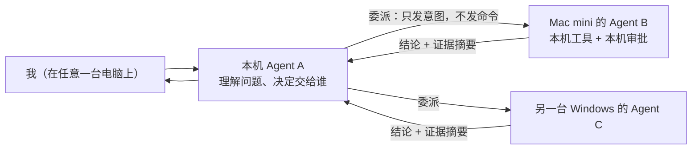
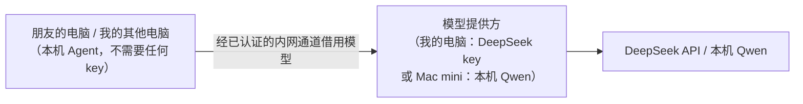

# 新主线设计：每台电脑一个服务管家 Agent

> 状态：草案，等待确认。确认之前不动代码。不设期限，做对比做快重要。

## 一句话

我的服务散在好几台电脑上。每台电脑跑一个 **本机 Agent**，它了解自己这台机器、也只有它能在本机动手。
我在任意一台上用大白话提问，问题会被 **交给真正管那台机器的 Agent** 去处理，它查清、修好，把结论和证据交回来。
朋友的电脑也可以加进来，而且不需要他们配置任何东西、花任何钱。

## 要解决的问题

| 我遇到的麻烦 | 现在怎么办 | 想要的样子 |
|---|---|---|
| 记不清哪个服务在哪台、端口是多少 | 翻笔记、挨个登录查 | 打开一个页面就看到所有服务和可点击的地址 |
| 想知道某台机器上的情况（跑了什么、谁最占内存） | SSH 上去敲命令 | 直接问，由那台机器的 Agent 回答 |
| 服务打不开了 | SSH 上去看进程、看日志、手动重启 | 把问题交给那台机器的 Agent，它查原因、提修复方案，我点批准 |
| 服务挂了我不知道 | 等用的时候才发现 | 那台机器的 Agent 自己发现、先查原因，再通知我 |

## 四种能力，一个核心机制

"服务打不开"只是其中一种用法。真正的核心是 **委派**：一个 Agent 把一件事交给另一台机器的 Agent 去办。

| 能力 | 例子 | 委派怎么用 |
|---|---|---|
| ① 认识服务 | 首页列出所有机器上的服务，自动起好名字，比如"相册（Docker）""数据清洗脚本（Python）" | 每台 Agent 识别自己机器上的服务：看容器镜像、脚本名、网页标题，写一句简介 |
| ② 问答 | "相册在哪？""Mac mini 上哪个容器最占内存？" | A 判断问题属于哪台，交给它回答；涉及多台就同时问，再汇总 |
| ③ 排查修复 | "Mac 上的相册打不开" | 交给 B：B 查进程、端口、容器状态和日志，提出修复方案（如重启容器）；我批准后 B 执行，A 再从自己这边复验 |
| ④ 主动巡检 | 某个 Python 脚本半夜退出了 | B 自己发现，先查原因，写一份报告推给我，附带修复建议，等我批准 |

## 模型从哪来：集中提供，大家借用

这是之前卡住多机协作的问题：别的电脑、尤其是朋友的电脑，怎么配 API？朋友肯定不愿意买 token。

答案是 **其他电脑根本不用配**：

- 网络里指定一台机器作为 **模型提供方**，可以是持有 DeepSeek key 的电脑，也可以是跑着本机 Qwen 的 Mac mini（Qwen 不花钱）。
- 其他机器的 Agent 在本机跑，执行、判断、动手都在本机；只有"请模型想一想"这一步，经同一条已认证的内网通道借提供方的模型。
- **key 只存在提供方一台机器上**，不分发、不复制。朋友不需要账号、不需要充值。
- 提供方可以设额度：每台机器每天最多用多少 token，防止被用光。
- 代价要说明白：借用模型时，那台机器发给模型的内容（问题和证据摘要）会经过提供方。自己的机器无所谓；朋友加入时，界面上会明确告诉他。
- **加入方式**：在我的电脑上生成一个邀请码，朋友装好程序、粘贴邀请码，就完成了。这里只解决"Agent 之间怎么认识"，组网本身仍然假定已经通了。

这也是一个好讲的面试点：**执行分布在各机器，模型集中提供**；权限和数据留在本机，花钱的部分集中管理。

## 哪些服务该出现：通用规则 + 你说了算

现在的问题：
- 筛选靠一条路径规则（程序装在用户目录、`/opt/`、`/usr/local/` 才显示）。在 Mac 上碰巧好用，在 Windows 上几乎什么都显示不出来。
- 有专门为你的机器加的特例，比如写死了"进程名叫 `llama-server` 就显示"。这是先射箭再画靶，换一台机器、换一个程序就失灵。

新规则分三档，**不为任何具体机器或程序写特例**：

| 档位 | 什么样的程序 | 首页怎么处理 |
|---|---|---|
| 显示 | 满足任意一条：① 发布了端口的 Docker 容器；② 从终端启动的程序（往上追父进程能找到终端或 shell，包括编辑器里的终端）；③ 装在你自己目录里的程序或脚本（如 uv、pip、npm、Homebrew 装的），即使启动它的终端已经关了；④ 你手动标记过"这是我的服务"的 | 直接显示 |
| 待确认 | 你这个账户运行的、在监听端口的其他程序，看不出是不是服务 | 收在一个"可能是服务"的小区域，一键选择"是我的服务"或"隐藏"；不确定可以问 Agent "这是什么" |
| 不显示 | 系统进程；桌面应用（`.app`、Program Files）及其后台助手；应用自己注册的开机自启服务；TunnelMinion 自身；Docker 运行环境自己的端口；停了很久的容器 | 不出现。想看可以去高级里的完整清单 |

几条配套做法：

- **Docker 按"一组"合并**：同一个 compose 项目的多个容器显示成一项，端口算到容器头上，不算成运行环境（如 OrbStack、Docker Desktop）开的。
- **名字优先取网页标题**：能打开的网页服务，用它自己的页面标题当名字，比如"WireGuard Panel"；其次用容器名、脚本名或项目目录名。
- **对外开放的更像服务**：监听所有网卡（`0.0.0.0`）的比只监听本机（`127.0.0.1`）的更可能是你要用的服务。这只用于排序，不单独决定显示与否。
- **验证靠标准答案**：每台机器由你逐项确认一份"该显示什么"的清单，规则做完后拿它比对，统计漏掉几个、多出几个。清单里有你机器的真实路径和地址，只存在本地，不提交到公开仓库。

**你的每次选择都会被记住**：标记过的一直显示，隐藏过的不再打扰。时间一长，首页上就只剩你真正关心的东西。

验证方式也要改：不再拿"我知道 Mac 上有 X，所以它必须出现"来验收，而是在三台机器上各数一遍，统计"该出现的漏掉几个、不该出现的混进几个"。

## 界面：先定每屏回答什么问题，再谈好不好看

现在的问题不在审美，而在 **信息太多、不知道有什么用**：新鲜度、证据来源、协调器状态、运行时状态……这些是给程序员调试看的，不是给使用者看的。

新原则：**每一样显示出来的东西，都必须回答你的一个具体问题，回答不了的就不显示。**

| 你的问题 | 界面上回答它的东西 |
|---|---|
| 我有哪些服务？ | 服务列表：名字、一句话简介 |
| 在哪台、怎么打开？ | 所在机器名、可点击的地址 |
| 现在能用吗？ | 一个状态：正常 / 打不开 / 已停止 |
| 出了什么事？ | 需要我处理的事（比如"相册挂了，建议重启，批准吗？"），没有就不显示 |
| 我想问点什么 | 一个输入框 |

其他技术信息全部收进"高级"，默认不出现。

### 选定的样式：像素拓扑

可以点着看的草图：[`mockups/pixel.html`](mockups/pixel.html)（数据是假的）。

- **首页是一张像素风的电脑拓扑图。** 每台电脑是一个像素小电脑：屏幕亮着表示在线，发灰表示离线。
- **电脑之间的连线表示它们怎么连通。** 线的颜色表示组网方式（WireGuard、局域网、n2n），虚线表示当前不通。
- **鼠标放上去有反馈。** 电脑会跳一下、出现选框，相连的线变粗；旁边的提示框写着这台电脑的名字、服务数量和连接方式。
- **点一下电脑，旁边弹出服务框。** 框里有这台电脑上的服务，每个都可以一键打开；需要处理的事和"可能是服务"的程序也在框里。框带一个小尾巴指向电脑；右边放不下就放左边，点空白处或按 Esc 关闭。
- **服务多时的处理：**
  - 打不开的永远排最前，其次是正常的，已停止的放最后。
  - 超过 8 个服务时出现搜索框，按状态分组，每个服务只占一行。
  - 按页查看：翻页条在列表上方，键盘左右键也能翻；每页条数按框能放下的高度自动定，3～6 个，尽量不用滚动。
  - 屏幕太小、确实需要滚动时，滚动条加粗加亮，框底部还有"▼ 下面还有"的提示。
- **有事需要处理的电脑头上冒红色感叹号。** 点一下就能看到原因和修复建议，批准后它会消失。
- **委派过程看得见。** 提问时，一个数据包从这台电脑沿着连线跑到负责的电脑；那台电脑头上冒出"思考中"气泡，答完再跑回来。
- **底部是对话框加输入框。** 回答以打字机效果出现，标明是哪台电脑的 Agent 在说话；"过程"和"依据"可以展开查看。

## 关键设计决定（也是面试要讲的点）

1. **只发意图，不发命令。** A 不能在 B 上执行任何东西，只能说"我连不上相册"。查什么、能修什么，由 B 自己决定。
   这比"A 拿着权限远程操作 B"安全，也是为什么要多个 Agent 而不是一个 Agent 加远程工具。
2. **执行分布，模型集中。** 每台机器在本机判断、本机动手；模型由一台机器统一提供，其他机器零配置借用。
3. **原始数据不出本机。** 日志、进程命令行这些留在 B，只把结论和证据摘要交回给 A。
4. **动手要分级、要本机批准。** 查看随便做；重启容器、重新拉起脚本这类可撤销的操作，需要那台机器批准；删除数据、执行任意命令一律拒绝。
5. **服务筛选靠通用规则加用户反馈，不靠特例。**
6. **Skill = 排查剧本。** "容器挂了怎么查""脚本退出了怎么查"写成剧本，Agent 按需加载。
7. **MCP = 把"我的服务网络"开放出去。** 让 Claude Code、Codex 这类 AI 工具也能问"我的服务都在哪""帮我查一下相册"。

## 要做的事（按顺序，不设期限）

每一步做完，你都能看到、能用，再进入下一步。

| 顺序 | 内容 | 谁做 | 做完你能看到什么 |
|---|---|---|---|
| 1 | 界面样式（已完成：像素拓扑） | Claude | 草图 `mockups/pixel.html` |
| 2 | 服务筛选新规则 + "是我的服务 / 隐藏" | Claude | 三台机器上，首页只剩真正的服务 |
| 3 | 按像素拓扑草图重做首页，接上真实数据 | Codex，Claude 验收 | 新首页 |
| 4 | 模型借用 + 邀请码加入 | Claude | 其他电脑不配 key 也能用 Agent |
| 5 | 委派协议 + 统一的本机 Agent（合并现有两套重复循环） | Claude | 在 A 上问 Mac 的事，由 Mac 的 Agent 回答 |
| 6 | 本机工具：容器状态与日志、资源占用、重启容器、重新拉起脚本 | Claude 定接口，Codex 实现 Mac 部分 | Agent 能查到更多、能修 |
| 7 | 排查剧本：容器挂了、脚本退出了；主动巡检 | Claude | 服务挂了会收到报告和修复建议 |
| 8 | MCP 服务 | Codex | 在 Claude Code 里问"我的服务" |
| 9 | 三台真机演示、讲解稿、架构图 | Claude + 你 | 能拿去讲的完整材料 |

## 明确不做

- 组网相关的一切：自动组网、WireGuard 和 n2n 排查。WireGuard 只当作已经通的"网线"。
- 游戏联机场景。
- 协调服务器、安装包升级回滚：代码保留不删，停止投入，首页不再展示。

## 现有代码怎么处理

| 处理方式 | 内容 |
|---|---|
| 直接复用 | Gateway 通信与认证、本机只读工具（Windows/macOS）、Agent 预算和证据引用、风险分级与本机审批、模型配置、网页框架 |
| 合并 | 两套 Agent 循环合成一套 |
| 删除 | 为具体机器写的特例规则（如 `llama-server`） |
| 冻结 | 协调服务器、自动组网、托管模式、安装包升级 |
| 重做 | 首页、服务筛选、排查剧本 |

## 文档怎么办

不逐个修改旧文档，也不以旧文档为依据。

- **所有文档由 Claude 编写**：设计、README、使用说明、给你看的进度和总结。Codex 只写代码和测试，不新增、不修改说明文档；它的 PR 描述只写改了哪些文件、跑了哪些测试，给你看的说明由 Claude 重写。
- **判断项目现状只看代码和实际运行结果**，不引用旧的路线图、阶段文档、评测报告里的说法。旧文档里的结论如果要用，先在代码或真机上核实。
- 本文是新主线的唯一设计。README 重写成一页，用你能看懂的话说清楚项目是什么、怎么跑、怎么演示。
- 旧的路线图、阶段文档和历史 `openspec/` 统一收进 `docs/legacy/`，不删除，也不再维护。
- `AGENTS.md` 简化成十几条：分支命名、提交格式、谁写哪些文件，并写明"Codex 不写说明文档"。改之前先给你看。

## 开工前需要你做的事

1. **让我能登录 Mac mini。** 告诉我 Mac 上的用户名；我在这台电脑生成一把 SSH 密钥，你把公钥加到 Mac 的 `~/.ssh/authorized_keys`。
2. **Qwen 的访问地址。** Mac 上 Qwen 服务的端口，以及它是否兼容 OpenAI 接口。
3. **另一台 Windows（Sugarfarmer-LAP）。** 让 Codex 在那台上拉取仓库，或者开一个 SSH 给我。两种都行，选一种。
