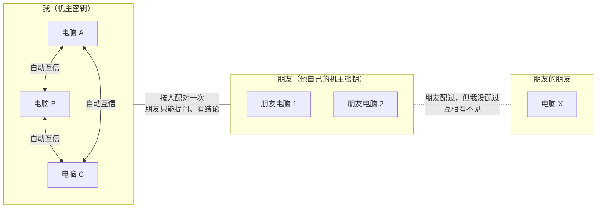
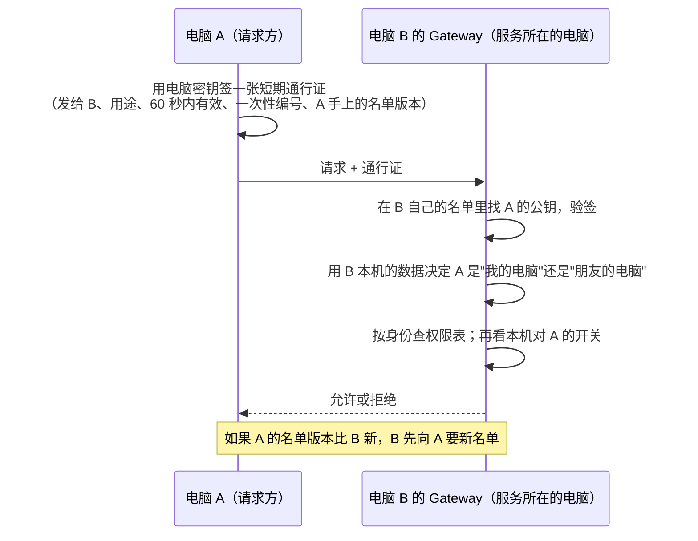
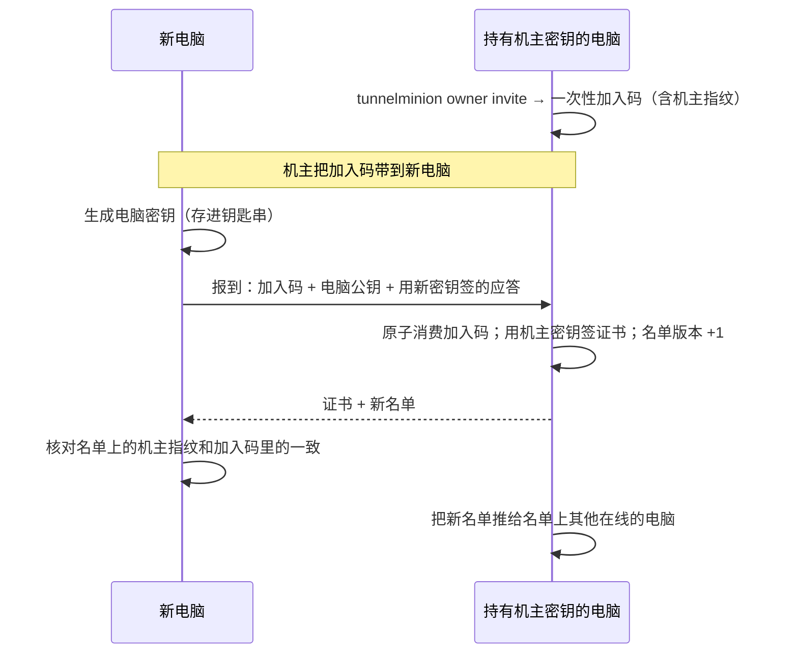

# 机主身份与访客权限：我的电脑自动互信，朋友按人配对

> 状态：已确认，按 4 个 PR 实现中。总体方向见 [`node-agents.md`](node-agents.md)，配对现状见 [`model-borrowing.md`](model-borrowing.md) 的"邀请码"一节，代批准见 [`agent-fix.md`](agent-fix.md)。

## 一句话

每个机主有一把**机主密钥**。机主的每台电脑都由这把密钥签名，登记在一份**"我的电脑"名单**里；名单上的电脑自动互相信任，不用两两配对。朋友不再按电脑配对，而是**按人配对**一次，配好后朋友的电脑只能提问、看结论；批准修复、改设置只有机主自己的电脑能做。

## 为什么需要

- 现在两台电脑靠邀请码一对一配对。3 台电脑要配 3 次，5 台要配 10 次。
- 配对之后，每个对端都是一样的"对端"，分不清是我自己的电脑还是朋友的电脑。要靠逐台打开 `allow_delegation`、`allow_model_borrowing`、`allow_proxy_repair_approval` 这几个开关来区分，容易开错。
- 加了一台电脑或换了一台电脑，要去每台旧电脑上重新配一遍；淘汰一台电脑时，也要去每台电脑上删一遍。

## 四种身份

| 身份 | 是谁 | 能做什么 |
|---|---|---|
| 本机 | 坐在这台电脑前的人（本机网页只绑定 127.0.0.1，本机命令行） | 全部 |
| 我的电脑 | 和本机同一个机主、在"我的电脑"名单上的其他电脑 | 提问（委派）、看结论、借模型、远程调只读工具、**替本机批准修复** |
| 朋友的电脑 | 本机机主按人配对过的朋友，他名单上的电脑 | 只能提问（委派）、看结论；借模型要本机另外打开。**不能**批准修复，**不能**改设置，也不能远程调只读工具拿原始数据 |
| 其他 | 没配对过的电脑 | 什么都不能做，连本机的服务地图都看不见 |

**信任不传递**：我配了朋友，朋友配了他的朋友 X，X 和我之间仍然互相看不见。

## 基本做法

### 三把密钥

| 密钥 | 存在哪里 | 用来签什么 |
|---|---|---|
| 机主密钥（Ed25519） | 机主的第一台电脑的系统钥匙串里 | 只签三样东西："某台电脑属于我"的证书、"我的电脑"名单、"我信任的人"名单 |
| 电脑密钥（Ed25519） | 每台电脑自己的系统钥匙串里，从不离开这台电脑 | 只签这台电脑发出的请求 |
| 恢复密钥 | 不存在任何电脑上，只以一串恢复码交给机主自己保管（抄下来或存进密码管理器） | 只签一件事："换一把新的机主密钥" |

机主密钥只放在第一台电脑上，加电脑、删电脑都在这台电脑上操作；其他电脑丢了也不会泄露机主密钥。机主密钥本身丢了，靠恢复码救回来（见下文）。

钥匙串沿用现在网关凭据的存储方式（`KeyringSecretStore`，用户显式选择时用受限文件 `RestrictedFileSecretStore`），没有屏幕登录的 Mac mini 也能用。

**按用途区分签名**：每次签名都带上用途标签（例如 `tm-device-cert`、`tm-roster`、`tm-trust-list`、`tm-owner-rotate`、`tm-request`），验签时必须和预期用途一致。这样一个用途的签名不能被挪去冒充另一个用途。

### "我的电脑"名单

名单里有：机主密钥的指纹、恢复密钥的指纹、每台电脑的节点 ID、显示名、电脑公钥、组网地址和端口，以及一个**版本号**。整份名单由机主密钥签名。

- 每次加电脑、删电脑，版本号加一，重新签名。
- 每台电脑只接受签名正确、机主指纹和本机一致、而且版本号**比本机现有的大**的名单。旧版本、签名不对、别的机主签的，一律丢掉。
- 本机更新名单用 SQLite 的 `BEGIN IMMEDIATE` 短事务，"比较版本号 + 写入"一次完成，两份名单同时到达时不会互相覆盖。
- 名单的每次变化（谁加的、谁被移除、什么时候、原因）都写进本机的审计记录，不含任何密钥。

### 请求怎么认证

- **权限只在服务所在的那台电脑上判断。** 请求里没有"我是机主"这种字段；即使有，也一律忽略。B 只看两件事：通行证是不是由 B 本机名单里的某把电脑公钥签的；这把公钥属于 B 的机主，还是属于 B 配过的某个朋友。
- 通行证只对指定的那台电脑、指定的用途有效，60 秒过期，一次性编号在有效期内只能用一次，截获了也没法拿去别处重放。这比现在长期有效的配对令牌更安全。
- 现在的配对令牌（静态令牌）继续能用，见下文"迁移"。

### 加一台我的电脑

- 加入码沿用现在邀请码的规则：24 小时有效、只能用一次、本机只存摘要、报到来源地址必须和报上来的地址一致、失败时统一回答"无效、已过期或已被使用"、报到每分钟最多 10 次。
- 加入码里带着机主指纹，新电脑据此确认自己加入的是对的机主，组网里有人冒充也骗不过去。
- 新电脑报到时要用新密钥签一段应答，证明私钥确实在它手里。

### 移除一台我的电脑

在持有机主密钥的电脑上运行 `tunnelminion owner remove <电脑>`：名单版本加一，去掉那台电脑，重新签名，推给所有在线的电脑。被移除的电脑如果在线，也会收到通知并删除自己的证书；但这只是顺手做，安全不依赖它。

### 和朋友按人配对

- 我运行 `tunnelminion friend invite`，朋友在他的任意一台电脑上运行 `tunnelminion friend join <配对码>`。
- 双方交换的是**机主公钥和各自的"我的电脑"名单**。配好后，朋友名单上的所有电脑都被我的所有电脑认作"朋友的电脑"，朋友那边同理。
- "我信任的人"也是一份由机主密钥签名、带版本号的名单，和"我的电脑"名单一样在我的电脑之间同步。所以朋友只需配一次，不用跟我的每台电脑分别配。
- 朋友能看到我名单上的全部电脑，每台电脑各自决定朋友能做什么。
- 朋友加了新电脑、删了电脑，他的新名单会在两边电脑接触时同步过来（规则同上：签名对、版本更大才收）。
- 解除配对：`tunnelminion friend remove <朋友>`，从"我信任的人"名单里删掉他，版本加一并同步。

## 设计里要回答的问题

### 1. 离线电脑错过了"移除某台电脑"的通知

例子：电脑 C 被移除时，电脑 B 关着机。B 开机后手上还是旧名单，旧名单里 C 仍然是"我的电脑"。

处理分两层：

1. **一接触就同步。** 每张通行证里都带着请求方手上的名单版本。B 开机后，只要和任何一台我的电脑或朋友的电脑说上话，发现对方版本更新，就先要来新名单再处理请求。B 自己开机后也会主动找名单上的其他电脑同步一次。
2. **被移除的电脑没法帮 B 更新。** C 手上只有旧名单，它的请求里带的也是旧版本，所以 B 不会从 C 那里学到"C 还在"之外的东西。只要 B 和任何一台其他电脑接触过，C 就会被拒绝。

剩下的风险是：B 还没来得及和任何其他电脑同步时，C 仍能做它被移除前本来能做的事。TunnelMinion 只跑在机主自己组的网里，被移除的电脑一般是机主自己淘汰的，这个风险可以接受，所以不设"多久没同步就降级"。被盗或丢失的电脑应该走下面的"换机主密钥"，而不是只移除。

### 2. 机主密钥丢了怎么恢复

| 情况 | 怎么办 |
|---|---|
| 持有机主密钥的电脑坏了，恢复码还在 | 在任意一台我的电脑上运行 `tunnelminion owner recover`，输入恢复码。恢复密钥签发"换成新的机主密钥"声明，新机主密钥存进这台电脑的钥匙串，名单用新密钥重新签名、版本加一。其他电脑认得恢复密钥的指纹（它从第一天起就写在名单里），所以会自动接受新机主密钥，朋友那边也一样。不用重新配对。 |
| 持有机主密钥的电脑被偷了 | 同上。新名单里顺手把被偷的电脑移除。旧机主密钥签的东西从此一律不收，小偷拿着旧密钥也签不出更大版本的有效名单。 |
| 恢复码也丢了 | 没法证明"我还是原来那个机主"，只能重新开始：选一台电脑 `owner init --reset` 生成新的机主密钥和恢复码；其他每台电脑要有人**在本机**运行一次 `owner join` 重新加入；朋友要重新配对一次。旧配对在此之前照样可用，不会突然断掉，只是不能再加电脑、删电脑。 |

`owner init` 时会显示恢复码，并要求机主把恢复码的前几位再输一遍，确认已经抄下来。恢复码不进任何日志、数据库或 Git。

### 3. 和现有功能的关系、怎么平滑迁移

| 现有功能 | 以后怎么样 |
|---|---|
| 邀请码 `invite` / `join`（`agent/invites.py`） | 保留，作为"旧式配对"继续工作。新的 `owner invite` 和 `friend invite` 复用它的一次性加入码存储（`SQLiteInviteStore`：只存摘要、一条 `UPDATE … RETURNING` 原子消费）、来源地址核对和统一错误文案。 |
| 对端开关 `allow_delegation`、`allow_model_borrowing`、`daily_quota` | 变成"按身份的默认值 + 本机收紧"。我的电脑默认全部打开；朋友默认只开"允许提问"，借模型默认关闭、额度沿用 20 万。每台电脑仍可以在本机为某个朋友或某台电脑单独关掉或调小，但**不能**为朋友打开下面这条。 |
| 代批准 `allow_proxy_repair_approval`（#193） | 我的电脑默认允许替本机批准（本机可以关掉）；朋友的电脑**永远不允许**，配置里打开也无效，网关检查身份时直接拒绝。动手的仍是服务所在电脑，动手前照样再核对。 |
| 远程调只读工具（`allowed_tools`） | 我的电脑照旧；朋友的电脑不再能直接调，只能通过委派拿结论。 |
| 改设置 | 现在只能在本机网页或本机命令行改，这一版不变，也不新增远程改设置的接口。规则先写进权限表：以后如果加远程改设置，只限"我的电脑"。 |

**迁移步骤**（全程不断线）：

1. 两台电脑升级以后，旧的静态令牌配对照样能用，界面上标成"旧式配对"。旧式配对的权限就是现在配置文件里那几个开关，行为和今天完全一样。
2. 机主在一台电脑上运行 `owner init`，再在其他电脑上 `owner join`。加入以后，两台电脑之间优先用新的通行证认证；旧令牌还在，作为后备。
3. 运行 `tunnelminion peers migrate`：本机列出所有旧式配对，对已经在"我的电脑"名单上的，提示删掉旧令牌；对剩下的（一般就是朋友），提示改用 `friend invite` 重新按人配对。不自动删除任何东西，每一条都要机主确认。
4. 这一版不停用旧式配对，也不设强制下线的期限。

### 4. 协调服务器里哪些能复用，哪些要新写

协调服务器（`src/tunnelminion/coordinator/`）已经冻结，这次**不重新启用它，也不改那个目录**。新代码放在新模块 `src/tunnelminion/trust/`，按需借用做法：

| 内容 | 处理方式 | 说明 |
|---|---|---|
| 一次性加入令牌 | 复用现有邀请码存储 | `SQLiteInviteStore` 已经是"只存摘要 + 原子消费"，比协调服务器的 `enrollment_tokens` 更贴近现在的用法 |
| 加盐哈希 + 常量时间比较（`_hash_secret` / `_matches_secret`） | 照做法新写一份 | 只用在加入码摘要上；直接从冻结目录 import 会把两边绑在一起 |
| `BEGIN IMMEDIATE` 短事务 | 照做法新写 | 用在名单版本比较和写入上 |
| Ed25519 签名、按用途（audience）验签、短期通行证（`identity.py` 的 `AssertionService`、`OfflineAssertionVerifier`） | 照做法新写 | 协调服务器是"服务器签、节点验"，这里是"每台电脑自己签、对方按名单验"，签名者和信任来源不同，只沿用 PyJWT 的 EdDSA、`aud`、过期时间和时钟容差这些做法 |
| 移除审计（`coordinator_audit`、`revoke_node`） | 照做法新写 | 表结构参考：谁、对谁、做了什么、版本号、原因，不含秘密 |
| 钥匙串存储（`SecretStore` 及两种后端） | 直接复用 | 已经在 `model/secrets.py`，不属于协调服务器 |
| 网关认证入口（`GatewaySecurityPolicy.authenticate`） | 扩展 | 现在依次尝试"静态令牌"和"协调服务器断言"；增加第三种"电脑通行证"，认证结果多带一个身份字段（本机机主 / 朋友 / 旧式） |
| 权限检查（`gateway/api.py` 里各接口对开关的判断） | 改成查一张权限表 | 身份决定上限，本机开关只能在上限以内收紧 |
| 组网、心跳、目录同步、托管模式 | 不用 | 名单同步走现有 Gateway，只在电脑之间点对点交换 |

## 分几个 PR

| PR | 交付什么 | 用户能看到的变化 |
|---|---|---|
| 一：身份底座 | `trust/` 模块：机主密钥、电脑密钥、恢复密钥的生成和钥匙串存储；证书和两份名单的签名、验签、按用途区分；版本号规则和本机存储（`BEGIN IMMEDIATE`）；审计记录；`owner init` / `owner status` | 能在本机看到"我是谁、我的名单"；跨电脑行为还没变 |
| 二：我的电脑自动互信 | `owner invite` / `owner join` / `owner remove`；网关认"电脑通行证"；名单在接触时同步、开机主动同步；我的电脑默认可以代批准 | 第三台电脑加入后，不用再和每台电脑配对，地图上自动出现；移除后各电脑都拒绝它 |
| 三：朋友按人配对与权限表 | `friend invite` / `friend join` / `friend remove`；"我信任的人"名单与同步；网关按身份查权限表（朋友只能提问看结论，永不允许代批准，不能直接调工具）；`peers migrate`；设置页标出"我的电脑 / 朋友 / 旧式配对" | 朋友配一次就能问我所有的电脑；朋友那边点批准会被拒绝 |
| 四：恢复与换密钥 | `owner recover`、恢复密钥签发换密钥声明、其他电脑和朋友自动接受、`owner init --reset` | 主力电脑坏了或丢了，用恢复码救回来 |

每个 PR 合入前都跑全量测试；涉及安全边界的 PR 二、三在合入前做一次独立只读审计。

## 怎么算做完

**自动测试要覆盖：**

- 签名用途不符、机主不符、版本号更小或相同的名单一律拒收；两份名单并发写入只留版本更大的那份。
- 通行证过期、发给别的电脑、用途不符、一次性编号重复使用，都被拒绝。
- 请求里自称"机主"、或者朋友的电脑出示了伪造的"我的电脑"证书，都被拒绝；权限只按服务所在电脑本机的名单判断。
- 朋友的电脑：配置里打开 `allow_proxy_repair_approval` 也无法批准；不能直接调只读工具；能委派、能拿到结论。
- 没配对过的电脑：所有接口都认证失败；朋友的朋友同样如此。
- 离线电脑：开机后与任意一台电脑接触就拿到新名单并拒绝被移除的电脑。
- 恢复：用恢复码换机主密钥后，其他电脑和朋友自动接受，旧机主密钥签的名单被拒收。
- 旧式配对：升级后行为与今天一致；`peers migrate` 不经确认不删除任何东西。
- 任何日志、数据库、错误信息里都没有私钥、恢复码和令牌明文。

**真机验收**（用这台 Windows 电脑和 Mac mini；如果没有第三台电脑，就在 Mac mini 上用另一个数据目录和端口开一个"第三台电脑"，再用一个数据目录充当"朋友"）：

1. 这台电脑 `owner init`，Mac mini `owner join`。两边地图上互相出现，原来的旧式配对标为"旧式"且仍可用。
2. "第三台电脑"加入时只和这台电脑打交道。之后在 Mac mini 上能直接看到它、把问题委派给它，**两者之间没有做过任何配对**。
3. 在 Mac mini 上让本机提出一个修复，在这台电脑的地图上点感叹号批准，Mac mini 动手修好；这次没有手动打开 `allow_proxy_repair_approval`。
4. 关掉 Mac mini 的 TunnelMinion，在这台电脑上移除"第三台电脑"；再启动 Mac mini，确认它同步到新名单，"第三台电脑"的请求被拒绝，审计记录里有这次移除。
5. "朋友"按人配对后，能向 Mac mini 提问并看到结论；在朋友那边点批准修复，被 Mac mini 拒绝；朋友直接调只读工具，被拒绝。
6. 一个没配对过的数据目录向 Mac mini 发请求，认证失败，地图上也看不到 Mac mini。
7. 在这台电脑上抄下恢复码，然后在 Mac mini 上用恢复码 `owner recover`，确认这台电脑和"朋友"都接受了新机主密钥，无需重新配对。

验收记录写回本文末尾，只写示例地址和节点 ID 的缩写，不写真实 IP、机器名和令牌。
