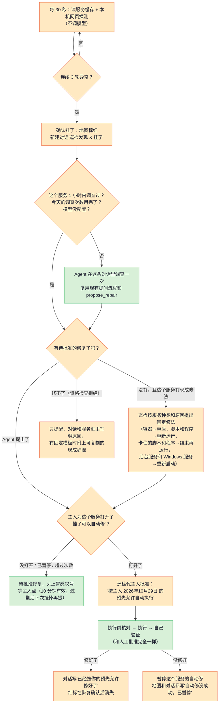
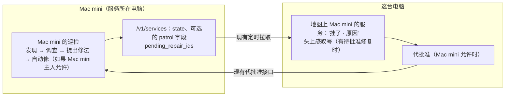

# 主动巡检：服务挂了先提醒，主人允许的范围内自动修

> 状态：已实现（#212、#214），2026-10-29 在这台 Windows 电脑和 Mac mini 上真机验收通过，记录见"真机验收结果"。
> 相关设计：修复的提出、批准、执行前核对和验证见 [`agent-fix.md`](agent-fix.md)；地图和对话抽屉见
> [`map-workspace.md`](map-workspace.md)；服务分档见 [`node-agents.md`](node-agents.md)。

## 一句话

现在只有用户提问、或者服务出现和消失时，Agent 才会去看一眼。巡检让每台电脑**自己盯着地图上的服务**：
连续几次确认某个服务挂了，就在地图上标红、在对话里留一条记录，Agent 自动查一次原因并提出修法；
主人事先为这个服务打开过"挂了可以自动修"的，Agent 直接动手修、修完自己验证，审计里写明
"按主人某年某月某日的预先允许自动执行"。没打开的，照样生成待批准的修复，电脑头上冒感叹号，等主人点。

## 用户影响

| 现在 | 有了巡检以后 |
|---|---|
| 半夜相册容器退出了，第二天打开地图才看到"已停止"，还得自己问一句 | 一两分钟内地图上标红"挂了 · 容器已退出"，对话里已经有一条"巡检发现相册挂了"，Agent 查完原因、提出了修法，头上冒感叹号 |
| 每次都要人点批准 | 主人可以为某个服务打开"挂了可以自动修"（默认关）。打开后，挂了就自动修，主人醒来看到的是"已经按你的预先允许修好了" |
| 模型调用次数说不准 | 巡检本身完全不调模型；只有确认挂了以后才调查一次，同一服务 1 小时最多 1 次，每天总数有上限 |
| 别的电脑上的服务挂了，只能看到"已停止" | 那台电脑自己的巡检负责发现和修；它报来的清单带上"挂了 · 原因"，这台电脑的地图上同样标红 |

## 现在已经有什么（以代码为准）

| 现有部件 | 在哪 | 巡检怎么用 |
|---|---|---|
| 服务观察：每 30 秒读一次本机端口、进程、Docker，结果放进服务缓存 | `agent/service_observation.py`，由 `incident/observer.py` 的观察循环在每轮开始前刷新 | **直接读缓存**，巡检不再扫描电脑 |
| 地图服务清单：按服务身份合并，分"显示 / 可能是服务 / 隐藏"，带 `state`（`running` / `stopped`） | `web/service_map.py` 的 `build_local_service_map` | 巡检对象就是这份清单里 `tier == "show"` 的服务（规则直接显示的 + 主人标成"是我的服务"的） |
| 抖动抑制：连续 N 次确认才算变化 | `incident/snapshot.py` 的 `SnapshotDiffDetector` | 沿用同样思路：连续 3 轮异常才算挂了 |
| 自动调查限频：同一服务 1 小时最多 1 次 | `incident/observer.py` | 巡检调查用自己的同样规则；本机服务的"挂了"由巡检负责，见下文"和现有自动调查的关系" |
| 对话：新建线程、带服务上下文提问、`propose_repair` 工具 | `agent/conversation.py`、`web/conversation.py`、`repair/agent_tools.py` | 巡检确认挂了以后，新建一条对话、带上服务上下文问 Agent 一次，Agent 可以用现有的 `propose_repair` 提出修法 |
| 修复：资格检查、计划、待批准 10 分钟、执行前核对、执行、验证、失败收场、同一服务 1 小时最多 3 次、同一时间只修一个 | `repair/` 全部 | **原样复用**。自动修只是换了一个"批准人"，其余步骤一步不少 |
| 修复结果写回对话 | `RepairService.set_result_handler` → `append_repair_result` | 巡检的对话里自动出现"修好了 / 没修好" |
| 网页探测（只连本机，读首页状态码） | `repair/local.py` 的 `LocalVerifier.web_status` | 巡检用它判断"网页打不开" |
| 感叹号、批准框、代批准 | `frontend/src/features/repairs/` | 原样复用 |

## 规则

### 1. 巡检谁

- 只巡检**这台电脑**地图上直接显示的服务：规则判定直接显示的，以及主人标成"是我的服务"的。
  "可能是服务""隐藏"的一律不管。
- 只有巡检**亲眼见过它正常运行**之后，它再变成异常，才算"挂了"。巡检启动时本来就停着的服务
  （可能是主人有意停的）照旧显示"已停止"，不提醒、不自动修。"见过正常"会存进本机数据库，
  TunnelMinion 重启后仍然记得。
- 别的电脑上的服务由那台电脑自己巡检，这台电脑不替它巡检，也不替它调模型。

### 2. 什么算"挂了"

每 30 秒一轮，跟着现有服务观察的节奏，只读缓存和本机探测，不调模型：

| 现象 | 怎么判断 | 哪种服务 |
|---|---|---|
| 容器退出了 | 清单里 `state == "stopped"`，类型是 docker | 容器、compose 组 |
| 脚本退出了 | 清单里 `state == "stopped"`，类型是 python（有启动记录、现在不在跑） | 从终端启动的 Python 脚本 |
| 后台服务退出了 | 清单里 `state == "stopped"`，并且是 macOS 后台服务（`launch_agent`，有后台服务记录、现在不在跑） | 当前用户 `~/Library/LaunchAgents` 里的后台服务 |
| 程序退出了 | 清单里 `state == "stopped"`，类型是 program（有启动记录、现在不在跑） | 从终端或用户目录启动的普通程序 |
| Windows 服务停了 | 清单里 `state == "stopped"`，并且是 Windows 服务（`windows_service`，有服务记录、现在不在跑） | 主人标过的 Windows 服务 |
| 端口不再监听 | 见过正常的服务从清单里消失了，或者它原来的端口一个都不在了 | 所有类型 |
| 卡住了 | 服务在跑、端口在听，但只拿它**自己以前的样子**比：以前能打开的首页现在不回应（超时或不说 HTTP），或者以前连上就先回话的端口（例如 SSH 先报版本号）现在不回话 | 见过它能打开网页或会回话的服务；本来就不说话的端口永远不会被判成卡住 |
| 网页打不开 | 服务在跑，但它原来能打开的网页入口首页返回 5xx，或者从没成功打开过的网页入口探测失败 | 有网页入口（`has_web_page`）的服务 |

网页探测只连 `127.0.0.1` 上这个服务自己的端口，3 秒超时；不跟随跳转到别的主机，不读也不保存网页正文。
"会不会先回话"的探测只连上、不发任何东西，最多等 2 秒收 1 个字节就断开；每个不是网页的端口只在第一次见到
时探一次，记成"会回话"或"不说话"，之后只探"会回话"的端口。网页和回话探测合计每轮最多 16 个入口，网页优先。

### 3. 防抖：连续确认和冷却

- **连续 3 轮都异常才确认挂了**（大约 1～1.5 分钟）。中间有一轮正常，计数清零。
- **连续 2 轮正常才算恢复**。恢复后地图上的红标消失，对话里补一句"巡检确认 X 已恢复"。
- **一次挂掉只提醒一次**：从确认挂了到恢复之前，不重复提醒、不重复调查。
- **"这次是我有意停的"**：主人点了以后，这次挂掉不再提醒、不自动修，直到巡检再次看到它正常运行。

### 4. 提醒

- **地图**：服务行标红"挂了"，后面一句原因（"容器已退出""脚本已退出""程序已退出""后台服务已退出"
  "Windows 服务已停止""端口不再监听""卡住了""网页打不开"）
  和"巡检 3 分钟前确认"。电脑头上显示挂掉的服务数（"1 个服务挂了"）；有待批准的修复时照旧冒红色感叹号。
- **对话**：确认挂了时新建一条对话，标题就是第一句："巡检发现 相册 挂了：容器已退出。"
  对话带上这个服务的上下文，出现在抽屉的"以往对话"里；后续的调查、修复结果、恢复都写在这条对话里。
  顶栏"对话"按钮照常出现新消息的红色数字。

### 5. 挂了以后：调查一次、提出修法

图例：绿色 = 复用现有代码；橙色 = 新写。

- 调查用的是**现有的提问流程**：问题由巡检用固定模板生成，例如
  "巡检确认 相册（Docker 容器组 photos）挂了：容器已退出，从 02:13 起连续 3 次检查都不正常。
  请查明原因；能修的话用 propose_repair 提出修法。"，带上服务上下文。模型能用的工具和平时提问一样，
  只有只读工具和 `propose_repair`。
- 等调查结束（受现有每次提问的上限约束：最多 8 轮模型、12 次工具、120 秒），巡检再看这条对话有没有
  提出待批准的修复。**模型没提、没配置模型、或者今天的调查次数用完了**，而这个服务有现成修法时，
  巡检自己按服务种类提出那一种固定修法，理由写"巡检确认它挂了：容器已退出"。这样不管模型表现如何，
  主人都能看到感叹号。
- 巡检提出的修复来源记为"巡检"（`RepairOriginKind.PATROL`），带上这条对话的编号，修复结果照常写回对话。

### 6. 预先允许的自动修

| 规则 | 具体做法 |
|---|---|
| 谁能打开 | 只能在**服务所在电脑的本机网页**上打开。接口只认本机环回地址和同源请求；Gateway 上没有任何能改它的接口；"允许替我批准修复"不包括它；朋友和别的电脑都打不开 |
| 按什么打开 | 按服务（服务身份，如 `docker:compose:photos`、`python:app.py@8000`）。每个服务按原因只有一种现成修法（容器→重启；脚本和程序→重新运行，卡住时结束再运行；Mac 后台服务→重新启动，见 [`launchagent-repair.md`](launchagent-repair.md)；Windows 服务→启动或重启，见 [`more-repair-kinds.md`](more-repair-kinds.md)），所以"按服务"就等于"按服务 + 修法"。没有现成修法的服务没有这个开关；Windows 服务要主人先允许 Agent 启停它才有这个开关 |
| 卡住了也自动修 | 单独的第二个开关，默认关闭，只有打开了"挂了可以自动修"才能打开；没打开时卡住的服务只生成待批准修复 |
| 默认 | 关闭。标成"隐藏"或不再显示时自动失效 |
| 修什么 | 只限现有的固定修法。资格检查、执行前核对、执行、验证、失败收场全部走现有修复流程，一步不省 |
| 限次 | 同一服务自动修 **1 小时最多 1 次**（另外仍受现有"同一服务 1 小时最多修 3 次、同一时间只修一个"约束）。超过时照样生成待批准修复，冒感叹号 |
| 失败就停 | 自动修一次没修好（验证失败、执行前核对发现情况变了、执行出错），这个服务的自动修**立刻暂停**，地图上写"自动修已暂停：上次没修好"。主人看过以后重新打开开关才恢复。不会反复重启 |
| 审计 | 批准人记为 `patrol`；批准依据写"按主人 2026-10-29 的预先允许自动执行"，日期是主人打开开关的那天；审计记录写"按主人 2026年10月29日 打开的'挂了可以自动修'自动执行（巡检确认：容器已退出）"。开关的每次打开、关闭、暂停也记在本机，带时间 |
| 有意停服务 | 打开了自动修的服务，主人有意停它之前先关掉开关，或者停了以后马上点"这次是我有意停的"（确认挂了需要 1～1.5 分钟，来得及） |

### 7. 跨电脑

- 别的电脑上的服务挂了，由**那台电脑自己的巡检**发现、调查、提出修法，必要时自动修；模型调用花在那台电脑上
  （或它借用的模型上）。
- 对方的 `/v1/services` 在巡检确认挂了的服务项里多带一个可选的 `patrol` 字段：`status`（`down`）、`reason`、
  `reason_text`（如"容器已退出"）、`confirmed_at`，以及对方主人是否为它打开了自动修（`auto_repair`，只是是或否）。
  没挂的服务不带这个字段。对话编号、修复编号、暂停原因和调查次数不出对方电脑。
- 这台电脑沿用现有定时拉取，在对方的服务框里把它标红"挂了 · 原因"和"Mac mini 的巡检 3 分钟前确认"；
  对方打开了自动修时加一句"Mac mini 会自己修"。对方有待批准修复时头上照旧冒感叹号，对方允许时可以在这台电脑上
  代批准（[`agent-fix.md`](agent-fix.md)）。
- 跨电脑响应已经统一按"忽略不认识的字段"解析（`gateway/contracts.py` 的 `parse_peer_response`），旧版本读不到
  `patrol` 时照常显示"已停止"；新版本读旧版本的清单时没有这个字段，同样只显示"已停止"。
- "挂了可以自动修"**只能由服务所在电脑的主人在那台电脑本机设置**。这台电脑不能替它打开，代批准权限也不包含它。

### 8. 和现有自动调查的关系

现有观察循环在"显示"和"是我的服务"出现或消失时自动调查（同一服务 1 小时 1 次）。本机服务消失这件事
巡检也会发现，两边都调查就是重复花钱。所以：

- **本机服务**的"挂了"统一由巡检负责调查；观察循环照常记录"服务消失"事件，但不再为本机服务自动调查。
- 其他事件（服务新出现、通过 coordinator 看到的远端服务、节点离线等）仍由现有观察循环处理，不变。

### 9. 模型开销与频率上限

| 环节 | 调不调模型 | 上限 |
|---|---|---|
| 每 30 秒一轮巡检 | **不调** | 每轮最多 16 次本机网页探测，每次 3 秒超时 |
| 确认挂了以后的调查 | 调一次（就是一次普通提问） | 同一服务 1 小时最多 1 次；整台电脑**每天最多 12 次**；同一时间最多 1 次巡检调查；每次受现有上限约束（8 轮模型、12 次工具、120 秒） |
| 巡检自己提出修法、自动批准、执行、验证 | **不调** | 见第 6 条限次 |

每天的调查次数用完以后，巡检照样提醒、照样提出固定修法（不需要模型），只是对话里写"今天的自动调查次数
已用完，这次没有查原因"。按 DeepSeek 每题约 0.02 元算，最坏每天约 0.24 元。

## 页面

沿用地图和服务框现有的像素风格：

1. **服务行**：挂了的服务排在最前，红色"挂了"标签 + 原因 + "巡检 3 分钟前确认"；恢复后标签消失。
2. **电脑头上**：除了现有的红色感叹号（有待批准修复），再显示挂掉的服务数，例如"1 个服务挂了"。
3. **服务框里每个可修的服务**（只在这台电脑自己的服务框里出现）：
   - 开关"挂了可以自动修"，默认关；旁边小字"只限重启容器 / 按上次的方式重新拉起，修完会自己确认"。
   - 打开时显示"从 2026年10月29日 起允许"；暂停时显示"自动修已暂停：上次没修好"和"重新打开"。
   - 挂了时多一个按钮"这次是我有意停的"。
   - 有对应巡检对话时多一个"看巡检记录"，点开就是那条对话。
4. **别的电脑的服务框**：对方报来挂了的服务同样标红"挂了 · 原因"，写明"Mac mini 的巡检几分钟前确认"，对方打开了自动修时加一句"Mac mini 会自己修"；不出现开关、"有意停的"和"看巡检记录"。

## 接口

全部是本机接口，挂在现有本机应用上，只认本机环回地址和同源请求（`web/request_guard.py`）。

| 接口 | 做什么 |
|---|---|
| `GET /api/patrol` | 巡检状态：每个被巡检服务的 `key`、`status`（`ok` / `suspect` 可疑但未确认 / `down` 已确认挂了 / `acknowledged` 主人说是有意停的）、`reason`（`container_exited` / `script_exited` / `agent_exited` / `port_closed` / `web_failed`）、`down_since`、`confirmed_at`、`thread_id`、`repair_id`、`auto_repair`（`available` 有没有现成修法、`enabled`、`enabled_at`、`paused`、`last_attempt_at`、`last_result`）；以及今天剩余的调查次数 |
| `PUT /api/patrol/services/{key}/auto-repair` | 请求体 `{"enabled": true/false}`。只接受这台电脑地图上显示、且有现成修法的服务；打开时记下日期，同时清除"已暂停" |
| `POST /api/patrol/services/{key}/acknowledge` | "这次是我有意停的"：只对 `down` 的服务有效 |

前端用 `GET /api/patrol` 按 `key` 合并到现有本机服务清单上，不改 `/api/services/local` 的格式。
状态存在本机数据库（"见过正常"、确认挂了、开关、暂停、最近一次自动修）；发给别的电脑的只有第 7 条列出的
`/v1/services` 可选字段，沿用现有认证和"允许委派才能看清单"的规则，对方的本机接口 `/api/peers/{对端}/services`
原样转给页面。

## 安全边界

1. **只修已经能修的**：自动修只是替主人点了一次"批准"，修法种类、资格检查、执行前核对、验证、失败收场、
   现有限次全部不变。不新增修法，没有"执行任意命令"。
2. **默认关闭，按服务逐个打开**；只能在服务所在电脑本机打开；别的电脑、朋友、Gateway、模型都改不了这个开关。
   模型的提示和工具里没有"打开自动修"。
3. **模型不能决定动手**：是否自动执行只看本机开关和限次，跟模型说了什么无关。模型提出的修法若不属于该服务
   的那一种，照常走待批准，不自动执行。
4. **不会修个没完**：同一服务自动修 1 小时最多 1 次；一次失败立即暂停；还受现有"1 小时 3 次、同时 1 个"约束。
5. **巡检本身只读**：只读服务缓存和本机网页首页状态码，不扫描别的电脑，不读网页正文，不碰系统服务、
   WireGuard、防火墙、系统设置。
6. **全程留痕、留在本机**：确认挂了、调查、提出修法、自动批准（写明依据和日期）、执行、验证、暂停都有记录；
   对模型和别的电脑只给摘要。

## 自动测试

全部用假的服务缓存、假的 Docker、假的进程、假的网页探测和假的模型，不碰真机器：

- 判定：容器退出、脚本退出、端口消失、网页连续失败各自确认为挂了；没见过正常的服务不提醒；"可能是服务""隐藏"不巡检。
- 防抖：2 轮异常不确认、第 3 轮确认；中间一轮正常清零；恢复要连续 2 轮正常；一次挂掉只提醒一次；"有意停的"之后不提醒、再次正常后恢复巡检。
- 提醒：确认时新建一条带服务上下文的对话；恢复时补一句；`GET /api/patrol` 状态正确。
- 调查：同一服务 1 小时只调查 1 次；每天 12 次上限；同时最多 1 个；模型没配置时不调查但照样提出固定修法；模型提出修法时不重复提出。
- 自动修：开关默认关；关时只生成待批准修复；开时以 `patrol` 批准、依据和审计里写明日期，然后执行前核对、执行、验证；1 小时 1 次；失败后暂停、重新打开后恢复；执行前核对发现情况变了也算失败并暂停；修法种类不符时不自动执行。
- 权限：开关接口拒绝非本机、非同源请求；没有现成修法或不在地图上的服务被拒绝；Gateway 没有对应接口；代批准不能打开它。
- 跨电脑：`/v1/services` 只在挂了的服务项里带 `patrol`，不带对话编号、修复编号和暂停原因；旧版本读取方忽略这个字段照常显示；新版本读到没有这个字段的旧清单照常显示。
- 和现有自动调查的关系：本机服务消失只由巡检调查一次，观察循环仍记录事件。
- 前端：服务行的"挂了"标签和原因、电脑头上的挂掉数、开关的三种状态（关 / 开 / 已暂停）、"这次是我有意停的"、"看巡检记录"打开对应对话；别的电脑的服务框按对方报来的字段标红"挂了"，没有开关。关键流程补 Playwright：挂了 → 标红 → 打开开关 → 修好 → 标签消失。

## 真机验收步骤

巡检只对它亲眼见过正常运行的服务提醒。测试服务启动后，要等巡检至少完整跑过一轮（看到 `GET /api/patrol` 里这个服务出现、或本机 `patrol.sqlite3` 里记下"见过正常"）再停掉它，否则停掉也不会提醒。

1. 这台电脑：在临时目录里从终端运行 `python -m http.server <测试端口>`，标成"是我的服务"。关掉终端。
   约 1～1.5 分钟内地图上标红"挂了 · 脚本已退出"，以往对话里出现"巡检发现……挂了"，Agent 查完提出
   "重新拉起"，电脑头上冒感叹号。点批准修好，红标随后消失。
2. 同一个测试网页，在服务框里打开"挂了可以自动修"，再关掉它的终端。不用点任何东西，几分钟内看到
   "已经按你的预先允许修好了"；修复记录里批准人是 `patrol`，依据写着打开开关的日期。
3. 自动修失败：把测试网页的入口文件改名后再关掉终端，看到自动修没成功、"自动修已暂停"，不再重复尝试。
4. Mac mini：起一个测试容器（发布一个高端口），标成"是我的服务"，在 Mac mini 本机打开自动修，然后停掉它。
   Mac mini 自己修好；这台电脑地图上先看到对方报来的"挂了 · 容器已退出"和"Mac mini 会自己修"，随下一次同步恢复正常。确认这台电脑上没有任何
   能替 Mac mini 打开开关的入口。
5. 测完删掉测试容器，停掉测试网页，关掉开关。

## 真机验收结果（2026-10-29）

基于 `main` 的 `f74135b`。每台电脑都用全新的数据目录，网页只绑本机环回地址。这台电脑用 DeepSeek，Mac mini 用本机的 Qwen（关闭思考模式）。

1. **提醒与人工批准（这台电脑）**：从终端启动的测试网页直接出现在地图上（"直接显示"）。巡检记下它正常运行以后，关掉终端：约 1 分钟后巡检确认"挂了 · 脚本已退出"。电脑头上冒感叹号，显示"有 1 件事要你批准"；服务行标红"挂了 · 脚本已退出 · 巡检 刚刚确认"，并有"看巡检记录""这次是我有意停的"和"挂了可以自动修"开关。巡检对话里依次是巡检的通知、自动生成的提问、Agent 的分析和它提出的"重新拉起"。在批准框里点"批准并修复"后，结果是"修好了：端口在听，首页能打开（HTTP 200）"。约 1.5 分钟后巡检确认恢复，对话里补上"修好了"和"已恢复正常"。
2. **预先允许的自动修（这台电脑）**：在服务框里只给测试网页打开"挂了可以自动修"，开关记下当天的日期；同一台电脑上其他服务的开关保持关闭。停掉测试网页后没有点任何东西，约 1.5 分钟后自动修好，端口重新在听。修复记录的批准人是 `patrol`，依据是"按主人 2026-10-29 的预先允许自动执行"，修复来源记为"巡检"，修后验证通过。
3. **自动修失败后暂停**：同一服务自动修 1 小时最多 1 次，第 2 步刚修过，所以这一步没有在真机上做，由自动测试覆盖（验证失败、执行前核对发现情况变了都会暂停，重新打开开关才恢复）。
4. **Mac mini 本机自动修容器**：Mac mini 上起一个测试容器（只发布在本机环回地址），地图上直接显示。巡检记下它正常运行后，在 Mac mini 本机接口上只给它打开自动修，然后停掉容器：约 2 分 20 秒后，巡检确认"挂了 · 容器已退出"，Qwen 调查一次，然后自动重启容器，自动修结果为成功、没有暂停。这一步没有让两台电脑配对，所以"这台电脑地图上看到对方报来的'挂了'"由自动测试覆盖；跨电脑的接口里也没有任何能替对方打开开关的入口。
5. **收尾**：两台电脑都停掉了测试网页、测试容器和临时网页进程，删掉了验收数据目录。

验收中没有发现需要修的问题。实测要注意：在同一个数据目录里，巡检也会盯着这台电脑上其他直接显示的服务（例如 Mac mini 上已有的容器），只是它们的自动修默认关闭，挂了也只会提醒、等主人批准。

## 拆分

一个实现 PR（分支 `feature/proactive-patrol`），按以下顺序分几个提交：

1. 巡检核心：判定、防抖、状态存储、`GET /api/patrol` 和两个写接口。
2. 提醒与调查：新建对话、调查一次、补提固定修法、修复来源"巡检"；本机服务消失不再由观察循环重复调查。
3. 自动修：开关、代主人批准、限次、失败暂停、审计。
4. 跨电脑：`/v1/services` 的可选 `patrol` 字段；这台电脑地图上对方服务标红。
5. 前端：服务行、电脑头上、开关、"有意停的"、"看巡检记录"、对方服务的"挂了"；Playwright。

## 明确不做

- 巡检别的电脑上的服务、替别的电脑打开自动修。
- 新的修法种类、执行任意命令、改配置文件、重建容器、拉镜像。
- 巡检系统服务、桌面应用、TunnelMinion 自己、WireGuard 和组网。
- 在这台电脑上为别的电脑的服务打开自动修、点"有意停的"或打开对方的巡检对话（这些只在服务所在电脑本机做）。
