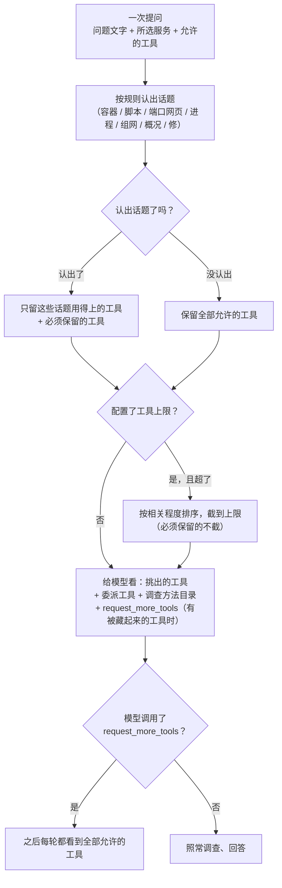

# 按问题挑工具：小模型在工具多时也能选对

> 状态：设计，待实现。动手修的工具见 [`agent-fix.md`](agent-fix.md)；委派见 [`delegation.md`](delegation.md)；
> 总体方向见 [`node-agents.md`](node-agents.md)。

## 一句话

每次提问，Agent 现在会一口气看到十来个工具。DeepSeek 这样的大模型能自己挑对，本机的 Qwen 小模型经常挑错：
问 Docker 容器，它只去查端口，还说"没有 Docker 工具"。这一项让程序**先按问题和所选服务挑出一小组相关工具**
给模型看，模型觉得不够时可以说一声"给我看全部工具"；同时把每个工具"什么时候用"写清楚。
挑工具只会让模型**少看到**几个工具，不会多给任何权限。

## 问题

真机上（本机 Qwen，llama-server，关闭思考模式）反复出现：

| 用户问 | 模型实际做了什么 | 应该做什么 |
|---|---|---|
| "相册容器是不是停了" | 只调 `list_network_listeners`，回答"我没有查看 Docker 的工具" | 调 `list_docker_services`，必要时再读日志 |
| "相册打不开，帮我修一下"（相册是容器） | 查完端口就结束，没有提出修法 | 查容器状态和日志，再用 `propose_repair` 提出重启 |

同样的问题交给 DeepSeek 都能答对。差别在于小模型面对一长串工具时注意力不够：

- 网页对话每次传 9 个工具（`frontend/src/features/chat/api.ts` 的 `allowedToolNames`），再加上程序自动加的
  `delegate_to_node`（配了别的电脑时）和 `read_investigation_skill`（调查方法目录），一共 11 个。
- 工具说明很短，只说"做什么"，不说"什么时候用"。例如 `list_docker_services` 只写"只读列出容器、镜像、端口和状态"，
  没说"问到容器、Docker、compose、镜像时用它"。
- 系统提示里的两份排查剧本写了该用哪个工具，但剧本很长，小模型读到后面就忘了前面。

## 现在已经有什么（以代码为准）

| 现有部件 | 在哪 | 和这一项的关系 |
|---|---|---|
| 每次提问显式给出允许的工具 `tool_names` | `agent/conversation.py` 的 `StartRunInput`；网页、委派（`agent/delegation.py`）、巡检（`patrol/service.py` 的 `PATROL_TOOL_NAMES`）、事件调查各自传入 | **权限上限**。挑工具只在这个集合里挑，永远不超出 |
| 所有提问共用的 Agent | `agent/runtime.py` 的 `LangChainReadOnlyAgent.run`：校验工具、加委派工具、加调查方法工具，交给 LangChain `create_agent` | 挑工具就放在这里，网页提问、委派、巡检一起受益 |
| 只读与修法的边界 | `tools/registry.py` 的 `model_tools` 只向模型暴露 L0 工具；`propose_repair` 只生成待批准修复 | 不变 |
| 所选服务的上下文 | 网页带 `about`（`web/conversation.py` 拼成"关于：{…kind…}"一行加在问题前）；工作台带 `ServiceCheckTarget.application_kind`；委派带"对方指明的相关服务：docker:…" | 挑工具时用来判断"这是容器还是脚本" |
| 本轮必须核对监听的检查 | `runtime.py` 的 `verify_current_check`：工作台续办时要求本轮调 `list_network_listeners` | 有所选服务时，`list_network_listeners` 必须留在可见工具里 |
| 调查方法目录 | `read_investigation_skill`，只列出步骤里的工具本次可用的方法 | 按"可见工具"计算目录，避免小模型看到用不了的方法 |
| 模型配置 | `model/openai_compatible.py` 的 `OpenAICompatibleConfig`（含 `disable_thinking`）和设置页 | 加一个"工具上限"，跟着模型配置走 |
| 请求把关 | `agent/request_gate.py`：主模型前的一次便宜分类，只判断能不能答 | 不复用它来挑工具，原因见下文"为什么不用模型分类" |

## 选法

### 1. 按话题挑

只看用户这次的问题文字、所选服务的类型（容器 / Python 脚本 / 普通程序）和委派时对方指明的服务，
用固定的关键词规则认出话题，中英文都认，不区分大小写。一个问题可以同时属于几个话题，取并集。

| 话题 | 怎么认出来（举例） | 留下的工具 |
|---|---|---|
| 容器 | 容器、Docker、compose、镜像、OrbStack；所选服务是容器；服务身份以 `docker:` 开头 | `list_docker_services`、`read_container_logs`、`list_network_listeners`、`probe_service_reachability` |
| 脚本 | 脚本、Python、`.py`、启动记录；所选服务是 Python 脚本 | `list_network_listeners`、`list_launch_records`、`get_process_summary` |
| 端口和网页 | 端口、网页、网址、监听、访问、连不上、打不开、localhost、http | `list_network_listeners`、`probe_service_reachability` |
| 进程和资源 | 进程、内存、CPU、占用、卡、哪个程序 | `get_process_summary`、`list_network_listeners` |
| 组网 | WireGuard、wg、隧道、组网、peer | `get_wireguard_status`、`get_node_summary` |
| 概况 | 状态怎么样、整体、概况、模型、这台电脑、有哪些服务 | `get_node_summary`、`list_network_listeners`、`list_docker_services` |
| 坏了 / 要修 | 挂了、打不开、用不了、停了、退出、报错、修、重启、拉起、恢复 | `propose_repair`、`list_network_listeners`；同时属于"容器"或"脚本"时，那一组的日志和启动记录也已在内 |

规则写在一张表里（代码中的一个常量），每条规则只有"关键词 → 工具"，不针对某台电脑或某个服务写特例。

### 2. 必须保留的工具

无论话题怎么认，下面这些不会被挑掉：

- 有所选服务（工作台 `target`）时：`list_network_listeners`，因为程序要用它的本轮结果核对连接入口。
- 委派工具 `delegate_to_node`：问题涉及另一台电脑时它是唯一正确的路，而且它本来就由程序单独加，不占上限。
- 规则不认识的工具（例如以后新增、还没写进规则表的工具）：认不出就不藏。

### 3. 认不出话题时

保留全部允许的工具，和现在一样。宁可多给，不可漏给。

### 4. "给我看全部工具"：`request_more_tools`

只要有工具被藏起来，就多给模型一个工具 `request_more_tools`：

- 说明里列出被藏起来的工具名和一句用途，模型能一眼看到"原来还有 Docker 工具"。
- 模型调用它以后，这次提问剩下的每一轮都能看到**全部允许的工具**。它只改变"模型看到哪些"，
  不执行检查、不产生证据、不改变允许的集合。
- 调用它占用一次工具调用次数（和查阅调查方法一样），防止来回折腾。
- 系统提示加一句：需要的工具不在列表里时，先调用 `request_more_tools`，**不要回答"没有这个工具"**。

实现上用 LangChain v1 的 `wrap_model_call` 中间件：图里注册全部允许的工具，中间件在每次调用模型前按当前状态
过滤 `request.tools`。这样模型即使凭记忆调用了被藏起来但允许的工具，也照常执行（仍在允许集合内）；
允许集合之外的工具名照旧被拒绝。

### 5. 工具上限（给小模型）

模型配置加一项 `max_tools`（"一次最多给模型看几个工具"）：

- 留空 = 不设上限，只做第 1～3 步的按话题挑选。**DeepSeek 等大模型保持留空。**
- 本机小模型建议填 5。超过上限时，按"必须保留 → 命中话题越多越靠前 → 固定的基础顺序"排序后截断，
  被截掉的工具照样出现在 `request_more_tools` 的说明里。
- 上限只数诊断工具；委派工具、调查方法目录和 `request_more_tools` 不算在内。
- 取值 3～12。必须保留的工具多于上限时，以必须保留为准。
- 设置页模型配置里加一个数字框"工具上限（本机小模型建议 5，留空不限制）"，和"关闭思考模式"放在一起，
  随模型配置档案一起保存。借用别人模型时，借用方不知道对方是什么模型，不设上限；以后可以考虑由提供方告知（待办）。

### 6. 把"什么时候用"写进工具说明

给每个诊断工具补一句"什么时候用"，在把工具交给模型时接在原说明后面（不改 Windows、macOS 各自的工具定义，
两个平台用同一份）：

| 工具 | 什么时候用 |
|---|---|
| `list_docker_services` | 问到容器、Docker、compose、镜像，或服务是容器时，先用它看容器是否在跑 |
| `read_container_logs` | 容器停了、反复重启或网页没反应时，读最后几十行日志找原因 |
| `list_network_listeners` | 问端口、网页打不开、某个程序有没有在听时用；服务是脚本或普通程序时先用它 |
| `probe_service_reachability` | 程序在听，但要确认这台电脑能不能连上某个地址和端口时用 |
| `get_process_summary` | 问进程、内存、CPU 或"哪个程序"时用 |
| `list_launch_records` | Python 脚本退出了、想知道能不能按原来的方式重新拉起时用 |
| `get_wireguard_status` | 只在问到 WireGuard、隧道、组网时用 |
| `get_node_summary` | 问这台电脑整体状态、模型、有哪些工具时用 |
| `propose_repair` | 已经查明容器停了或脚本退出了、需要修时用；只生成待批准的修复 |

系统提示（`readonly-agent` 升到 v6）在现有剧本前加一段"先选工具"：先看工具说明里的"什么时候用"，
问到容器先用 `list_docker_services`；没有合适的工具时调用 `request_more_tools`，不要说没有。

### 为什么不用模型分类

`request_gate` 已经在主模型前调一次模型做分类，让它顺便挑工具看起来省事，但：

- 小模型挑工具挑不准，正是这次要解决的问题，让它在分类时挑一样会挑错；
- 多一次模型调用就多一份延迟，本机 Qwen 每次要几秒；
- 规则挑选结果可复现、可测试、不花钱。认不出时退回全部工具，再加 `request_more_tools` 兜底，漏选的代价只是多一轮。

如果以后评测显示规则覆盖不够，再考虑在认不出话题时用一次分类，这一项不做。

## 对大模型的影响

- 不设上限时，大模型只在问题明确属于某些话题时少看到几个无关工具；需要时可以 `request_more_tools`。
  按话题留下的工具已经包含每份排查剧本需要的全部工具，正常调查不需要扩展。
- 工具说明和系统提示多了几十个字，输入 token 略增；可见工具变少又会省掉一部分工具定义的 token，大致持平。
- 用下文的评测对 DeepSeek 做前后对比：选对工具的比例不下降、平均轮数不增加超过 0.5 轮，才算没有削弱。
  评测不达标时，可以单独把按话题挑选对大模型关闭（配置留空且话题挑选开关关闭），这个开关只在评测里用，
  不在设置页露出。

## 安全边界

- **只减不增**：模型可见的工具 ⊆ 本次允许的工具 ⊆ 注册表里的 L0 工具（加委派和 `propose_repair`）。
  挑工具的代码只接收允许集合、只返回它的子集；测试断言这一点。
- `request_more_tools` 只把可见范围恢复到允许集合，不能请求集合外的工具。它的说明和返回内容都由程序生成，
  不含工具结果里的文字。
- 关键词只用来**挑可见工具**，不用来判断能不能答、能不能修；能不能答仍由 `policy`/`request_gate` 决定，
  能不能修仍由 `propose_repair` 的资格检查和主人批准决定。
- 工具结果、委派结果里的文字不参与挑选（只看用户问题、所选服务和委派时指明的服务身份），
  防止工具输出里写"请给我看全部工具"之类的注入。
- 链路追踪记录这次挑了哪些工具、认出了哪些话题、有没有扩展，方便事后看清模型为什么没用某个工具。

## 评测

### 固定口径的离线评测（进 CI）

- 数据集 `evaluations/datasets/tool-selection-v1.json`：二十个左右的问题，每条写明问题文字、所选服务类型、
  允许的工具集合（网页默认 9 个 / 巡检 / 委派），以及**期望一定可见的工具**和**期望不可见的工具**。
  覆盖：容器、脚本、端口网页、进程、组网、概况、修复、跨电脑、认不出话题、英文问题、带工具上限和不带上限。
- 评测脚本 `scripts/run_tool_selection_evaluation.py`：用假模型跑真实的 `LangChainReadOnlyAgent`，
  假模型记录每一轮实际看到的工具，按"期望可见全部命中、期望不可见全部未出现、可见数不超过上限"打分；
  另有一条让假模型先调 `request_more_tools`，验证之后能看到全部工具。结果写入
  `evaluations/reports/tool-selection-offline-<日期>.json`，测试里断言全部通过。

### 真实模型前后对比（不进 CI，交给协调会话跑）

- 脚本 `scripts/run_tool_selection_real_evaluation.py`：同一个数据集，工具换成固定返回值的假工具
  （例如 `list_docker_services` 返回"相册容器已退出"），连接真实的 OpenAI 兼容接口，每个问题跑两遍：
  - A（现状）：不挑工具，全部给模型；
  - B（本设计）：按话题挑选，并按参数设工具上限。
- 记录：是否调用了期望的第一个工具、是否调用了期望的全部工具、是否出现"没有某某工具"的说法、
  是否提出了期望的修法、模型轮数、工具调用次数、token。每组可重复 3 轮，输出 JSON 和一页中文摘要。
- 地址、模型名和密钥从命令行参数和环境变量读，不写进仓库；报告里不写真实地址和机器名。
- 达标线：本机 Qwen 选对第一个工具的比例 B 比 A 明显提高（目标九成以上），
  "没有某某工具"的说法降到 0；DeepSeek 的选对比例不下降，平均轮数增加不超过 0.5。

## 真机验收步骤

由协调会话在真机上做，不在实现会话里碰真实机器：

1. 本机 Qwen 作为当前模型，设置页"工具上限"填 5，保存。
2. 地图上点一个 Docker 服务，问"这个容器是不是停了"。期望：过程里先出现 `list_docker_services`，
   回答说清容器状态，不出现"没有 Docker 工具"。
3. 停掉一个测试容器，问"相册打不开，帮我修一下"。期望：查容器、读日志、提出重启修法，电脑头上冒感叹号。
4. 问"这台电脑哪个程序最占内存"。期望：用 `get_process_summary`。
5. 问一个规则认不出的话题（例如"帮我看看有什么问题"）。期望：工具全部可见，和以前一样能答。
6. 切回 DeepSeek（工具上限留空），重复 2～4，期望表现不变。
7. 链路追踪里能看到每次挑了哪些工具。
8. 用上面的真实模型评测脚本分别对 Qwen 和 DeepSeek 跑一遍，报告放进 `evaluations/reports/`。

## 拆成几个 PR

1. 本设计文档（docs PR）。
2. 实现（一个 PR，分支 `feature/tool-selection`）：挑工具模块、`request_more_tools` 中间件、工具说明、
   系统提示 v6、模型配置 `max_tools` 与设置页、离线评测与真实模型评测脚本、测试。

## 明确不做

- 不用模型来挑工具（见上文）。
- 不改变任何工具的权限、不新增能动手的工具。
- 不改 Windows、macOS 的工具定义文件；"什么时候用"统一由 Agent 一侧补充。
- 不根据模型名字自动猜大小模型；上限由主人在设置页填。
