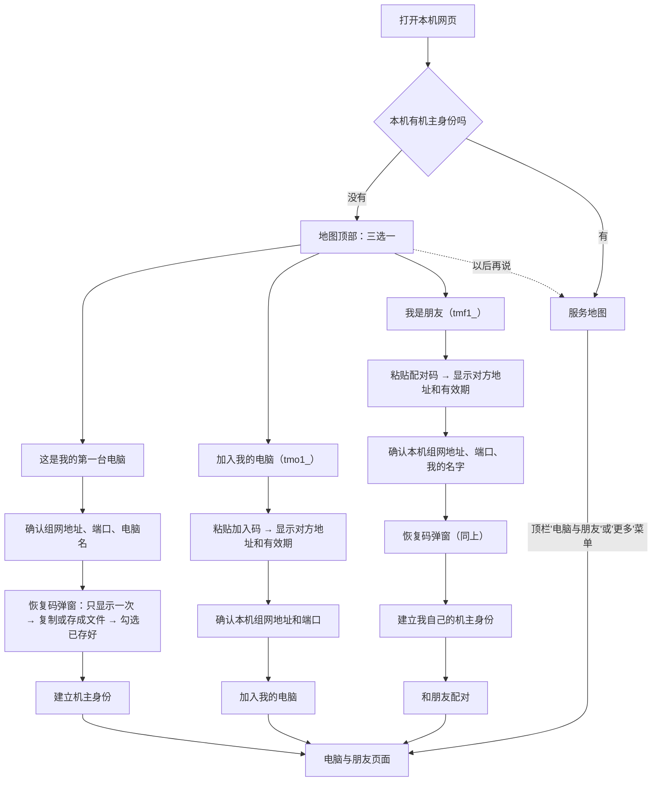
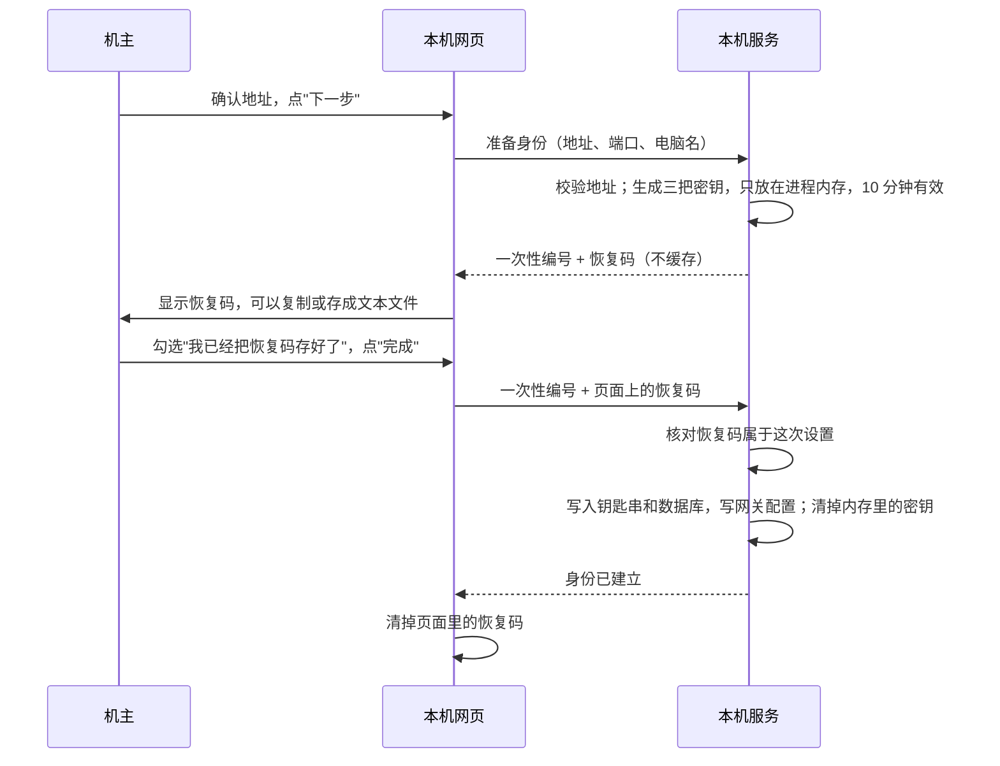

# 网页上邀请与加入：不用终端也能加入我的电脑、和朋友配对

> 状态：已实现（#208、#210），2026-10-29 在这台 Windows 电脑上真机验收通过，记录见文末。验收时发现的三个问题（同一台电脑多个数据目录共用钥匙串条目、朋友地图上机主电脑的在线状态、对方不在线时推名单没有说明）已经修好，现在的行为写在对应章节里。
> 相关设计：机主身份与朋友配对的规则见 [`owner-identity.md`](owner-identity.md)，地图首页见 [`map-workspace.md`](map-workspace.md)。

## 一句话

机主身份和朋友配对现在只能用命令行（`owner init/invite/join/remove/device-permissions`、`friend invite/join/list/remove/rename/permissions`）。这次把它们搬到本机网页上：新电脑第一次打开网页，地图顶部就有三选一："这是我的第一台电脑 / 加入我的电脑 / 我是朋友"，粘贴加入码或配对码、确认本机组网地址，就能完成加入；已经有身份的电脑在网页上生成加入码和配对码、看"我的电脑"和"朋友"、移除和改名。规则一条不变，命令行和网页调用同一套服务。

## 用户影响

| 谁 | 现在 | 做完以后 |
|---|---|---|
| 朋友（不会用终端） | 要打开终端、敲 `owner init`、`friend join tmf1_…` | 打开 `http://127.0.0.1:<端口>/`，点"我是朋友，粘贴配对码"，粘贴、存好恢复码，完成 |
| 机主加第二台电脑 | 两边各敲一条命令 | 第一台电脑网页上点"加一台我的电脑"、复制加入码；新电脑网页上点"加入我的电脑"、粘贴 |
| 机主管理 | `owner status`、`friend list` 看不全，改名、移除要记编号和指纹 | "电脑与朋友"页面里一目了然，点按钮移除、改名、关掉权限 |

不变的东西：恢复码换机主密钥（`owner recover`）、重置身份（`--reset`）、旧式配对迁移（`peers migrate`）、选择秘密存储后端仍然只在命令行做，网页上写清楚怎么做。启动本机网关也仍按现在的方式（命令行 `tunnelminion gateway` 或打包运行时里打开网关组件），网页只提示"加入后需要启动或重启本机网关"。

## 可以直接复用的现有部件

| 部件 | 在哪 | 怎么用 |
|---|---|---|
| 身份初始化 | `trust/service.py` 的 `OwnerIdentityService.init`、`trust/keys.py` 的 `InitializationKeys` | 网页和命令行都先生成密钥、显示恢复码，确认后再调用它落盘 |
| 加入我的电脑 | `trust/join.py` 的 `join_owner` | 原样调用，`host_override`/`port_override` 对应网页上填的组网地址和端口 |
| 加电脑、移除、收紧权限、推送名单 | `trust/devices.py` 的 `OwnDevicesService.invite/remove/restrict/push` | 原样调用 |
| 朋友邀请、加入、改名、权限、移除 | `trust/friends.py` 的 `FriendsService` | 原样调用 |
| 加入码、配对码 | `domain/trust.py` 的 `JoinCode.decode/encode` | 网页粘贴后先解析，给出对方地址、有效期和本机建议地址 |
| 推测本机组网地址 | `agent/join.py` 的 `detect_local_host` | 按对方地址问系统路由，不发包 |
| 对端列表与关系 | `gateway/configuration.py` 的 `GatewayConfigurationService.view` | "我的电脑 / 朋友 / 旧式配对"三种关系已经算好 |
| 旧式配对的代批准开关 | `GatewayConfigurationService.set_proxy_repair_approval` | 对应命令行 `peer-proxy-approval` |
| 本机请求守卫 | `web/request_guard.py` | 新接口挂在同一个应用下，自动只认环回 Host 和同源写请求 |
| 前端弹窗焦点管理 | `frontend/src/shared/useDialogFocusTrap.ts` | 三选一、恢复码、加入码弹窗都用它 |

**需要下沉的逻辑**：`trust/cli.py` 里 `owner init` 的"决定组网地址、显示名、写网关配置"那一段，和 `trust/friend_cli.py` 里 `friend list` 拼朋友电脑列表、`device-permissions`/`friend permissions` 合并权限的那几段，现在写在命令行函数里。挪到新的 `trust/local.py`，命令行只负责问答和打印，网页只负责收发 JSON。`owner recover` 和换密钥、回滚密钥的代码不动。

## 页面流程

### 地图顶部的三选一（没有身份时）

- 本机还没有机主身份时，地图首页顶部显示一块醒目的提示和三个按钮，点哪个就打开对应的弹窗。它不挡住地图，没准备好的人照常看地图。
- 点"以后再说"就收起，直到下次打开网页。页面不往浏览器存储写任何东西（现有验收要求浏览器不留持久数据），所以不记"不再提示"。之后也可以从顶栏"电脑与朋友"进来。
- 预览模式（只读）下不显示。
- 三个按钮在弹窗第一屏各有一句话说明（"电脑与朋友"页面的"开始设置"会先显示这三条说明）：
  - **这是我的第一台电脑**："建立你的机主身份。以后加电脑、邀请朋友都在这台电脑上操作。"
  - **加入我的电脑**："你已经有一台装好 TunnelMinion 的电脑，在那台电脑上点了'加一台我的电脑'，把加入码粘贴到这里。"
  - **我是朋友，粘贴配对码**："朋友发给你一串 `tmf1_` 开头的配对码。会先替你建立自己的身份，然后和朋友配对。"

### 确认本机组网地址和端口

三条路都要这一步，对应命令行的 `--bind-host`、`--bind-port`。

- 大白话说明："组网地址是这台电脑在 WireGuard 或 n2n 里的地址，别的电脑靠它找到这台。一般是 10. 或 192.168. 开头的地址。端口一般不用改，同一台电脑上跑多个 TunnelMinion 时才换一个。"
- **默认值**：
  - 粘贴了加入码或配对码：按对方地址问系统"去那里走哪个本机地址"，作为默认值（和命令行 `join` 一样，不发包）。
  - 第一台电脑：列出本机网卡上所有可用的私有地址供选择（只有一个时直接选中），也可以手动填。
  - 端口默认 8787。
- 本机已经有网关配置（以前做过旧式配对）时，地址和端口以它为准、不显示输入框，只写"已按本机现有网关配置"。建立身份时服务端同样以现有配置为准；加入我的电脑时传了不一致的地址会被拒绝。这和命令行的规则一致。
- 第一台电脑和"我是朋友"还要填"这台电脑叫什么"（默认本机现在的名字）；"我是朋友"另外有一栏"你的名字（朋友那边看到的）"，留空时对方看到"机主 + 指纹前 8 位"。

### 恢复码弹窗

- 恢复码只在这一次响应里出现。响应带 `Cache-Control: no-store`；页面不把它放进地址栏、浏览器存储或日志；"存成文件"在浏览器本地生成文本文件，不经过服务器。点"完成"后页面立刻丢掉它，之后再也取不回来。
- 不要求把恢复码再输一遍：复制、存文件已经足够，重新输入几十个字符只会让人放弃。勾选"已存好"是唯一的确认。关掉弹窗、超过 10 分钟或者再次点"下一步"，内存里的密钥就作废，什么都没写，要重新开始（会生成新的恢复码）。
- 一台电脑同一时刻只保留一份待确认的身份；本机网页进程重启后也作废。
- 系统钥匙串打不开时（最常见的是 TunnelMinion 从 ssh 远程会话里启动），页面提示到那台电脑的桌面上重新启动它；底层原因只写进本机日志，什么都没写入。
- "我是朋友"这条路：恢复码确认、身份建好之后，页面接着用配对码去配对。如果配对这一步失败（配对码过期、对方网关没开），身份照样保留，页面显示原因，并且可以在"电脑与朋友"页面重新粘贴配对码。

### 电脑与朋友页面（`/app/people`）

入口：地图顶栏新增"电脑与朋友"按钮；"更多"菜单和设置页"对端电脑"卡片也链接过去。

| 区块 | 内容 | 能做什么 |
|---|---|---|
| 我是谁 | 机主指纹前 8 位、"这台电脑持有机主密钥：是/否"、本机组网地址和端口；本机已被移出时显示红字说明 | — |
| 加电脑、邀请朋友 | 两个按钮：**加一台我的电脑**、**邀请朋友**（可选填"朋友那边看到的我的名字"） | 弹窗显示加入码或配对码、复制按钮、"24 小时内有效，只能用一次"和具体过期时间；另附一句话教对方怎么用 |
| 收到配对码 | **粘贴朋友的配对码**（已有身份的电脑和朋友配对） | 和三选一里"我是朋友"同一个弹窗，只是跳过建立身份 |
| 我的电脑 | 每台：名字、平台、组网地址、"这台电脑"标记；允许提问、允许借模型、**允许替我批准修复**三个开关 | **移除**（确认框）；三个开关只能关不能再开，关之前确认框写明"关掉后在网页和命令行都不能再打开" |
| 朋友 | 每个朋友：名字、指纹前 8 位、他的电脑列表；编号冲突的电脑标"和其他朋友的电脑编号冲突，暂不认"；允许借我的模型 | **改名**、**移除**（确认框）、打开或关闭"允许借我的模型" |
| 旧式配对 | 用老邀请码配对过、又不在名单上的电脑 | "允许替我批准修复"开关（可开可关，重启 TunnelMinion 后生效，与 `peer-proxy-approval` 一致）；说明"可以改用邀请朋友重新配对" |
| 只在命令行做的事 | 用恢复码换机主密钥、重置身份、迁移旧式配对 | 列出命令和一句话说明，不提供按钮 |

- 只有持有机主密钥的电脑能邀请、移除、改名、改朋友权限。其他电脑上这些按钮灰掉，旁边写"去持有机主密钥的那台电脑上操作"。"我的电脑"的三个开关是本机对那台电脑的限制，任何一台我的电脑都能关。
- 移除、改名、改权限之后，服务同时把新名单推给其他电脑，每台最多等 5 秒，不在线的电脑不会一台接一台地累加等待。等待期间页面显示"正在保存并通知其他电脑；有电脑不在线时要等几秒……"，确认框按钮显示"正在通知其他电脑……"；推完后列出"这次没推到 X，下次接触时会同步"。
- "朋友"一栏的"允许借我的模型"对应 `friend permissions --allow-model-borrowing/--no-model-borrowing`，会写进签名的朋友名单并同步；朋友永远没有"替我批准修复"这个开关。

**地图上对方电脑在不在线。** 配对或加入以后，对方的电脑（朋友眼里的机主电脑也一样）出现在地图上。本机网页每分钟向它要一次服务清单，按请求的结果判断在线状态：

- 连上了就算在线，即使对方按权限不给看服务清单（例如朋友没有委派权限），或者这次答得太慢没拿到清单。
- 连不上（连接被拒、连接超时）才算离线。
- 本机这边没能把请求发出去（缺凭据、签不出通行证）时，显示"尚未确认能否连上"，不当成对方离线。

读本机监听端口和进程的服务观察在自己的小线程池里运行。进程很多的电脑上服务观察可能反复超时，超时后还没跑完的读取只会拖慢下一次观察，不会占住网页进程共用的线程池，所以不影响地图轮询和其他网络请求。

## 接口

全部挂在本机网页应用（只绑 127.0.0.1）下，前缀 `/api/identity`，由新路由 `web/identity.py` 提供；业务调用 `trust/local.py`。写请求和带秘密的请求一律用 POST/PUT/PATCH/DELETE，码和恢复码只放在请求体里，不放地址栏。

| 方法和路径 | 请求体 | 返回 | 对应命令 |
|---|---|---|---|
| `GET /api/identity` | — | 本机身份概况：是否已建立、指纹、是否持有机主密钥、是否被移出、名单版本、本机组网地址和端口（及是否锁定）、可选地址、我的电脑（含本机限制）、朋友（含电脑、冲突）、旧式配对 | `owner status`、`friend list` |
| `POST /api/identity/codes:inspect` | `code` | 种类（加入码/配对码）、对方组网地址和端口、机主指纹、过期时间、本机建议地址和端口 | — |
| `POST /api/identity/setup` | 组网地址、端口、电脑名（本机已有网关配置时地址和端口可省略） | 一次性编号、恢复码、过期时间 | `owner init` 前半段 |
| `POST /api/identity/setup/{编号}:confirm` | 输入的恢复码 | 身份概况 | `owner init` 后半段 |
| `POST /api/identity/owner:join` | 加入码、组网地址、端口 | 身份概况 | `owner join` |
| `POST /api/identity/owner:invite` | — | 加入码、过期时间 | `owner invite` |
| `DELETE /api/identity/devices/{节点}` | — | 没推到的电脑 | `owner remove` |
| `PUT /api/identity/devices/{节点}/permissions` | 三个开关 | 身份概况 | `owner device-permissions` |
| `POST /api/identity/friends:invite` | 我的名字（可选） | 配对码、过期时间 | `friend invite` |
| `POST /api/identity/friends:join` | 配对码、我的名字（可选） | 身份概况 | `friend join` |
| `PATCH /api/identity/friends/{指纹}` | 新名字 | 身份概况 | `friend rename` |
| `PUT /api/identity/friends/{指纹}/permissions` | 允许借模型 | 身份概况 | `friend permissions` |
| `DELETE /api/identity/friends/{指纹}` | — | 没推到的电脑 | `friend remove` |
| `PUT /api/identity/legacy-peers/{节点}/proxy-approval` | 允许或关闭 | 身份概况 | `peer-proxy-approval` |

错误统一返回 `{"detail": {"code": …, "message": …}}`，`message` 是可以直接显示的大白话，沿用服务层现有文案（例如"邀请码无效、已过期或已被使用""连不上邀请方的电脑""只有持有机主密钥的电脑能做这件事"）。已有身份时再建立返回 409；恢复码不一致返回 400 `recovery_code_mismatch`；待确认的身份过期返回 410。

前端用 zod 严格校验每个响应（多出来的字段直接拒绝），和设置页现有做法一致。

## 安全边界

- **只认本机**：新接口和其他 `/api` 一样在 `LocalWebRequestGuardMiddleware` 之后，只接受环回 Host；写请求只接受同源浏览器请求（`Origin` 一致且带 `X-TunnelMinion-Request: same-origin`），跨站页面不能替用户生成加入码或配对。预览模式下全部写请求被拒。
- **秘密不落地**：加入码、配对码、令牌、恢复码不写日志、不写审计明文、不进错误信息、不进浏览器存储和地址栏。名单审计沿用现有 `TrustAudit`（只记谁、对谁、版本、原因）。待确认的身份密钥只在网页进程内存里，10 分钟过期、确认后或作废时立即丢掉。返回恢复码和加入码的响应带 `Cache-Control: no-store`。
- **接口返回不含令牌**：`codes:inspect` 只返回地址、指纹、过期时间，不回显令牌；身份概况不含任何私钥和令牌。
- **规则不变**：是否允许、谁能做什么全由服务层判断（持有机主密钥才能改名单、朋友永远不能代批准、我的电脑权限只能收紧）。网页没有任何绕过服务层的写法，命令行和网页走同一段代码。
- **出站连接**：只在"加入我的电脑""和朋友配对"时连对方网关，地址取自对方给的码，并从本机组网地址发出，和命令行一样。

## 自动测试

**后端（pytest，覆盖率 100%）**

- 三条初次设置路径：第一台电脑、加入我的电脑（对方用测试网关应答）、朋友（先建身份再配对）都能完成；落盘后 `owner status`/`friend list` 和网页概况一致。
- 恢复码：输错不写任何东西、可以再输；过期返回 410；同一时刻只保留一份；确认后编号作废；恢复码不出现在日志、审计、数据库和后续任何响应里。
- 组网地址：本机已有网关配置时以它为准（加入我的电脑时传了不同的值被拒）；没有网关配置时必须给地址；环回、公网地址被拒。
- 码：前缀不对、损坏、过期、种类不对都给出明确错误；`codes:inspect` 不回显令牌。
- 权限：没有机主密钥时邀请、移除、改名被拒；我的电脑的开关只能关；朋友没有代批准开关；旧式配对开关可开可关。
- 本机守卫：非环回 Host、跨站写请求、缺同源请求头、预览模式都被拒。
- 命令行回归：`owner init`、`friend list` 等下沉后输出和以前一致（现有命令行测试继续通过）。

**前端（vitest + typecheck）**

- 地图顶部三选一：没有身份时显示、已有身份时不显示、"以后再说"后这次打开期间不再显示，且不写浏览器存储；三条路走完各自的步骤。
- 恢复码弹窗：点"我已抄好"后恢复码从页面消失；输错显示提示、不关闭；关闭弹窗后再进来是新的流程。
- 电脑与朋友页面：各区块渲染、没有机主密钥时按钮灰掉、移除和关开关先出确认框、没推到的电脑显示出来。
- 响应校验：多出字段或缺字段时页面拒绝显示。

**Playwright（真实本机应用，临时数据目录）**

- 第一台电脑：从地图顶部的三选一走完恢复码确认，进入"电脑与朋友"页面，生成加入码并看到复制按钮和有效期；页面无障碍检查无严重问题。
- 配对码粘贴后先显示对方地址，不直接连接；浏览器存储和地址栏里都没有恢复码。

## 真机验收步骤

用这台 Windows 电脑（机主，已有身份）加一个全新的数据目录扮演"朋友"。下面的命令都在仓库目录里运行；`<PC 数据目录>` 是这台电脑平时用的数据目录，`<PC 组网地址>` 是它的 WireGuard 地址。

1. **准备**：更新到包含本功能的 `main`，运行 `uv sync` 和 `uv run python scripts/prepare_frontend_dist.py`。源码运行时网页读的是 `build/frontend-dist`，只运行 `npm run build` 不会更新它。这台电脑照常运行网关和网页。
   在同一台电脑上用新的数据目录扮演朋友不需要额外准备：每个数据目录在系统钥匙串里有自己的一组条目（服务名带数据目录的节点编号），不会和这台电脑自己的身份冲突。
2. **朋友从网页加入**
   - 这台电脑的网页：打开"电脑与朋友"，点"邀请朋友"，复制 `tmf1_` 配对码。
   - 朋友：`uv run tunnelminion --data-dir .data/f --port 8767`，浏览器打开 `http://127.0.0.1:8767/`。地图顶部应显示三选一。点"我是朋友，粘贴配对码"，粘贴；页面显示对方地址和建议的本机地址，端口改成 8789；抄恢复码、完整输入一遍。
   - 检查：朋友页面显示"已和朋友配对"，"朋友"一栏有这台电脑的机主；这台电脑的"朋友"一栏出现新朋友。`uv run tunnelminion friend list --data-dir .data/f` 结果一致。
3. **朋友能用**：朋友启动网关 `uv run tunnelminion gateway --data-dir .data/f`，在朋友的地图上看到这台电脑，提一个问题能拿到结论。
4. **管理**：这台电脑网页上给朋友改名，朋友那边无需操作；关掉再打开"允许借我的模型"；最后移除朋友，朋友的地图上这台电脑消失（下次同步后）。
5. **加入我的电脑（可选，有第二台电脑时）**：这台电脑点"加一台我的电脑"，另一台电脑的网页选"加入我的电脑"粘贴加入码，确认组网地址；两边"我的电脑"都列出 2 台。
6. **秘密不落地**：在 `.data/f` 和网页进程的输出里搜恢复码和配对码，应搜不到。

验收记录只写示例地址和节点编号缩写，不写真实 IP、机器名、令牌和恢复码。验收结束后停掉朋友的网页和网关，删掉 `.data/f`。

## 真机验收结果（2026-10-29）

基于 `main` 的 `d8dfe81`。和上面的步骤有一处不同：这台电脑平时的数据目录还没有机主身份，所以"机主"也用一个全新的数据目录，在网页上从"这是我的第一台电脑"开始。机主和朋友都在这台 Windows 电脑上，各用单独的数据目录、网页端口和网关端口，密钥都存在各自的数据目录里。恢复码确认这一步用浏览器自动化脚本完成：脚本从页面读出恢复码再填回去，不打印、不保存。

1. **机主从网页建立身份**：地图顶部出现三选一。选"这是我的第一台电脑"后，组网地址默认就是本机的 WireGuard 地址，端口和电脑名可以改。恢复码弹窗只显示一次；点"我已抄好"后页面上找不到它；故意输错时提示"不一致"，弹窗不关；输对后身份建立。
2. **朋友从网页加入**：机主在"电脑与朋友"页面点"邀请朋友"，得到 `tmf1_` 配对码，并写明 24 小时内有效、只能用一次和具体截止时间。朋友选"我是朋友，粘贴配对码"，粘贴后先看到对方地址和机主指纹前 8 位，填端口和名字，确认恢复码，页面提示"已经和朋友配好对了"，并提醒要启动或重启本机网关。机主页面的"朋友"一栏出现了这位朋友。
3. **朋友能用**：朋友的地图上，机主的电脑显示为"机主 <指纹前 8 位> · <电脑名>"。朋友提问并委派给机主的电脑，拿到了结论。
4. **管理**：机主在网页上给朋友改名、打开"允许借我的模型"，都生效；移除朋友后，名单推到了朋友那边（没有"这次没推到"的提示）。再从朋友那边委派，机主的电脑不再给结果。
5. **加入我的电脑**：这次没有第二台电脑，没有做；由自动测试和 Playwright 用例覆盖。
6. **秘密不落地**：在两个数据目录和全部进程输出里搜配对码、加入码和恢复码的格式，都搜不到；页面上、浏览器存储和地址栏里也没有恢复码。

## 不做的事

- 网页上不提供恢复码换机主密钥、重置身份、迁移旧式配对、选择秘密存储后端。
- 网页上不启动或重启网关进程。
- 不新增远程改设置的接口；这些操作都只在本机网页上做。
