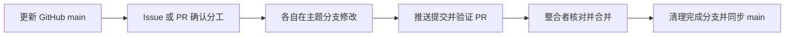
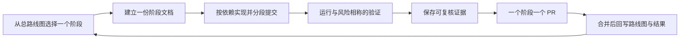

# TunnelMinion 项目推进方式

本目录是当前项目推进入口，说明整个项目走到哪里、当前阶段怎样算完成，以及跨电脑协作怎样接入。

## 文档分工

| 内容 | 位置 | 何时更新 |
|---|---|---|
| 产品总流程、当前阶段、暂停项 | [`roadmap.md`](roadmap.md) | 阶段开始和结束 |
| 单阶段目标、范围、验收与结果 | `stages/YYYY-MM-DD-<topic>.md` | 阶段内持续更新 |
| 系统边界和长期结构 | [`../architecture.md`](../architecture.md) | 架构发生变化 |
| 不轻易反复的技术决策 | [`../adr`](../adr) | 决策形成或被替代 |
| 可复核的运行和评测结果 | [`../../evaluations/reports`](../../evaluations/reports) | 产生新证据 |
| 用户安装和使用方法 | [`../../README.md`](../../README.md) | 用户行为变化 |

`openspec/` 保留为历史记录。已经归档的 change、历史 spec 和路线图不得因停用 OpenSpec 而删除；
从现在开始不再创建或维护新的 OpenSpec change。

## 跨电脑通过 GitHub 协作

两台电脑分别保存代码，通过同一个 GitHub 仓库同步任务和成果。双方共用已合并的 `main`，各自使用主题
分支；本地旧目录与聊天记录中的状态不自动成为另一方的工作起点。



| 要知道什么 | 去哪里看或写 |
|---|---|
| 项目目标、已完成能力与下一步 | 本目录的 [`roadmap.md`](roadmap.md) |
| 当前是谁在做、允许改哪些文件、遇到什么问题 | 对应 GitHub Issue 或主题 PR |
| 具体代码、测试证据与待审修改 | 对应 PR 的最新提交和检查结果 |
| 双方已经交付的代码 | GitHub `main` |

首次接入在独立目录中获取主线，不复用来历不明的旧功能分支：

```shell
git clone --single-branch --branch main https://github.com/Sugarfarmeriod/TunnelMinion.git
cd TunnelMinion
git rev-parse HEAD
```

先阅读仓库根目录的 `AGENTS.md`、`README.md` 和本目录的总路线图；具体任务涉及架构时再读
[`../architecture.md`](../architecture.md)。两台电脑分别使用已获授权的 GitHub 登录，凭据不放进仓库。

每个独立任务在一个 Issue 或已有主题 PR 中记录以下内容；已有记录完整时直接复用，不另建重复任务卡：

- 执行方：能区分双方的电脑或会话标识。
- 基线：开始工作时的 `origin/main` 提交。
- 范围：目标、允许修改的文件和禁止触碰的服务。
- 验收：怎样证明任务完成，需要运行哪些检查。
- 整合者与状态：谁负责公共文件和合并，当前进行中、待评审或已完成。

动手前查看打开的 Issue 和 PR，确认文件范围不重叠。同一文件只由一个执行方写入；公共配置、总路线图
和阶段文档由明确的整合者维护。初次接入只读熟悉项目时可直接使用接入记录，收到具体任务后再确定写入范围。

在干净的工作区中更新基线，再创建符合 `AGENTS.md` 命名约定的主题分支：

```shell
git fetch --no-tags origin
git switch --no-track -c feature/task-topic origin/main
```

示例分支名按实际工作替换。保留已有未提交修改，不用强制重置处理同步。阶段提交及时推送到主题分支，
在同一个 PR 中写清结果和验证证据；整合者核对实际代码及最新提交所需检查后再合并。

合并后清理已完成的远端主题分支，其他电脑重新获取 `main` 后再开始新主题。旧 PR 若已失效，先说明去向
再关闭；尚未确认合入的旧内容保留可恢复的引用，并在 GitHub 说明状态。协作本身不授权真实模型调用、
部署、现有服务或网络改动，这些操作仍遵守各任务已经确认的范围。

## 推进循环



每个阶段只维护一份文档，使用 [`stages/_template.md`](stages/_template.md)。小修复如果不改变
产品路线，只需 Issue/PR 描述和测试证据，不新建阶段文档。

## 状态定义

| 状态 | 含义 |
|---|---|
| `已完成` | 已合并，验收证据可访问 |
| `进行中` | 当前唯一主写阶段 |
| `下一步` | 边界和验收已明确，等待启动 |
| `暂停` | 成果保留，暂时不继续投入 |
| `条件触发` | 只有触发条件成立后才规划 |

一个阶段完成时必须同时满足：用户可见结果已实现、定向验证通过、需要的全量门禁通过、证据已保存、
路线图已回写。独立审计仅用于安全、高风险写操作、跨分支冲突或用户明确要求的场景，不作为每个阶段的
固定仪式。
