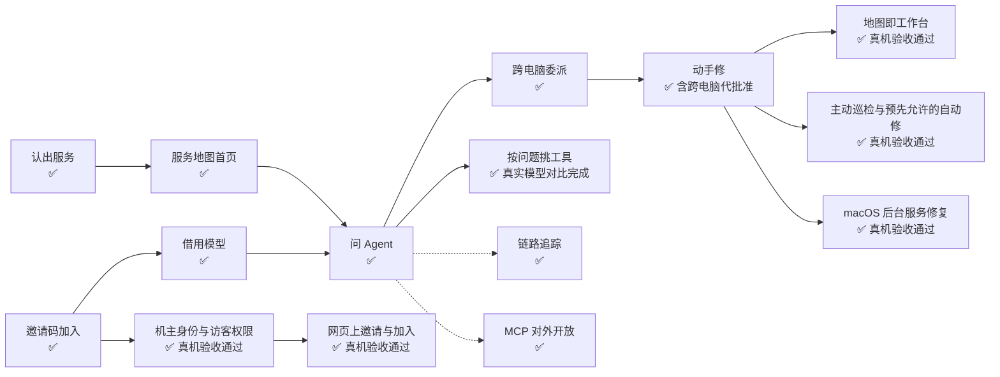

# TunnelMinion 产品路线图

## 产品主线

我和朋友的服务散在好几台电脑上。每台电脑跑一个 TunnelMinion Agent，它负责三件事：

- 认出本机有哪些"自己的服务"；
- 服务打不开时查明原因，必要时把问题交给另一台电脑的 Agent 去查；
- 经主人批准后动手修好，并自己确认修好了。

朋友的电脑不用配置模型，也不用花钱，粘贴一个邀请码就能加入。

组网（WireGuard、n2n）假定已经通了；TunnelMinion 不负责组网，也不排查网络故障。

## 当前状态

### 已完成

| 能力 | 用户能做什么 | 出处 |
|---|---|---|
| 服务识别与筛选 | 按进程来源（终端、容器、桌面应用、系统）区分"我的服务"和后台程序，不针对某台电脑写特例 | #154；设计 [`node-agents.md`](../design/node-agents.md) |
| 网页标题识别 | 用网页标题给服务起名，例如 "Penpot" | #155 |
| "是我的服务 / 隐藏"标记 | 点一下就能纠正分类，标记按程序身份长期保存 | #156、#159 |
| 像素拓扑首页 | 一眼看到几台电脑是否在线、各有哪些服务 | #158 |
| 委派 | A 电脑把问题交给 B 电脑的 Agent，B 用本机工具查完把结论带回 | #160；设计 [`delegation.md`](../design/delegation.md) |
| 模型借用 | 不配 key，借用另一台电脑的模型；有每日额度，提供方只记账、不存内容 | #161；设计 [`model-borrowing.md`](../design/model-borrowing.md) |
| 邀请码 | `invite` / `join` 两条命令完成配对 | #163 |
| 回答标题显示真实结论 | 模型的推断直接显示出来，并标明"尚未逐条核对" | #165 |
| 动手修：修复核心 | 重启 Docker 容器、重新拉起退出的 Python 脚本；本机批准后才执行，修完自己验证 | #166；设计 [`agent-fix.md`](../design/agent-fix.md) |
| 动手修：Agent 接入 | Agent 能读容器日志、看启动记录，查明原因后提出一个待批准的修法；委派时对方也能提出修法 | #170 |
| MCP | 外部 Agent（如 Claude Code）可以调用本机只读诊断工具 | #167；[`mcp.md`](../design/mcp.md) |
| 链路追踪 | 一次提问的全过程（跨两台电脑）串成同一条 OpenTelemetry 链路 | #168；[`tracing.md`](../design/tracing.md) |
| 地图即工作台 | 只留服务地图一个主页面：点"问问"对话从右侧滑出；看到配对的电脑和它们的服务；委派时连线上有数据包、对方显示"正在查"；本机和别的电脑提出的修复都在电脑头上冒感叹号，本机修复点批准就能修好 | #176、#178、#175、#180、#184、#191；设计 [`map-workspace.md`](../design/map-workspace.md) |
| 自动调查限频 | 服务出现或消失照常记录，只对"显示"和"是我的服务"自动调查，同一服务 1 小时最多 1 次；观察循环单轮出错不再停摆 | #186 |
| 修复说法属实 | 回答声称提了修复但本次没有生成时，自动补一句纠正；批准方式统一为点地图上的感叹号，命令行只作后备 | #187 |
| 关闭思考模式 | 模型设置可关掉思考模式，本机 Qwen 同一问题从约 30 秒降到约 1 秒 | #188 |
| README 按当前产品重写 | 旧方向的使用文档已清理 | #192 |
| 动手修：跨电脑代批准 | 服务所在电脑的主人可以为信任的电脑打开"允许替我批准修复"（默认关闭），之后在那台电脑的地图上点感叹号就能批准；动手的仍是服务所在电脑，动手前照样再核对 | #193；设计 [`agent-fix.md`](../design/agent-fix.md) |
| 机主身份与访客权限 | 同一个机主的电脑由机主密钥签名，自动互相信任，加新电脑只要一个加入码，不用两两配对；朋友按人配对一次，只能提问、看结论，永远不能替我批准修复；电脑被移除后，其他电脑一同步就拒绝它；主力电脑丢了，用恢复码换一把机主密钥，其他电脑和朋友自动接受。2026-10-28 用这台电脑和 Mac mini 真机验收通过；验收时发现两台电脑时钟差约 11 秒导致通行证被拒，已把容许的误差放宽到 2 分钟 | #197、#199、#201、#202、#204、#205；设计 [`owner-identity.md`](../design/owner-identity.md)，验收记录在文末 |
| 加固：回答长度上限与提问前把关 | 模型单次回答默认最多 2048 个 token，被截断时直接报错、不把半截回答当结论（借用模型时被截断也照样记账）；提问前用一道支持任意语言的轻量判断，礼貌拒绝要秘密、要写操作、和服务无关的请求。用本机 Qwen 评测 31 条：误拦 0 条，漏拦 1 条（模型冷启动超时，按规则放行）；每次提问大约多花 380 个 token、0.66 秒 | #196 |
| 机主身份验收问题与加固 | 对方不认这台电脑时，地图上如实显示"对方不认这台电脑"；同步名单时审计写明新增、移除了哪台；朋友的地图不再把自己列成对端；朋友那边看到的是机主的名字而不是电脑名。换机主密钥中途断电或进程被杀，下次读取身份时用备份自动还原旧密钥；回滚时每把密钥单独处理；朋友之间撞号可以用 `friend resolve-conflict` 手动处理。跨电脑的响应统一忽略不认识的字段，对方升级后加字段，旧版本照样能读 | #207、#209 |
| 网页上邀请与加入 | 新电脑第一次打开网页，从"这是我的第一台电脑 / 加入我的电脑 / 我是朋友"三选一，粘贴码、确认组网地址、确认恢复码就能完成，不用终端；"电脑与朋友"页面里生成加入码和配对码、看我的电脑和朋友、改名、移除、开关权限。2026-10-29 真机验收通过 | #208、#210；设计 [`web-onboarding.md`](../design/web-onboarding.md)，验收记录在文末 |
| 网页加入验收问题 | 每个数据目录各用一组钥匙串条目，同一台电脑上多个数据目录不再互相挡住，老用户的密钥按指纹核对后自动迁过去；服务观察改用自己的线程，进程很多的电脑上也不再拖住地图轮询，朋友能如实看到机主电脑在不在线；推名单时同时通知所有电脑，页面显示"正在通知其他电脑" | #213 |
| 主动巡检与预先允许的自动修 | 每台电脑盯着地图上直接显示的服务，连续 3 轮异常（约 1 分钟）确认挂了：地图标红、开一条巡检对话、Agent 调查一次并提出修法。主人可以按服务打开"挂了可以自动修"（默认关），之后挂了就自动修好、自己验证，批准人记为巡检，并写明主人哪天允许的；自动修失败立刻暂停。别的电脑上的服务挂了，在这台电脑地图上也标红并写明"对方会自己修"。巡检本身不调模型，调查同一服务 1 小时最多 1 次、每天最多 12 次。2026-10-29 两台电脑真机验收通过 | #212、#214；设计 [`proactive-patrol.md`](../design/proactive-patrol.md)，验收记录在文末 |
| 第三种修法：macOS 后台服务 | Mac 上主人自己装进 `~/Library/LaunchAgents` 的后台服务退出后，地图显示"已停止"、巡检会提醒；Agent 提出"重新启动后台服务"，批准后用固定的一条 `launchctl kickstart` 拉起并自己验证，也可以按"挂了可以自动修"由巡检代批准。系统、组网、Docker、应用自带的后台服务不碰，主人有意卸载的不替你重新加载，配置文件不改。2026-10-29 在 Mac mini 上真机验收通过 | #218、#220、#221；设计 [`launchagent-repair.md`](../design/launchagent-repair.md)，验收记录在文末 |
| 按问题挑工具 | 每次提问只把和问题相关的几样工具交给模型，每个工具写清"什么时候用"；模型觉得不够时可以要回全部工具，权限不会变多。设置页可以给本机小模型设工具上限。真实模型对比：DeepSeek 选对率不变、token 少约 10%；本机 Qwen 两组都 63/63 先调对工具，挑工具后 token 少约 6%，"说没有工具"仍有 1/63 次 | #217、#219；设计 [`tool-selection.md`](../design/tool-selection.md)，对比结果在文末 |
| 更多修法：重新运行和结束卡住的程序 | 主人从终端跑起来的普通程序（Node、Go 写的小服务、转发工具等）退出后，Agent 能提出"按上次的启动方式重新运行"；程序还在但卡住不响应，巡检连续 3 轮确认后能"结束再运行"，结束的一定是记录里那个进程；本来就不回应的服务不会被判卡住。主人自己装的 Windows 服务可以对单个服务授权后启停；compose 组按依赖顺序启动；修不了时给出不含密钥、可复制的步骤。2026-10-30 Windows 和 macOS 用测试程序部分真机验收通过，Windows 服务授权、管理员程序、TunnelMinion 重启后程序还在、macOS 后台服务卡住这几项还没验收 | #233、#237；设计 [`more-repair-kinds.md`](../design/more-repair-kinds.md)，验收记录在文末 |

在这之前完成的基础还在继续使用：确定性观察、Incident、跨节点只读调查、受控操作框架，以及固定口径的 A/B 评测。证据见下文。

### 进行中

目前没有进行中的阶段。

### 下一步

路线图上规划的能力已经全部完成。下面是已知的不足：

- 本机 Qwen 在容器修复和巡检场景里，有时查完容器状态就停了，不接着读日志或提出修法（对比评测里每组约 7～8 次 / 63 次）。
- macOS 上用系统自带 Python 跑的脚本被重新运行后从地图上消失，再次卡住认不出来。
- 更多修法里还有几项没做真机验收：Windows 服务授权和撤回、以管理员身份运行的程序、TunnelMinion 重启后重新运行的
  程序还在、macOS 后台服务卡住时结束再拉起。
- Mac 运行包没有固定签名，每次换版本钥匙串都会按条目弹几次授权框；也还没有一键更新。

## 暂停与非目标

- 不做组网，也不排查 WireGuard、防火墙、路由和 DNS 的故障。
- 不修改系统自带服务、防火墙和系统设置；主人自己装的 Windows 服务，只在主人标成"是我的服务"、并对这一个服务打开授权后才启停。不提供"执行任意命令"这类修法。
- 不做游戏联机方向。
- 不为凑关键词增加多 Agent、A2A、RAG。MCP 和链路追踪之所以做，是因为它们有实际用途：外部 Agent 要调用诊断工具，跨电脑的委派也需要能被看清。

## 证据

| 内容 | 位置 |
|---|---|
| 固定口径 A/B 评测（DeepSeek，15 个场景，A/B 各跑 3 轮）：任务完成 40/45 → 44/45，远端 3/6 → 6/6，安全违规 0 | [`evaluations/reports/incident-ab-deepseek-2026-09-30`](../../evaluations/reports/incident-ab-deepseek-2026-09-30/summary.md) |
| 真实双机手动诊断与恢复 | [`stages/2026-10-03-real-recovery.md`](stages/2026-10-03-real-recovery.md) |
| 委派、模型借用、邀请码、机主身份、网页加入、主动巡检、macOS 后台服务修复的真机验收 | 各设计文档末尾的"真机验收"一节 |
| 按问题挑工具的真实模型对比（本机 Qwen 和 DeepSeek，A/B 各 63 次） | [`tool-selection-qwen-2026-10-29`](../../evaluations/reports/tool-selection-qwen-2026-10-29/summary.md)、[`tool-selection-deepseek-2026-10-29`](../../evaluations/reports/tool-selection-deepseek-2026-10-29/summary.md) |
| MCP 外部客户端实测、跨电脑链路（同一条链路 18 步） | [`mcp.md`](../design/mcp.md)、[`tracing.md`](../design/tracing.md) |

架构与安全边界见 [`../architecture.md`](../architecture.md) 和 [`../adr`](../adr)。

`stages/` 下的阶段文档和 `openspec/` 都是历史记录，只读保留。新的能力用 `docs/design/` 下的设计文档推进；每合入一项，就回写本页的"当前状态"。
