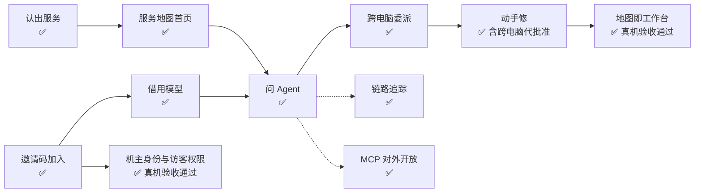

# TunnelMinion 产品路线图

## 产品主线

我和朋友的服务散在好几台电脑上。每台电脑跑一个 TunnelMinion Agent，它负责三件事：

- 认出本机有哪些"自己的服务"；
- 服务打不开时查明原因，必要时把问题交给另一台电脑的 Agent 去查；
- 经主人批准后动手修好，并自己确认修好了。

朋友的电脑不用配置模型，也不用花钱，粘贴一个邀请码就能加入。

组网（WireGuard、n2n）假定已经通了；TunnelMinion 不负责组网，也不排查网络故障。

## 当前状态

### 已完成

| 能力 | 用户能做什么 | 出处 |
|---|---|---|
| 服务识别与筛选 | 按进程来源（终端、容器、桌面应用、系统）区分"我的服务"和后台程序，不针对某台电脑写特例 | #154；设计 [`node-agents.md`](../design/node-agents.md) |
| 网页标题识别 | 用网页标题给服务起名，例如 "Penpot" | #155 |
| "是我的服务 / 隐藏"标记 | 点一下就能纠正分类，标记按程序身份长期保存 | #156、#159 |
| 像素拓扑首页 | 一眼看到几台电脑是否在线、各有哪些服务 | #158 |
| 委派 | A 电脑把问题交给 B 电脑的 Agent，B 用本机工具查完把结论带回 | #160；设计 [`delegation.md`](../design/delegation.md) |
| 模型借用 | 不配 key，借用另一台电脑的模型；有每日额度，提供方只记账、不存内容 | #161；设计 [`model-borrowing.md`](../design/model-borrowing.md) |
| 邀请码 | `invite` / `join` 两条命令完成配对 | #163 |
| 回答标题显示真实结论 | 模型的推断直接显示出来，并标明"尚未逐条核对" | #165 |
| 动手修：修复核心 | 重启 Docker 容器、重新拉起退出的 Python 脚本；本机批准后才执行，修完自己验证 | #166；设计 [`agent-fix.md`](../design/agent-fix.md) |
| 动手修：Agent 接入 | Agent 能读容器日志、看启动记录，查明原因后提出一个待批准的修法；委派时对方也能提出修法 | #170 |
| MCP | 外部 Agent（如 Claude Code）可以调用本机只读诊断工具 | #167；[`mcp.md`](../design/mcp.md) |
| 链路追踪 | 一次提问的全过程（跨两台电脑）串成同一条 OpenTelemetry 链路 | #168；[`tracing.md`](../design/tracing.md) |
| 地图即工作台 | 只留服务地图一个主页面：点"问问"对话从右侧滑出；看到配对的电脑和它们的服务；委派时连线上有数据包、对方显示"正在查"；本机和别的电脑提出的修复都在电脑头上冒感叹号，本机修复点批准就能修好 | #176、#178、#175、#180、#184、#191；设计 [`map-workspace.md`](../design/map-workspace.md) |
| 自动调查限频 | 服务出现或消失照常记录，只对"显示"和"是我的服务"自动调查，同一服务 1 小时最多 1 次；观察循环单轮出错不再停摆 | #186 |
| 修复说法属实 | 回答声称提了修复但本次没有生成时，自动补一句纠正；批准方式统一为点地图上的感叹号，命令行只作后备 | #187 |
| 关闭思考模式 | 模型设置可关掉思考模式，本机 Qwen 同一问题从约 30 秒降到约 1 秒 | #188 |
| README 按当前产品重写 | 旧方向的使用文档已清理 | #192 |
| 动手修：跨电脑代批准 | 服务所在电脑的主人可以为信任的电脑打开"允许替我批准修复"（默认关闭），之后在那台电脑的地图上点感叹号就能批准；动手的仍是服务所在电脑，动手前照样再核对 | #193；设计 [`agent-fix.md`](../design/agent-fix.md) |
| 机主身份与访客权限 | 同一个机主的电脑由机主密钥签名，自动互相信任，加新电脑只要一个加入码，不用两两配对；朋友按人配对一次，只能提问、看结论，永远不能替我批准修复；电脑被移除后，其他电脑一同步就拒绝它；主力电脑丢了，用恢复码换一把机主密钥，其他电脑和朋友自动接受。2026-10-28 用这台电脑和 Mac mini 真机验收通过；验收时发现两台电脑时钟差约 11 秒导致通行证被拒，已把容许的误差放宽到 2 分钟 | #197、#199、#201、#202、#204、#205；设计 [`owner-identity.md`](../design/owner-identity.md)，验收记录在文末 |
| 加固：回答长度上限与提问前把关 | 模型单次回答默认最多 2048 个 token，被截断时直接报错、不把半截回答当结论（借用模型时被截断也照样记账）；提问前用一道支持任意语言的轻量判断，礼貌拒绝要秘密、要写操作、和服务无关的请求。用本机 Qwen 评测 31 条：误拦 0 条，漏拦 1 条（模型冷启动超时，按规则放行）；每次提问大约多花 380 个 token、0.66 秒 | #196 |

在这之前完成的基础还在继续使用：确定性观察、Incident、跨节点只读调查、受控操作框架，以及固定口径的 A/B 评测。证据见下文。

### 进行中

目前没有进行中的阶段。

### 下一步

1. 先修机主身份验收时发现的几处显示问题（见下面"以后再说"里的第一条），这几处都是小修复，不改变产品路线。
2. 再从"以后再说"里挑下一个阶段。

### 以后再说

- 机主身份真机验收发现的显示问题：
  - 对方认证失败（401）时，对端列表里的"可达"仍然显示为是。
  - 移除一台电脑后，其他电脑的审计只记了"同步名单"，没有写出移除了哪台。
  - 朋友的地图把朋友自己这台电脑也列成了"我的电脑"。
  - 朋友那边显示我的名字时用的是电脑名，应该改用机主的显示名。
- 本机的 Qwen 小模型在可用工具很多时，容易不去调用 Docker 工具；可以按问题缩小给模型的工具范围。
- 网页上点按钮完成邀请和加入（目前用命令行）。
- 主动巡检：服务挂了先提醒，或者在预先允许的范围内自动修。
- macOS 用户级后台服务（LaunchAgent）的修复。
- 机主身份的几处加固：
  - 换机主密钥时，钥匙串已经写好、数据库事务还没提交的那一刻，如果断电或进程被杀，旧机主密钥会丢。可以先给旧密钥留一份带时间戳的备份，事务提交后再删；启动时发现备份、并且数据库里的指纹对得上，就自动还原。
  - 回滚密钥时，只要一步出错就会停下，后面的密钥不再写回。可以改成每一步单独处理、全部做完后统一报错。
  - 朋友之间撞号时，目前只能等对方改名单；以后加一条手动处理的命令，并在审计里写明和谁冲突。
- 跨电脑接口的向后兼容：Gateway 的服务清单等老接口仍用严格模式解析，往里加字段旧版本就读不了，目前这类改动需要两台电脑一起升级。代批准的新接口已经改为忽略不认识的字段；老接口以后按同样方式放宽，或者按协议版本协商。

## 暂停与非目标

- 不做组网，也不排查 WireGuard、防火墙、路由和 DNS 的故障。
- 不修改系统服务、防火墙和系统设置；不提供"执行任意命令"这类修法。
- 不做游戏联机方向。
- 不为凑关键词增加多 Agent、A2A、RAG。MCP 和链路追踪之所以做，是因为它们有实际用途：外部 Agent 要调用诊断工具，跨电脑的委派也需要能被看清。

## 证据

| 内容 | 位置 |
|---|---|
| 固定口径 A/B 评测（DeepSeek，15 个场景，A/B 各跑 3 轮）：任务完成 40/45 → 44/45，远端 3/6 → 6/6，安全违规 0 | [`evaluations/reports/incident-ab-deepseek-2026-09-30`](../../evaluations/reports/incident-ab-deepseek-2026-09-30/summary.md) |
| 真实双机手动诊断与恢复 | [`stages/2026-10-03-real-recovery.md`](stages/2026-10-03-real-recovery.md) |
| 委派、模型借用、邀请码、机主身份的真机验收 | 各设计文档末尾的"真机验收"一节 |
| MCP 外部客户端实测、跨电脑链路（同一条链路 18 步） | [`mcp.md`](../design/mcp.md)、[`tracing.md`](../design/tracing.md) |

架构与安全边界见 [`../architecture.md`](../architecture.md) 和 [`../adr`](../adr)。

`stages/` 下的阶段文档和 `openspec/` 都是历史记录，只读保留。新的能力用 `docs/design/` 下的设计文档推进；每合入一项，就回写本页的"当前状态"。
