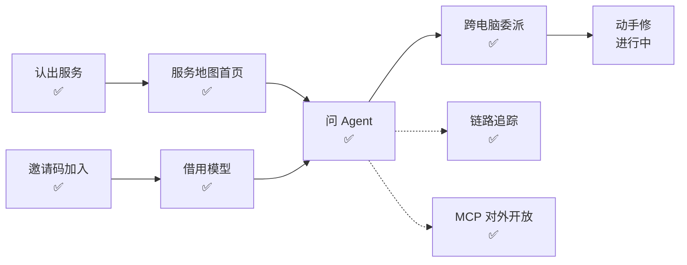

# TunnelMinion 产品路线图

## 产品主线

我和朋友的服务散在好几台电脑上。每台电脑跑一个 TunnelMinion Agent，它负责三件事：

- 认出本机有哪些"自己的服务"；
- 服务打不开时查明原因，必要时把问题交给另一台电脑的 Agent 去查；
- 经主人批准后动手修好，并自己确认修好了。

朋友的电脑不用配置模型，也不用花钱，粘贴一个邀请码就能加入。

组网（WireGuard、n2n）假定已经通了；TunnelMinion 不负责组网，也不排查网络故障。

## 当前状态

### 已完成

| 能力 | 用户能做什么 | 出处 |
|---|---|---|
| 服务识别与筛选 | 按进程来源（终端、容器、桌面应用、系统）区分"我的服务"和后台程序，不针对某台电脑写特例 | #154；设计 [`node-agents.md`](../design/node-agents.md) |
| 网页标题识别 | 用网页标题给服务起名，例如 "Penpot" | #155 |
| "是我的服务 / 隐藏"标记 | 点一下就能纠正分类，标记按程序身份长期保存 | #156、#159 |
| 像素拓扑首页 | 一眼看到几台电脑是否在线、各有哪些服务 | #158 |
| 委派 | A 电脑把问题交给 B 电脑的 Agent，B 用本机工具查完把结论带回 | #160；设计 [`delegation.md`](../design/delegation.md) |
| 模型借用 | 不配 key，借用另一台电脑的模型；有每日额度，提供方只记账、不存内容 | #161；设计 [`model-borrowing.md`](../design/model-borrowing.md) |
| 邀请码 | `invite` / `join` 两条命令完成配对 | #163 |
| 回答标题显示真实结论 | 模型的推断直接显示出来，并标明"尚未逐条核对" | #165 |
| 动手修：修复核心 | 重启 Docker 容器、重新拉起退出的 Python 脚本；本机批准后才执行，修完自己验证 | #166；设计 [`agent-fix.md`](../design/agent-fix.md) |
| MCP | 外部 Agent（如 Claude Code）可以调用本机只读诊断工具 | #167；[`mcp.md`](../design/mcp.md) |
| 链路追踪 | 一次提问的全过程（跨两台电脑）串成同一条 OpenTelemetry 链路 | #168；[`tracing.md`](../design/tracing.md) |

在这之前完成的基础还在继续使用：确定性观察、Incident、跨节点只读调查、受控操作框架，以及固定口径的 A/B 评测。证据见下文。

### 进行中

- **动手修：Agent 接入**：新增读容器日志的只读工具、"提出修法"工具（`propose_repair`）和两份排查剧本，委派时对方也能提出修法。
  这是 [`agent-fix.md`](../design/agent-fix.md) 里的第 2 个 PR。

### 下一步

1. **动手修：网页批准**。首页显示"已停止"的服务和红色感叹号，点开是一个大白话的批准框，不用敲命令。
2. **动手修：跨电脑代批准**。B 电脑可以为信任的电脑打开"允许替我批准修复"。
3. **首页接上委派**。在服务地图上直接提问，并显示问题在两台电脑之间传递的动画。
4. **文档整理**。按现在的产品重写 README，旧方向的使用文档归档。

### 以后再说

- 网页上点按钮完成邀请和加入（目前用命令行）。
- 主动巡检：服务挂了先提醒，或者在预先允许的范围内自动修。
- macOS 用户级后台服务（LaunchAgent）的修复。

## 暂停与非目标

- 不做组网，也不排查 WireGuard、防火墙、路由和 DNS 的故障。
- 不修改系统服务、防火墙和系统设置；不提供"执行任意命令"这类修法。
- 不做游戏联机方向。
- 不为凑关键词增加多 Agent、A2A、RAG。MCP 和链路追踪之所以做，是因为它们有实际用途：外部 Agent 要调用诊断工具，跨电脑的委派也需要能被看清。

## 证据

| 内容 | 位置 |
|---|---|
| 固定口径 A/B 评测（DeepSeek，15 个场景，A/B 各跑 3 轮）：任务完成 40/45 → 44/45，远端 3/6 → 6/6，安全违规 0 | [`evaluations/reports/incident-ab-deepseek-2026-09-30`](../../evaluations/reports/incident-ab-deepseek-2026-09-30/summary.md) |
| 真实双机手动诊断与恢复 | [`stages/2026-10-03-real-recovery.md`](stages/2026-10-03-real-recovery.md) |
| 委派、模型借用、邀请码的真机验收 | 各设计文档末尾的"真机验收"一节 |
| MCP 外部客户端实测、跨电脑链路（同一条链路 18 步） | [`mcp.md`](../design/mcp.md)、[`tracing.md`](../design/tracing.md) |

架构与安全边界见 [`../architecture.md`](../architecture.md) 和 [`../adr`](../adr)。

`stages/` 下的阶段文档和 `openspec/` 都是历史记录，只读保留。新的能力用 `docs/design/` 下的设计文档推进；每合入一项，就回写本页的"当前状态"。
