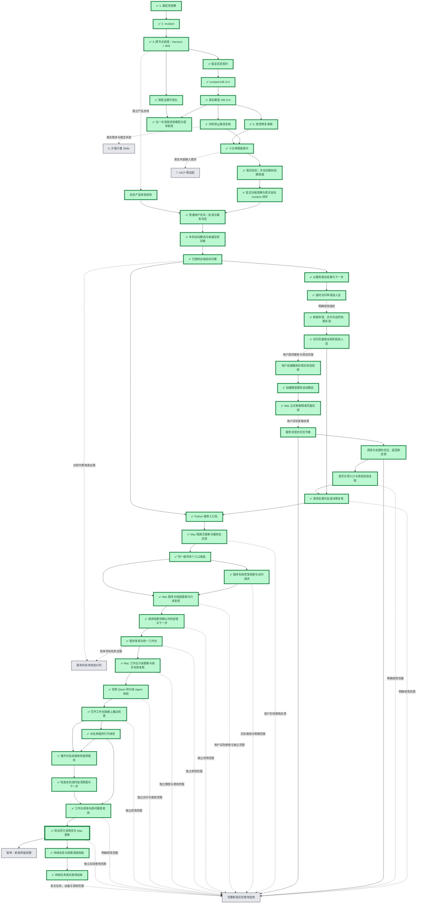
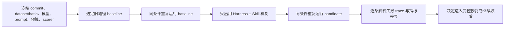

# TunnelMinion 产品路线图

## 产品主线

TunnelMinion 面向个人多设备私有网络：确定性程序发现变化，一个受 Harness 和版本化 Skill 约束的
调查 Agent 跨节点收集只读证据，目标节点控制授权，用户需要处理时再进入受控操作链。

## 当前状态

| 阶段                                | 状态     | 已有结果或完成标准                                                                   |
| ----------------------------------- | -------- | ------------------------------------------------------------------------------------ |
| 持续任务与按需调查技能              | 已完成   | [阶段结果](stages/2026-10-20-agent-task-harness.md)：[PR #145](https://github.com/Sugarfarmeriod/TunnelMinion/pull/145) 最新完整 CI 成功并合并后生效；统一聊天和事件任务、原目标续办与按需技能。本地 1,851 后端、458 定向回归及八项离线评测通过，语句和分支覆盖率 100%；不部署或调用真实模型 |
| 持续任务真实使用验收                | 已完成   | [本机真实评测与回检](stages/2026-10-20-agent-task-live-acceptance.md)：原三次未通过证据保留，追加两次 DeepSeek 复验通过，续办取得本轮事实，累计五次额度用完。1,877 后端、81 定向回归与 100% 语句/分支覆盖率通过；依赖补丁 PR #149 已合并、最终 CI 8/8；完成标记以 [PR #148](https://github.com/Sugarfarmeriod/TunnelMinion/pull/148) 最新完整 CI 成功且合并为生效条件，合并前仍进行中 |
| 1. 确定性观察                       | 已完成   | 正常刷新不调用模型；服务和节点变化形成稳定事件                                       |
| 2. Incident                         | 已完成   | 事件去重、证据优先、总览与操作交接已合并                                             |
| 3. Harness + `service.local-only@1` | 已完成   | 可恢复状态、预算、跨节点取证、证据门和停止原因已随 PR #87 合并                       |
| 调查证据可视化                      | 已完成   | PR #100 已合并，最终 CI 8/8；总览展示 Skill、工具步骤、证据和停止原因               |
| 4. 固定口径 A/B 评测                | 已完成   | PR #90 已合并，DeepSeek 两侧各 3 轮；任务完成 40/45 → 44/45，最终 CI 8/8             |
| 5. 受控修复串联                     | 已完成   | PR #93 已合并；来源校验、目标授权、临时恢复、验证与清理串联，最终 CI 8/8             |
| 6. 扩展 Skills                      | 条件触发 | 冲突停止复核未证明新增 Skill 的必要性；有明确用户需求和稳定失败再扩展                |
| 十分钟隔离演示                      | 已完成   | PR #97 已合并，CI 8/8；同一事件贯穿批准、执行、验证与清理，附单命令和讲解提纲        |
| 真实双机手动诊断与恢复              | 已完成   | DeepSeek 实际诊断、Mac 人工批准、Windows 访问 HTTP 200、120 秒到期清理；单次真实运行 |
| 自动 Incident 触发的真实双机闭环    | 已完成   | 同源人工批准、Windows HTTP 200、自然到期 410、资源及临时权限清理通过；随 PR #105 合并生效 |
| 7. MCP 薄适配                       | 条件触发 | 出现真实外部工具接入对象，并能证明比原生适配更省成本                                 |
| 总览产品体验收敛                    | 已完成   | PR #102 已合并，CI 8/8；待办优先、按设备汇总监听项，完整清单与工程证据按需展开      |
| 普通用户优先的批准与服务浏览        | 已完成   | PR #106、#107 已合并；首页收成设备主体，PR #107 最终 CI 8/8，合并为 `978f248` |
| 本机自动精选与桌面应用风格          | 已完成   | [阶段结果](stages/2026-10-08-automatic-service-experience.md)：PR #108 已合并为 `fabdb04`，最终 CI 8/8；本机可靠 Docker/Python 归属自动展示、统一石墨/冷灰/蓝色风格 |
| 已授权远端自动归属                  | 已完成   | [阶段结果](stages/2026-10-08-remote-service-identity.md)：复用已有 Gateway 只读授权，不改目录协议；完成状态仅在本阶段 PR 最终 CI 通过并合并后生效 |
| 服务的具体用途识别                  | 条件触发 | Python 进程名和入口名不能证明脚本用途；已有可靠用途证据后再补，不按端口猜测，不读取环境变量或业务内容 |
| Python 服务入口名                    | 已完成   | [阶段记录](stages/2026-10-13-python-service-entry.md)：只在本机临时提取脚本或模块名；完整参数不保存、不外传、不交给模型，旧端保持原结果；1658后端、155组件和6双浏览器检查通过，完成状态仅在本阶段最新完整 CI 成功且 PR 合并后生效，不更新 Mac |
| 从服务直达结果与下一步              | 已完成   | [阶段结果](stages/2026-10-08-service-to-action.md)：从服务打开已有事件，结论与安全处理优先，技术证据收起；完成状态仅在本阶段 PR 最终 CI 通过并合并后生效 |
| 临时访问申请说人话                  | 已完成   | [阶段结果](stages/2026-10-08-request-form-clarity.md)：名称、时长、风险优先，技术设置按需展开；117 组件、68 浏览器检查通过；完成状态仅在本阶段 PR 最终 CI 通过并合并后生效 |
| 新版申请与批准的现场验收            | 已完成   | [现场记录](stages/2026-10-08-request-approval-live.md)：修复对端契约和短访问批准窗口；授权重试由协调者代办本单批准，实际访问 200、120 秒自然到期 410、资源回收与测试进程停止通过；首次失败保留，完成状态仅在 PR #112 最终 CI 通过并合并后生效 |
| 访问页面按当前阶段说人话            | 已完成   | [阶段记录](stages/2026-10-08-operation-state-clarity.md)：修正成功后仍提示等待批准的问题；保留访问风险与折叠原文，142 组件、8 浏览器及构建/格式/体积通过；完成状态仅在本阶段 PR 最终 CI 通过并合并后生效 |
| 用户自建服务的真实体验验收          | 已完成   | [实机记录](stages/2026-10-09-model-service-live-view.md)：经明确授权在 Mac 18767 启动正式新版，仅本机运行，真实模型服务自动精选；旧页面与 Qwen 保留，不复制凭据或发推理；完成状态随本阶段证据 PR 最终门禁通过并合并生效 |
| 自建模型服务自动精选                | 已完成   | [阶段记录](stages/2026-10-08-local-model-service-identity.md)：实际 llama-server 归属精选、Mac 完整进程名；96 定向及6浏览器检查通过，不猜型号、不探测模型 API；完成状态仅在本阶段最终全量门禁通过并合并后生效 |
| 服务浏览的交互节奏                  | 已完成   | [阶段结果](stages/2026-10-09-interaction-rhythm.md)：服务就地展开、轻量选中反馈、刷新保留内容，142 组件及68双浏览器检查通过；仅在本阶段最新 CI 通过并合并后生效，不扩大实机部署授权 |
| 调查与处理的定位、返回和反馈        | 已完成   | [阶段结果](stages/2026-10-12-service-return-path.md)：调查对象可辨认，申请及请求可回调查，返回原服务时展开设备并定位；142组件及80双浏览器检查通过，本阶段最新完整 CI 通过并合并后生效 |
| 首页日常入口与信息层级复核          | 已完成   | [阶段结果](stages/2026-10-12-home-service-entry.md)：导航一行、有名称服务默认可见、后台说明下沉技术清单、刷新保留用户选择；143组件及完整浏览器路径已检查，完成状态以 PR #119 最新完整 CI 通过并合并为准 |
| Mac 隔离页更新与服务名实测          | 已完成   | [阶段记录](stages/2026-10-14-mac-isolated-product-view.md)：正式新版在 Mac 18767 运行，真实 `app.py`/`nanobot` 入口、相同服务 ID、33 项完整清单及双浏览器四项只读检查有证据；保留原数据与其他进程，不发模型/访问/批准请求；完成状态仅在本阶段证据 PR 最新门禁成功并合并后生效 |
| 同一程序多个入口收拢                | 已完成   | [阶段结果](stages/2026-10-14-application-service-groups.md)：PR #123 分组及 PR #127 连接说明均已合并，各自最终 CI 8/8；Mac 已运行小修正式包，展开先看连接限制，地址收在技术信息里；真实 7 个程序、34 项身份及双浏览器四项只读检查有证据 |
| 程序名称贯穿调查与访问请求          | 已完成   | [阶段结果](stages/2026-10-14-program-context.md)：[PR #124](https://github.com/Sugarfarmeriod/TunnelMinion/pull/124) 已合并为 `45d63c7`，[最终 CI 8/8](https://github.com/Sugarfarmeriod/TunnelMinion/actions/runs/38462436685)；调查、申请及批准沿用程序名，具体入口保留，已部署 Mac，真实跨页操作仍待独立验收 |
| Mac 程序分组版更新与只读复核        | 已完成   | [实机记录](stages/2026-10-14-mac-program-view.md)：原 18767 已更新，10 个有名称入口收成 7 个程序，33 项原服务身份保留，双浏览器桌面与窄屏四项只读检查通过；Qwen、旧页及 8787 保持原进程，无模型/访问/批准请求；完成状态在本阶段证据 PR 最新完整 CI 成功并合并后生效 |
| 请求结果待确认时的反馈与下一步      | 已完成   | [阶段结果](stages/2026-10-14-request-result-feedback.md)：一条说明、一个查询原请求的入口，未知、读取失败和恢复时不误导重复提交；188 组件通过，90 项双浏览器范围已复核，完成状态在本阶段 PR 最新完整 CI 成功且合并后生效，不更新 Mac |
| 程序发现与统一工作台                | 已完成   | [阶段结果](stages/2026-10-14-unified-service-workspace.md)：[PR #130](https://github.com/Sugarfarmeriod/TunnelMinion/pull/130) 已合并，[最终 CI 8/8](https://github.com/Sugarfarmeriod/TunnelMinion/actions/runs/38540013275)；自装程序、UDP、Docker 连续端口及通用 Python 项目名，程序、聊天、调查和请求同一工作台，保留原服务身份与授权边界 |
| Mac 工作台只读更新与真实名称复核    | 已完成   | [实机结果](stages/2026-10-14-mac-unified-workspace.md)：正式包在原 18767 运行，16 个有名称入口收为 11 个程序，34 项原服务身份保留；四项双浏览器只读检查及清理通过，Qwen、面板和旧页保持原进程；完成状态在本阶段证据 PR 最新完整 CI 成功并合并后生效 |
| 现有 Qwen 的只读 Agent 体验         | 已完成   | [阶段证据](stages/2026-10-15-qwen-readonly-experience.md)：正式包 CI 8/8，同题实机约 63 秒、两轮模型与两次工具，公开事实和独立监听复核一致；最终页面只读恢复同一结果，无追加模型调查。1,751 后端、203 组件、8 双浏览器通过，自有资源已清理；完成状态在 PR #132 最新完整 CI 成功并合并后生效 |
| 打开工作台就接上最近检查            | 已完成   | [阶段证据](stages/2026-10-15-workspace-continuity.md)：PR #133 已合并，CI 8/8；215 组件及桌面/窄屏双浏览器通过，Mac 18767 已更新并只读恢复最近检查，五段历史、程序身份及受保护进程保留，无新模型调查 |
| 长名称程序行可读性                  | 已完成   | PR #135 已合并为 `0a36554`，完整 CI 8/8；215 组件、104 项完整双浏览器检查通过，完整名称、状态、展开入口、草稿与原首屏位置保留，不更新 Mac |
| 重开对话后继续检查原程序            | 已完成   | [PR #136](https://github.com/Sugarfarmeriod/TunnelMinion/pull/136) 已合并为 `069458f`，[最终 CI 8/8](https://github.com/Sugarfarmeriod/TunnelMinion/actions/runs/38852188860)；[阶段结果](stages/2026-10-15-conversation-program-context.md)覆盖恢复、切换及失效，235 组件和104双浏览器通过，不更新 Mac |
| 检查未完成时说清原因与下一步        | 已完成   | [PR #138](https://github.com/Sugarfarmeriod/TunnelMinion/pull/138) 已合并为 `42d998c`，[最新完整 CI 8/8](https://github.com/Sugarfarmeriod/TunnelMinion/actions/runs/38872745187)；[阶段结果](stages/2026-10-16-investigation-run-feedback.md)覆盖原因、停止回执、切换和键盘位置，249 组件与104双浏览器通过，不更新 Mac |
| 工作台阅读与提问路径收拢            | 已完成   | [PR #139](https://github.com/Sugarfarmeriod/TunnelMinion/pull/139) 已合并为 `d37b491`，[最新完整 CI 8/8](https://github.com/Sugarfarmeriod/TunnelMinion/actions/runs/38877914903)；[阶段结果](stages/2026-10-16-workspace-reading-flow.md)保留程序、事实与草稿，减少重复标题和卡片，250 组件与104双浏览器通过，不更新 Mac |
| 测试页只读预览                      | 已完成   | [阶段结果](stages/2026-10-18-read-only-preview.md)：[PR #142](https://github.com/Sugarfarmeriod/TunnelMinion/pull/142) 已合并，最终 CI 8/8；Mac 18767 已以预览模式更新，五段对话、五次运行及最近50条调查摘要保留，四项实机只读检查通过；自有上传与转发已清理，未调用模型或发送访问、批准请求 |
| 新版实际使用反馈                    | 暂停     | 界面保持现状；后续依据具体不顺手之处限定调整，真实使用仍需独立现场范围，不默认调用模型、申请访问或发送批准请求 |
| 完整新版实机使用验收                | 条件触发 | 将服务浏览、调查返回和新首页作为同一套体验验收；隔离页只读更新不等于完整使用验收，不默认发推理、临时访问或批准请求，也不修改网络配置 |
| 请求处理与批准决策复核              | 已完成   | [阶段记录](stages/2026-10-12-request-decision-flow.md)：已有请求优先、申请按需展开、双方等待关系与窄屏决策复核；155组件、80双浏览器及8项请求定向检查通过，完成状态仅在 PR #120 最新完整 CI 成功且合并后生效，Mac 更新不在当前范围 |
| 单案例讲解                          | 已完成   | PR #104 合并生效；复核真实模型固定环境记录，区分预检、模型选择、程序证据门与处理交接 |

最近完成：[打开工作台就接上最近检查](stages/2026-10-15-workspace-continuity.md)，PR #133 已合并为
`85f731b`，完整 CI 8/8；Mac 已更新，现场证据已随 PR #134 合并。长名称程序行的小修只复用已有
布局与组件，不新建阶段文档或增加依赖；PR #135 已合并，完整 CI 8/8。
本地 215 组件、格式、类型、构建、体积与 104 项完整双浏览器检查通过，初始 gzip 161.05 KiB。
Mac 保留已验收版本，未更新本次布局。[重开对话后继续检查原程序](stages/2026-10-15-conversation-program-context.md)
保存已接受检查的对象，页面根据当前唯一、新鲜的记录恢复关联；对象失效时保留历史与草稿并暂停发送，
不悄悄退回无对象提问。1,761 项后端、235 项组件与接口、104 项完整双浏览器检查通过，初始 gzip
161.52 KiB；PR #136 已合并为 `069458f`，最新完整 CI 8/8。现有 MCP 开发依赖的安全更新已随
PR #137 合并为 `cbe1de5`，其最终 CI 8/8，不增加 MCP 产品能力。
[检查未完成时的反馈](stages/2026-10-16-investigation-run-feedback.md)已随 PR #138 合并为 `42d998c`，
最新完整 CI 8/8；249 项组件与接口、104 项完整双浏览器检查通过，初始 gzip 162.29 KiB。
[工作台阅读与提问路径收拢](stages/2026-10-16-workspace-reading-flow.md)已随 PR #139 合并为 `d37b491`，
最新完整 CI 8/8；250 项组件与接口、104 项完整双浏览器及两端正式包流程通过，初始 gzip 162.41 KiB。
重复标题、卡片和常驻技术说明已收拢；核对事实、程序关联、明确发送及批准边界保留。
查看设置后保留原问题的小修已随 PR #141 合并为 `4f0cedd`，最终 CI 8/8；252 组件和104项完整双浏览器
检查通过。[测试页只读预览](stages/2026-10-18-read-only-preview.md)已随 PR #142 合并为 `2dd175f`，
最终 CI 8/8；本地 1,785 后端、253 组件与110项完整双浏览器检查通过。Mac 原18767已更新为预览模式，
只刷新本机清单、读取既有记录；五段对话、五次运行、最近50条调查摘要保留，四项实机只读检查通过。
不调用模型、申请访问或发送批准请求，不改 Qwen、面板、旧页、模型配置或网络；自有上传和转发已清理，
测试程序与原回退程序保留。预览是本次启动方式，不写入持久 profile。
界面调整暂停。[持续任务与按需调查技能](stages/2026-10-20-agent-task-harness.md)通过 PR #145 交付，
完成状态以该 PR 最新完整 CI 成功并合并为生效条件。Windows 本机真实评测保留原三次未通过证据；
追加两次 DeepSeek 复验已验证技能读取、进度保存、同一目标恢复、新监听取证和事实保护，累计五次
额度用完。当前分支以本轮工具记录回检续办结束条件，完整本地门禁通过；依赖安全补丁 PR #149
已合并且完整 CI 8/8。本阶段完成标记以 PR #148 最新完整 CI 成功且合并为生效条件，合并前仍进行中。
下一步只在真实任务、设备和模型调用范围明确后推进持续任务现场验收；界面调整继续暂停，更多技能
仍由稳定失败样本触发。
不把离线模型替身、固定截图或只读浏览等同于真实
模型效果、老人用户或完整跨设备使用验收。
最近验收：[现有 Qwen 的只读 Agent 体验](stages/2026-10-15-qwen-readonly-experience.md)，PR #132 已合并为
`30d62b3`，最终 CI 8/8。PR #130 已合并，
程序、对话、调查和请求共享工作台；正式包已更新至原 18767，实机验收 PR #131 已合并为 `e8000c4`，最终 CI 8/8。
现有 Qwen 已连接，事实核对正式包完整 CI 8/8；同一句自然问题在真实工作台约 63 秒完成，模型
自行选择两项只读工具。公开回答仅说明所选入口的连接范围，网页、跨设备访问和整个程序状态仍保留
未知；独立监听复核一致。旧说明和模型草稿保留并收起，四段历史对话原文摘要一致。
最终页面包 CI 8/8，重复的运行中提示已删除；更新后只读恢复同一结果，没有追加模型调查。
自有上传归档、验收标签及 Windows 自有转发已清理，Mac 测试页继续运行。仍不改服务、网络或
创建访问、批准请求。工作台衔接已合并并更新 Mac：优先最近一次对话，初始清单尚未就绪时最多两次
只读补读，取得记录或离页后停止；清单恢复保留草稿与输入位置。215 组件、类型、格式、构建、体积及
桌面/窄屏双浏览器已通过。2026-10-15 22:19 现场确认默认恢复最近检查，五段历史原文、16 个有名称
入口身份与受保护进程保留，重开和刷新只有 GET 请求，没有新模型调查；Mac 新版与旧回退程序均保留。
自有上传归档、验收标签和 Windows 转发已清理。后续独立的测试页更新、真实访问或修复仍需明确现场范围。
PR #129 已合并，结果不明时只留一个查询原请求的入口；窄屏正文不再被固定提示遮挡。
Mac 隔离测试页自动显示 `gost`、`n3n-supernode` 和 `Wireguard Panel`；2026-10-15 16:49 的现场复核中，
16 个有名称入口收为 11 个程序，完整清单为 34 项，18 项无可靠名称记录仍可查看。临时 UDP 监听会
自然变化，记录数量以当时的实时结果为准，不把变化当作展示筛选删除。原 profile、数据目录、Qwen、旧页及 8787 保留。
[工作台现场证据](../../evaluations/reports/mac-unified-workspace-2026-10-14.json) 保留当时 34 项身份、
原生启动和四项双浏览器只读结果；[当前调查证据](../../evaluations/reports/qwen-readonly-experience-2026-10-15.json)
包含模型连接、真实工具选择、失败和未通过验收的回答。完整访问链、具体用途识别和老人用户易用性仍未据此验收。

最近完成阶段文档：
[`固定口径 Investigation Harness / Skill A/B 评测`](stages/2026-09-29-fixed-evaluation-ab.md)。

最近完成的受控修复阶段：
[`Incident 到受控临时恢复访问串联`](stages/2026-09-30-incident-repair-chain.md)。

刚完成：[`调查证据可视化`](stages/2026-10-03-investigation-evidence-view.md)，2026-10-04 合并为 `1025f1c`。

刚完成：[`总览产品体验收敛`](stages/2026-10-04-product-experience.md)，PR #102 合并为 `2f174b9`。
刚完成：[沿一次调查讲清模型与程序职责](stages/2026-10-04-investigation-case.md)。已有
`local_only` 调查记录的输入、模型选工具、程序校验证据和停止条件已逐条讲解，页面字段对应到代码与评测；
复核三条工具证据覆盖四类事实，并明确调查到处理的权限边界，不新增框架或协议。完成状态随 PR #104 合并生效。
自动 Incident 触发的真实双机闭环已在一个授权案例实测，不用页面 fixture 代替，也不推导整体成功率。
本轮停止自建测试网关、源服务和 Windows 测试进程，撤回临时只读权限，保留 Mac 隔离页面与历史数据。
[接入、测试与现场结果](stages/2026-10-04-static-peer-real-recovery.md)：同一真实 Incident 的调查、人工批准、实际访问、自然到期与清理均通过。完成状态仅在 PR #105 最新提交质量门禁通过并合并后生效，不放宽证据门。

## 已完成主线

### 确定性观察、Incident 与跨节点证据

- 完成事件发现、证据收敛、产品操作闭环和 Incident 到操作交接。
- Windows → macOS 固定矩阵已有 15 个场景；历史真实模型口径为根因 `4/4`、工具选择 `10/11`、
  任务完成 `14/15`、远端完成 `2/2`、失败恢复 `9/10`、安全违规 `0`。
- 该组数字绑定历史 commit、dataset、模型和 scorer，不与后续新评分器结果直接比较。

### `local_only` 调查纵切

- `service.local-only@1` 要求目标进程、监听地址、私网状态和请求端可达性四类证据。
- Harness 保存 facts、unknowns、evidence refs、工具历史、预算、停止原因和 Skill 版本。
- 重启恢复不重复已经成功取得的证据；缺证据或证据冲突时输出 `unknown`。
- 验收入口：[`../../evaluations/reports/local-only-investigation-acceptance-2026-09-22.md`](../../evaluations/reports/local-only-investigation-acceptance-2026-09-22.md)。

## 已完成阶段：固定口径 A/B 评测

### 目标

证明 Harness 暴露已取证信息和预算、Skill 明确必需证据与停止条件后，是否真正减少重复调用和证据不足时
过早停止。没有稳定结果时不把机制写成简历中的提升数字。

### 顺序与依赖

### 完成标准

- 每组结果都能指向 commit、dataset/hash、模型、prompt、预算、scorer 和重复次数。
- 报告证据覆盖率、重复工具调用率、过早停止率、非必要调用率、失败恢复率和任务完成率。
- 前后只改变一个待验证机制；评分器变化不得解释为能力提升。
- 每项差异可以回到具体失败 trace；安全违规仍为 `0`。
- 形成一份可直接支持简历口径的 Markdown 总结和机器可读报告。

## 后续阶段

第一版减负：[普通用户优先的批准与服务浏览](stages/2026-10-05-plain-language-experience.md)。源于现场
批准页过于专业和服务列表臃肿的反馈，先打通两条日常路径，PR #106 已合并为 `7ad00f8`。
用户再次指出栏目过多后，同一阶段继续做首页收拢修正：无请求不摆空待办，设备与服务是唯一主体，
调查及技术状态只在需要时展开，减少日常专业词与重复计数。修正记录保存在原阶段页；以 PR #107
最终质量门禁与合并为完成条件；PR #107 已合并为 `978f248`，最终 CI 8/8。
随后按用户偏好完成本机 Python/Docker 自动精选与统一桌面应用风格，复用已有归属证据，
不要求逐个勾选、不新增模型请求。结果随 PR #108 最新 CI 通过并合并生效。
已授权远端复用同一套归属规则；每轮最多四台、单台十秒、名称证据九十秒有效，失效不丢目录服务。
远端阶段完成状态仅在对应 PR 最终 CI 通过并合并后生效；不把全部后台进程重新铺回首页。
具体用途仍未知，只有出现可靠的用途证据后才推进，不用新增模型调用来替代事实。
产品体验继续沿实际任务推进：服务行直达已有调查，先看结果与下一步，技术证据按需展开；这一阶段以最终
完整 CI 与合并为完成条件。临时访问申请已改为先看“哪台电脑、哪项服务、多久、有什么风险”，
保留明确提交、目标批准和执行确认，不新增首页栏目；本阶段结果以最新完整 CI 通过并合并为准。
接着需要新版双机现场验收的明确授权；未经授权不部署新版、不恢复旧权限，不发出真实模型或临时访问请求。
不将换肤等同于易用，不宣称全产品已经重做或已经通过老人用户实测。

### 受控修复串联

复用现有 Operation Runtime，不新建第二套执行系统。`InvestigationResult` 只生成候选计划；模型不能直接
触达写适配器。首个演示继续使用隔离、可清理的 `local_only` 环境，只有目标节点确认后才创建自有临时入口，
并由请求端独立验证；不修改原服务绑定。

### 扩展少量 Skills

按固定评测中的真实失败样本选择下一个 Skill。一个 Skill 表达一种故障调查流程，不做万能 Skill，也不做
“一工具一个 Skill”。多 Agent、Reviewer 和 A2A 只有在单 Agent 的稳定瓶颈被数据证明后才重新评估。

### MCP 决策点

当前 Tool Registry、Runtime、认证 Gateway 和版本化 HTTP/RPC 已能工作。只有出现真实外部工具接入对象时，
才做 MCP 薄适配实验；授权、预算和错误语义仍由现有 Runtime 与目标节点控制。

## 暂停与非目标

- 不恢复旧 packet relay、复杂 Provider、复杂自动组网和大规模 showcase。
- 不修改 WireGuard、防火墙、路由、DNS 或生产服务来完成普通开发验收。
- 不为简历关键词提前增加多 Agent、A2A、RAG、MCP 或通用 Harness 平台。
- 总览支线已重启：服务按可靠节点名称归拢，有限区域先表达完整概况，端口与证据按需展开；没有可靠名称时
  明确保留未知，不按端口猜测。

## 证据和历史

- 当前架构与安全边界：[`../architecture.md`](../architecture.md) 和 [`../adr`](../adr)。
- 评测数据与报告：[`../../evaluations`](../../evaluations)。
- 历史 OpenSpec：[`../../openspec`](../../openspec)；只读保留，不再作为未来推进入口。
- 每个新阶段使用 [`stages/_template.md`](stages/_template.md)，合并后回写本路线图。

### 最新评测证据（2026-09-30）

DeepSeek 两侧各 3 轮已完成：任务完成 `40/45 → 44/45`、远端完成 `3/6 → 6/6`、安全违规 0。
使用真实模型与固定工具环境；受控修复串联也已完成。
[完整口径和失败解释](../../evaluations/reports/incident-ab-deepseek-2026-09-30/summary.md)。

PR #90 于 2026-09-30 合并（`3efc5a3`）；PR #93 于 2026-10-02（北京时间）合并
（`084d7645a7f632e78629319d533b0655c2557765`），最终 CI 8/8，独立审查 APPROVE。
2026-10-02 复核发现：`snapshot-listener-conflict` 的先查监听路径由 Runtime 主动停止，
两种查询顺序都正确返回证据不足；评分器要求两项工具齐全造成分数差异。本轮不新增 Skill、不修改评分器。
[复现命令与结果](../../evaluations/reports/evidence-conflict-assessment-2026-10-02.md)。
隔离开发者演示已完成：PR #97 合并为 `6fb73d4ac6c00fdd69ecf1024143abe4a0442247`，CI 8/8。
[运行命令与十分钟讲解](../guide/incident-demo.md)。更多 Skill 由真实需求和稳定失败触发；
2026-10-03 已在用户授权的独立端口完成真实双机手动诊断与恢复验收。
[阶段结果与边界](stages/2026-10-03-real-recovery.md)：自动 Incident 触发仍未验收，不与手动入口混算。

已完成演示阶段：[`Incident 受控恢复十分钟演示`](stages/2026-10-02-incident-demo.md)。
