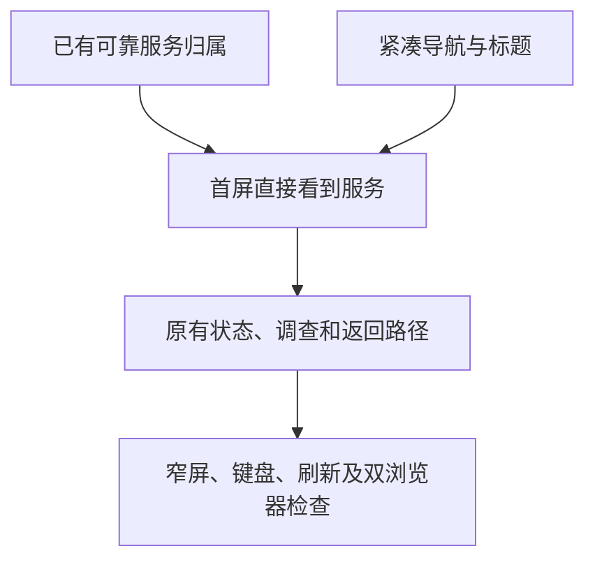

# 首页日常入口与信息层级

- 状态：`已完成`（仅在 PR #119 最新完整 CI 通过并合并后生效）。
- 主写分支：`feature/home-service-entry`；当前总协调者是唯一写入者。
- 基线：`f80a7dab1d629f8961959b040bb2fc931007123c`（PR #118）。
- 对应总流程：`首页日常入口与信息层级复核`。

## 结果与用户影响

打开首页就能看到已经识别出名称的服务，不用先猜哪台设备值得点开。窄屏导航保持一行，
把空间留给服务名称与状态；后台清单和工程信息仍按需展开，不增设栏目。

## 当前证据与缺口

- 基线的 Chromium 隔离页面在 320 CSS px 下，顶部品牌与导航占 275px，五个入口排成三行。
- Python、Docker、模型服务虽已自动精选，设备默认收起，仍需手动点击才能看见。
- 服务内的未知状态、调查入口和返回定位已有覆盖，本阶段保留这些能力。
- 基线截图在本工作树 `build/home-entry-before/`，使用固定数据，不代表 Mac 现场画面。

## 范围

- 压缩产品外壳与首页标题区，不删除五个现有入口或隐私提示。
- 有名称服务的设备默认展开；只有后台记录的设备默认收起。用户选择及返回定位不被刷新覆盖。
- 服务名称和状态优先于后台项目说明；后台数量说明移入现有技术清单，完整清单与未知状态保留。
- 不增加分类、设置、依赖、模型调用或探测权限，不部署 Mac 或修改真实网络。

## 依赖与顺序

## 完成标准

- [x] 有名称服务首次打开即显示；无名称后台项目不铺满首页。
- [x] 320px 与 200% 等效布局导航一行，无横向溢出，点击目标至少 44px。
- [x] 用户收起、展开及返回定位经过刷新仍正确；名称失效不丢后台记录。
- [x] 原有调查与申请交接、未知和陈旧状态、键盘及对比度验证通过。
- [x] 定向验证通过；最终全量门禁、PR 合并与路线图完成状态按下述生效条件核验。

## 当前实现与验证

- 产品外壳仍保留总览、聊天、操作、记忆、设置五个入口。桌面品牌与导航并排，窄屏导航一行，
  320px 截图顶部从 275px 缩至 131px；隐私提示保留。首页刷新与标题并排。
- 使用现有原生折叠控件：有名称服务默认展示，未识别后台项目不展开。
  新识别出名称的未操作设备会自动展开；用户手动收起的设备刷新后仍收起；返回服务定位仍能展开设备。
- 服务状态紧跟名称，不隔着整个桌面宽度。后台数量与不确定状态的统计在完整技术清单内，
  有名称服务各自的未知、不可用和陈旧状态仍直接显示。名称失效后完整检测记录不丢失。
- 归属未识别但已有名称的服务可见，并明确标记归属未知，不编造设备或用途。
- 143 项组件检查通过；80 项双浏览器检查中 78 项首轮通过，另两项因测试选择器匹配两个相同后台数量说明失败，
  修正选择器后 Chromium/WebKit 定向 2/2 通过。失败不作为产品通过证据，最终以 CI 完整矩阵为准。
- 构建、格式、体积、5 项供应链脚本与 13 项 Mermaid 文档检查通过。JS+CSS gzip 为 160012 字节，
  保持既有 300KiB 及已接受基线加 10% 门禁，不调整预算或依赖。
- 改后桌面及窄屏截图保存在本工作树 `build/home-entry-after/`；由固定数据的隔离 FastAPI 页面生成，
  不是 Mac 实机截图或老人用户测试。Python/Docker/模型服务的首屏与名称失效路径覆盖在
  `frontend/e2e/plain-language-experience.spec.ts`。

## 完成结果

[PR #119](https://github.com/Sugarfarmeriod/TunnelMinion/pull/119) 集中交付上述完整主题。
完成状态仅在该 PR 最新提交的完整 CI 通过并合并后生效，最终检查与运行链接见 PR，不能用旧提交的通过记录替代。
未部署 Mac、未发真实模型或访问请求、未修改真实网络、未触碰旧草稿 PR。

接下来应使用同一套新版完整体验验收，而不是继续拆零碎界面主题。Mac 页面升级与真实服务查看需要明确的现场范围；
未经确认不扩大此前隔离页面的部署授权，也不据此发推理、访问或批准请求。
