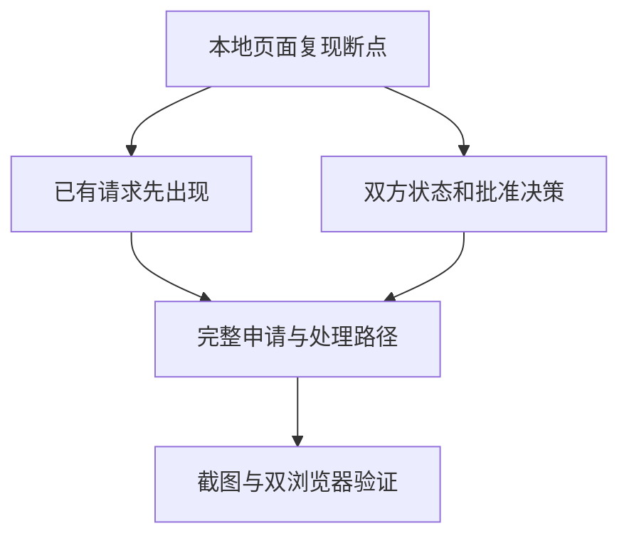

# 访问请求的处理顺序与批准决策

- 状态：`已完成`（以 PR #120 最新完整 CI 通过并合并为生效条件；此前为 `进行中`）
- 主写分支：`feature/request-decision-flow`
- 基线：`5ae29299576d0b6e4cadc3eb815c0e78097d290a`
- 对应总流程：`请求处理与批准决策复核`

## 结果与用户影响

先看到已有请求，需要新申请时再展开表单。批准页面清楚区分谁在等待谁，
窄屏不必滚到长页面底部才能找到决定按钮；具体对象、身份提醒、时长和访问风险仍然可读。

## 当前证据与缺口

- PR #119 后的本地生产构建：没有可申请电脑时仍展示整张不能提交的表单，已有请求详情入口在
  1280×720 页面第 1116 像素处。
- 320×720 批准页的“批准一次”位于第 1340 像素处；请求端等待别人时，徽标却写“等待本机批准”。
- 基线截图保存在隔离工作树 `build/request-experience-before/`，使用隔离数据，不是 Mac 现场截图。
- 当前部署范围仅含本地隔离页面；不更新 Mac，不发送真实模型或访问请求。

## 范围

- 本阶段完成：已有请求优先、申请表按需展开、请求摘要去除首屏工程编号、双方状态与动作使用日常语言、
  窄屏决定按钮可见，以及相连的组件和浏览器检查。
- 本阶段不做：服务用途识别、后端协议或权限变化、真实部署、模型调用、新依赖或新增栏目。
- 主写者：当前总协调任务；没有其他文件或图纸写入者。

## 依赖与顺序

## 完成标准

- [x] 普通入口先见已有请求，表单手动展开；调查带入申请仍自动展开、定位，不自动发送。
- [x] 双方明确看到等待谁；访问检查通过不等于入口可用或服务安全。
- [x] 窄屏批准、拒绝和取消按钮可找到；确认仍包含对象、时长、身份提醒与访问风险。
- [x] 不丢原始编号、状态、失败、未知结果或技术记录；不增加真实网络写操作。
- [x] 组件、双浏览器、构建、格式和体积的本地检查通过，截图已保存。
- 合并门禁：[PR #120 最新完整检查](https://github.com/Sugarfarmeriod/TunnelMinion/pull/120/checks)
  必须成功且 PR 合并；本页与路线图的完成状态仅在两项同时成立后生效。

## 当前设计与约束

复用现有查询、原生折叠和确认对话框。普通入口的新申请默认收起，调查带入申请展开并定位。
双方等待关系分别显示；访问检查通过只表达检查结果，不承诺服务安全或本机入口仍然可用。
窄屏处理按钮在底部停靠，摘要和风险可滚动阅读；确认框仍展示对象、身份提醒、时长和风险。
原始地址、编号及工具记录保留在技术详情，名称陈旧时回到未知，同名电脑使用编号末尾区分。
Python 归属目前只证明运行工具，具体项目用途属于待办；本阶段不扩展采集权限。

## 完成结果

本地实现与验证已完成，交付入口为 [PR #120](https://github.com/Sugarfarmeriod/TunnelMinion/pull/120)。
最终验收以该 PR 头提交的完整 CI 和合并状态为准，不以较早提交的绿色检查代替。

- 155 项组件检查、80 项 Chromium/WebKit 浏览器检查通过；当前请求路径的 8 项定向检查和
  13 项列表组件检查也已通过，覆盖陈旧名称、同名电脑、仅提交一次及访问失效。
- 构建、格式、体积、5 项供应链脚本检查和 13 项 Mermaid 文档检查通过。
- 初始 JS+CSS gzip 为 160165 字节，未调整 159331 字节比较基线，低于相对和绝对门禁。
- 截图位于隔离工作树 `build/request-experience-after/`：`requests-desktop.png`、
  `approval-desktop.png`、`approval-narrow.png` 和 `confirmation-narrow.png`。
  内容来自本地隔离数据与明确的名称夹具，不是 Mac 实机或老人用户可用性验收。
- 未改后端、依赖、真实服务或网络设置；本地隔离检查进程已经退出。
- 后续规划：Python 的具体项目名需要可靠的额外身份线索，读取启动信息的范围尚待确认；
  不将 Python 进程名或端口号写成已识别的业务用途，不因此更新 Mac。
