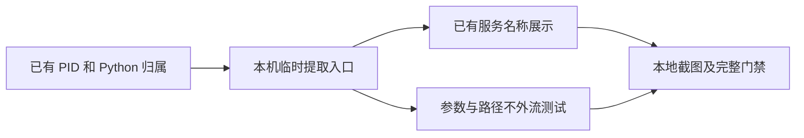

# Python 服务入口名

- 状态：`已完成`；仅在本阶段最新完整 CI 成功且实现 PR 合并后生效，否则仍为 `进行中`
- 主写分支：`feature/python-service-entry`
- 基线：`09cd2dcfbc91078a966425155b1addf332d3e127`
- 对应总流程：Python 服务入口名；业务用途识别仍为条件触发。

## 结果与用户影响

用户可看见实际运行的脚本或模块名，而不只看见“Python 服务”。入口名只说明启动对象，
不代表已经知道业务用途；无法识别时保留已有 Python 归属和服务状态。

## 当前证据与缺口

默认监听查询只有 PID 与进程名，页面没有隐藏现成的项目名称。服务清单使用严格字段校验，
旧客户端不能直接接收新增字段，因此入口名必须按需请求，默认监听结果保持原样。

## 范围

- 仅在服务所在电脑临时读取 TCP Python 监听进程的启动参数，保存的摘要只包含脚本 basename 或模块名。
- 完整参数不写日志、存储、工具输出或模型输入；不读取环境变量、文件内容、工作目录或编辑器内容。
- 支持普通脚本和 `python -m`，包括在 VS Code 等软件的终端中直接启动；调试包装、内联代码与未知参数不猜。
- 复用已授权的监听查询与现有名称展示，旧端不发送新参数，不新增模型调用、依赖或首页栏目。
- 不更新 Mac、不执行真实模型推理、临时访问或批准，不修改用户网络和已有进程。

## 依赖与顺序

## 完成标准

- [x] 普通脚本、模块、终端启动和已知调试包装有可重复测试。
- [x] 默认查询不读取参数，新查询不输出完整参数或完整路径；无权读取或进程退出不丢监听项目。
- [x] 本机与已授权远端共享名称规则，旧端降级、名称失效与身份绑定检查通过。
- [x] 本地页面显示入口名，保留未知及访问状态，有桌面和窄屏证据。
- 合并门禁：本阶段最新提交的完整跨平台 CI 必须成功，且一个实现 PR 合并；本页和路线图的完成状态
  仅在两项同时成立后生效。

## 当前设计

监听工具通过可选参数声明是否需要 Python 入口名。只有支持该参数的远端才接收请求；
默认输出不增加字段，避免破坏旧版严格解析。名称不改变服务 ID、访问状态、批准指纹或权限。
监听工具的新增可选参数属于 `1.1` 次版本，旧请求仍可使用 `1.0`。历史真实模型数据集保持冻结，
工具版本不符时仍拒绝运行；当前运行时的单元测试使用声明当前版本的临时夹具，不修改评分规则或历史成绩。

入口语法依据 [Python 命令行文档](https://docs.python.org/3.11/using/cmdline.html)；
[debugpy 的调试启动格式](https://github.com/microsoft/debugpy/wiki/Command-Line-Reference)不是普通脚本入口，
本阶段不把调试器本身当成用户项目。

## 完成结果

本地实现与验证已完成。服务名称复用原有首页列表，不增加栏目或前端运行时代码；Docker 与模型归属、
原始未知状态、服务身份和权限不变。读取在后台线程完成，同一 PID/进程名一轮只查询一次。

- Python 全量 1658 通过、6 环境跳过，行与分支覆盖率 100%；平台/归属定向 121 项通过。
- 前端组件 155 项通过，Chromium/WebKit 定向 6 项通过，覆盖入口名、线索失效回到通用归属、
  三百项完整清单、名称身份与批准摘要；桌面及 320px 窄屏无横向溢出。
- Ruff、Pyright、生产构建、前端格式与体积、离线安全回归通过。24 个改动文件秘密扫描无发现，
  不扫描用户受保护的提问目录。JS+CSS gzip 160165 字节，与基线前端构建一致，未放宽门禁。
- 截图位于自有工作树 `build/python-service-entry/services-desktop.png` 和 `services-narrow.png`，
  来自固定接口数据，不是真实 Mac 或老人用户验收。
- 未读真实模型凭据、环境或业务文件，未更新 Mac；无真实推理、访问或批准。调试器/内联代码保持未知，
  普通脚本名仍不能证明业务用途；完整新版实机验收需要独立明确范围。
