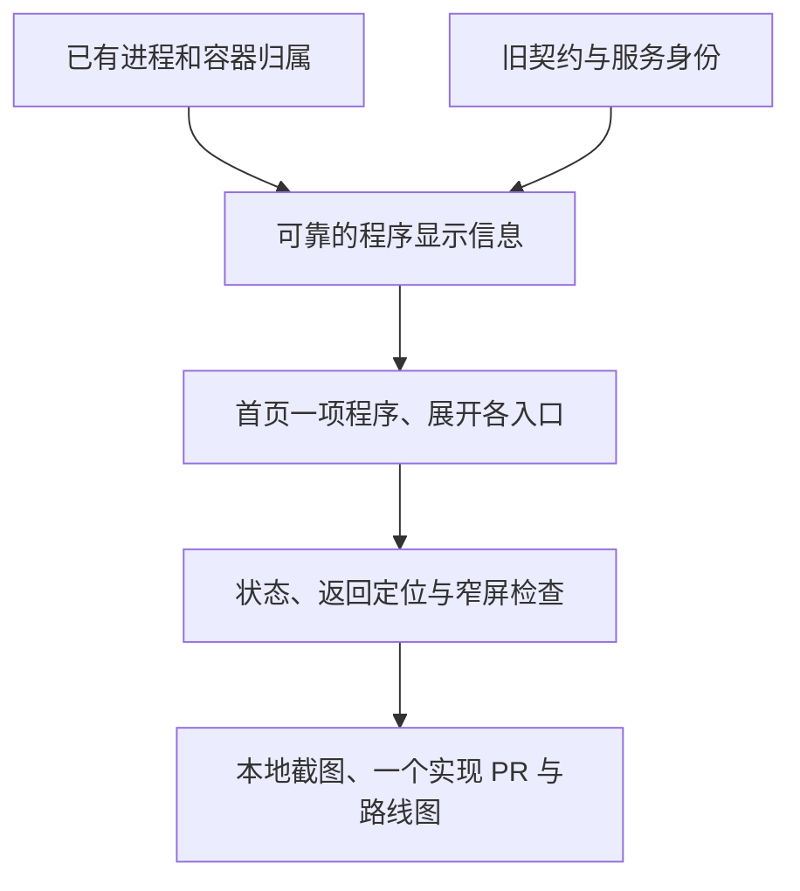

# 按程序收拢服务入口

- 状态：`已完成`（本阶段实现 PR 最新完整 CI 成功并合并后生效；合并前为 `进行中`）
- 主写分支：`feature/application-service-groups`
- 基线：`4ebbfdc76de61a2ffedb143e312483f69ffe18f0`
- 对应总流程：同一程序多个入口收拢。

## 结果与用户影响

首页先显示用户能辨认的程序，而不是把同一程序的每个端口都摆成一项。
打开程序后仍能查看每个入口的状态、地址及已有调查，不改变服务身份或操作权限。

## 当前证据与缺口

Mac 实机验收发现 `nanobot` 的两个入口、Docker `baota` 的两个入口分别占据服务行，
10 个有名称的监听项目仍需在小区域内滚动。现有采集已经包含 PID 和容器 ID，但首页只接收名称，
不能安全地按名字相似合并：不同程序都可能叫 `app.py`。

## 范围

- 复用现有监听及 Docker 归属，按节点内同一进程或容器形成只用于显示的分组。
- 同名但 PID/容器不同、归属冲突或证据失效时不合并；不按端口猜业务用途。
- 程序名称、来源和状态优先；各入口地址、状态及调查入口展开可见，完整技术清单保持原项目。
- 保持公开总览 GET、OpenAPI 和旧页面安全策略不变；新版首页使用页面专用的
  `GET /api/ui/overview`（`resource-overview-programs/v1`），读取同一份快照，不加入公开 OpenAPI。
  旧服务端没有该视图时回到原总览，远端缺少归属时保留原显示。
- 不新增模型调用、采集权限、后台分类、服务目录或依赖；不改服务 ID、批准指纹和写操作。
- 本阶段只做本地实现及验证，不再次部署或改动 Mac、Qwen、网络、凭据和现有进程。

## 依赖与顺序

## 完成标准

- [x] 同 PID/容器多个入口可收拢，同名不同程序及冲突证据不误合并。
- [x] 本机及已授权远端共用规则；原默认 GET、目录与工具契约不变，过期信息撤销。
- [x] 程序状态不掩盖未知、失效或不可用入口；所有服务 ID 及调查交接保留。
- [x] 展开、键盘、刷新、从调查返回原入口、桌面与窄屏有验证与截图。
- [x] 定向及必要全量门禁通过，及时提交推送，一个实现 PR 合并并回写路线图；完成状态受上述合并条件约束。

## 完成结果

本地实现与完整浏览器验证已完成。最终 CI 和合并证据见对应实现 PR，完成状态仅在最新完整门禁通过并合并后生效。
既有公开接口、OpenAPI、
旧页面及安全策略使用原基线校验，不更新基线来接受新表示。程序显示字段只进入前端专用表示，
不进入 Coordinator 目录、工具协议或批准指纹。

程序按名称稳定排列。折叠行只显示名称、来源和状态，多入口数量按需提示；展开后各入口的原地址、
状态及变化链接保留。只有一项变化时可直接进入该事件；多项变化仍需明确选择入口。
从调查返回原服务时会打开所属程序并定位到原服务 ID。手机使用页面滚动，避免程序列表内再藏一层滚动。

固定数据示例将 10 个有名称入口收拢为 7 个程序，完整清单仍为 33 项。
这是本地固定数据验证，不是 Mac 新版现场验收。程序入口名仍不代表业务用途；
Mac 保持上一份已授权更新的程序，本阶段没有真实推理、访问申请或批准。

## 验证证据

- 后端完整门禁：Ruff、371 个文件格式与 Pyright 通过；1666 项测试通过、6 项环境相关跳过，
  行及分支覆盖率均为 100%。新增空视图测试与冻结契约定向复核共 10 项通过。
- 前端：162 项组件检查、82 项 Chromium/WebKit 浏览器检查全部通过；涵盖同名不同进程、
  冲突及过期归属、旧服务端回退、展开与刷新、返回原入口、320 像素窄屏及完整技术清单。
- 构建及体积检查通过：CSS/JS 合计 gzip 160984 字节，低于原相对和绝对预算，不增加依赖。
- 本次 27 个变更文件秘密扫描无发现；文档定向检查 13 项通过。
- 截图由 `frontend/e2e/overview-program-groups.spec.ts` 生成，名称为
  `program-groups-desktop.png`、`program-groups-narrow.png` 与 `program-entry-return.png`。
  本地预览副本保存在忽略目录 `build/application-service-groups/`，不把运行产物加入提交。
