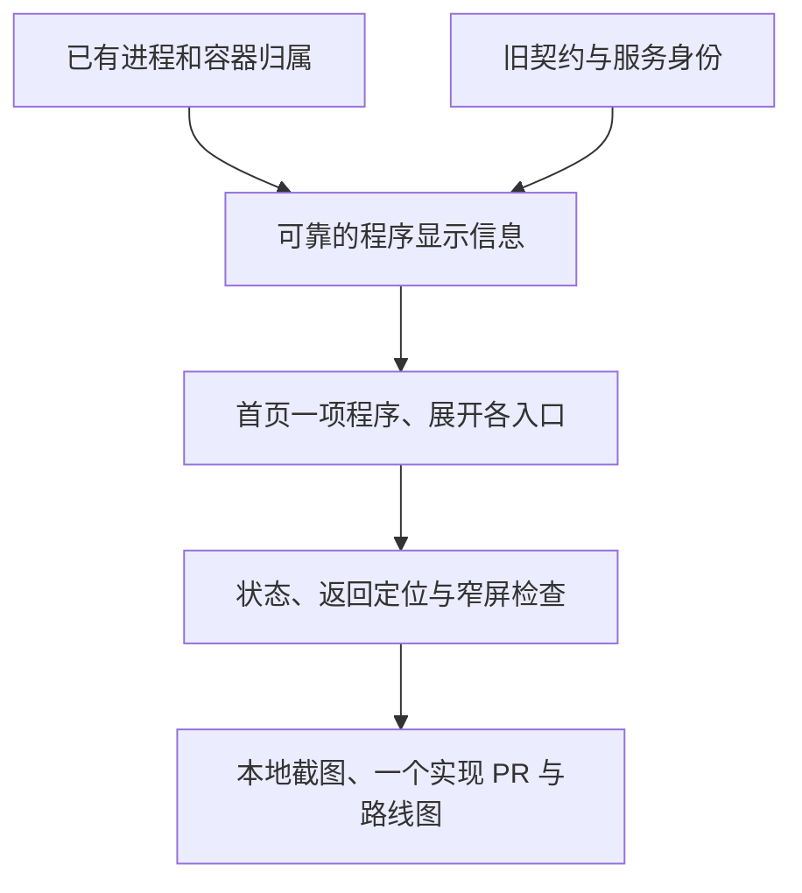

# 按程序收拢服务入口

- 状态：`已完成`
- 主写分支：`feature/application-service-groups`
- 基线：`4ebbfdc76de61a2ffedb143e312483f69ffe18f0`
- 实现 PR：[PR #123](https://github.com/Sugarfarmeriod/TunnelMinion/pull/123)
- 合并提交：`e543ddf6ced209b6b44a190214ac82f104a15231`
- 最终门禁：[完整 CI](https://github.com/Sugarfarmeriod/TunnelMinion/actions/runs/38458702985)，8/8 通过。
- 对应总流程：同一程序多个入口收拢。

## 结果与用户影响

首页先显示用户能辨认的程序，而不是把同一程序的每个端口都摆成一项。
打开程序后先说明哪些电脑能连接，以及哪些结果还不确定；原名和地址收在“技术信息”里，
各入口状态及已有调查保留，不改变服务身份或操作权限。

## 当前证据与缺口

页面已接收基于 PID 和容器 ID 的显示分组，不按名字相似合并；不同程序都可能叫 `app.py`。
本地固定数据将 10 个有名称入口收拢为 7 个程序，仍保留 33 项完整记录，未知及不可用状态未丢失。
[Mac 程序分组版只读复核](2026-10-14-mac-program-view.md)已有真实 10 个入口收成 7 个程序的证据。
连接说明与技术信息折叠的小修尚未更新 Mac；完整使用流程及普通用户易用性仍有独立范围。

## 范围

- 复用现有监听及 Docker 归属，按节点内同一进程或容器形成只用于显示的分组。
- 同名但 PID/容器不同、归属冲突或证据失效时不合并；不按端口猜业务用途。
- 程序名称、来源和状态优先；打开后先说明连接限制，相同说明只出现一次，不同状态分别说明。
  技术原名和地址按需查看，入口状态和调查保留，完整技术清单保持原项目。
- 保持公开总览 GET、OpenAPI 和旧页面安全策略不变；新版首页使用页面专用的
  `GET /api/ui/overview`（`resource-overview-programs/v1`），读取同一份快照，不加入公开 OpenAPI。
  旧服务端没有该视图时回到原总览，远端缺少归属时保留原显示。
- 不新增模型调用、采集权限、后台分类、服务目录或依赖；不改服务 ID、批准指纹和写操作。
- 连接说明的小修只做本地实现及验证，不再次部署或改动 Mac、Qwen、网络、凭据和现有进程。

## 依赖与顺序

## 完成标准

- [x] 同 PID/容器多个入口可收拢，同名不同程序及冲突证据不误合并。
- [x] 本机及已授权远端共用规则；原默认 GET、目录与工具契约不变，过期信息撤销。
- [x] 程序状态不掩盖未知、失效或不可用入口；所有服务 ID 及调查交接保留。
- [x] 展开、键盘、刷新、从调查返回原入口、桌面与窄屏有验证与截图。
- [x] 定向及必要全量门禁通过，实现 PR 已合并，路线图和证据已回写。

## 完成结果

本地实现、完整浏览器验证及最终 CI 已完成，实现 PR 已合并。
既有公开接口、OpenAPI、旧页面及安全策略使用原基线校验，不更新基线来接受新表示。程序显示字段只进入前端专用表示，
不进入 Coordinator 目录、工具协议或批准指纹。

程序按名称稳定排列。折叠行只显示名称、来源和状态，多入口数量按需提示；打开后保留连接限制、
各入口状态及变化链接，原名与地址在“技术信息”中查看。未知、不可用、停止或陈旧的结果不被写成可以使用。
只有一项变化时可直接进入该事件；多项变化仍需明确选择入口。
从调查返回原服务时会打开所属程序并定位到原服务 ID，不把键盘位置移到技术信息。
打开程序后使用页面滚动，避免内部滚动遮住其他程序；完整技术清单仍保持有界浏览。

固定数据示例将 10 个有名称入口收拢为 7 个程序，完整清单仍为 33 项。
固定数据不代替 Mac 现场验收，真实程序分组证据见上方实机记录。程序入口名仍不代表业务用途。
Mac 保持已授权更新的程序分组版；连接说明的小修没有新增真实推理、访问申请或批准。

## 验证证据

- 分组实现门禁绑定 PR #123。后端 Ruff、371 个文件格式与 Pyright 通过；1666 项测试通过、6 项环境相关跳过，
  行及分支覆盖率均为 100%。新增空视图测试与冻结契约定向复核共 10 项通过。
- PR #123 前端：162 项组件检查、82 项 Chromium/WebKit 浏览器检查全部通过；涵盖同名不同进程、
  冲突及过期归属、旧服务端回退、展开与刷新、返回原入口、320 像素窄屏及完整技术清单。
- 构建及体积检查通过：CSS/JS 合计 gzip 160984 字节，低于原相对和绝对预算，不增加依赖。
- 本次 27 个变更文件秘密扫描无发现；文档定向检查 13 项通过。
- PR #123 截图及预览副本保存在忽略目录 `build/application-service-groups/`，不把运行产物加入提交。
- 连接说明小修：179 项组件检查、2 项双浏览器定向检查、类型、构建、格式、体积及 5 项构建脚本测试通过；
  覆盖连接限制去重与刷新后的区别、陈旧/未知/停止/不可用、缺失端口、键盘操作、返回身份、完整清单及严重无障碍问题。
  最新完整 CI 以修复 PR 为准，不用本地定向检查替代。
- 当前截图由 `frontend/e2e/overview-program-groups.spec.ts` 生成：`program-groups-desktop.png`、
  `program-connection-desktop.png`、`program-connection-narrow.png` 和 `program-entry-return.png`；
  小修预览副本保存在忽略目录 `build/program-entry-experience/`，是固定数据而非实机截图。
