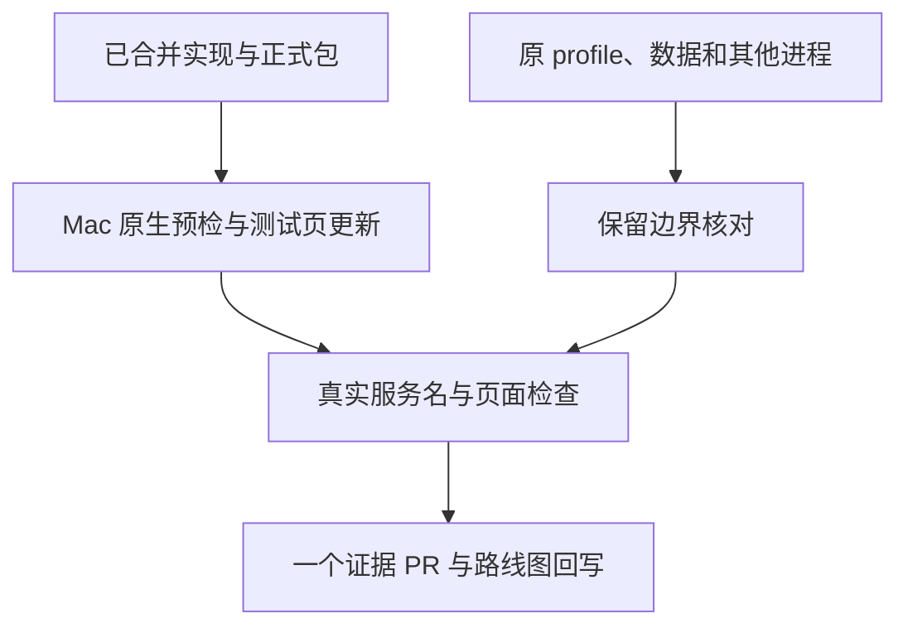

# Mac 隔离测试页更新与真实服务名验收

- 状态：`已完成`；仅在本阶段证据 PR 最新门禁成功并合并后生效
- 主写分支：`docs/mac-isolated-product-view`
- 基线：`6aa9ade6cd7f4f28ebf8c9c0e57d7ac5fb1fdb22`
- 对应总流程：Mac 隔离页更新与服务名实测；完整实机使用验收仍有独立范围。

## 结果与用户影响

Mac 原有隔离测试页使用已合并的新版首页和 Python 入口名识别，用户无需重新配置测试页，
也无需逐个服务填写名称。保持原有数据目录和页面地址，不把脚本名解释成业务用途。

## 当前证据与缺口

- 已有：PR #121 已合并，最终实现 head `3a3d2512a9bfd910411e8c3bab34d199801371de`，
  [完整 CI](https://github.com/Sugarfarmeriod/TunnelMinion/actions/runs/38280651082) 8/8 通过。
- 正式 macOS arm64 包的源码摘要与当前主线一致，本地 143 个清单文件校验通过；
  `runtime-package.tar` SHA-256 为 `398883f592e7abadcf3404f846e96bea006e8bcc0dbbc750fcbc8dc1b0859455`。
- 现场确认：18767 使用独立 profile、仅 local 组件，没有模型或 Gateway 配置；
  Qwen 8080、旧页面 18765 和既有 8787 的进程独立存在。
- 现场结果：[脱敏实机证据](../../../evaluations/reports/mac-isolated-product-view-2026-10-14.json)
  覆盖原生启动、前后服务身份、保留进程和四项真实页面检查；不是固定接口数据。

## 范围

- 用户明确授权只更新 Mac 隔离测试页，不需要再次批准同一范围。
- 新程序放在 `/Users/mac/Working-Env/tunnelminion-20261014-product-view`，保留旧程序目录。
- 复用 `/Users/mac/Working-Env/tunnelminion-20261009-model-view/profile.json` 和它声明的数据目录，
  地址仍为 Mac 本机 `http://127.0.0.1:18767/app/overview`。
- 只停止 profile 可证明归属的旧测试进程，复用现有 runtime 启动及原生包预检。
- 完整 Python 启动参数只在 Mac 临时读取；输出和证据仅保留入口名及必要服务状态。
- 不触碰 Qwen、旧页面、8787、网络设置、凭据、环境变量或业务文件；
  不发模型、临时访问或批准请求，不用本轮证明完整调查和操作闭环。

## 依赖与顺序



## 完成标准

- [x] Mac 原生包预检通过，正式包源码摘要和归档摘要匹配。
- [x] 新程序使用原 profile、数据及 18767；Qwen、旧页面和 8787 保持原进程。
- [x] 真实服务名、无法识别的结果、服务身份及新页面均有可核验证据。
- [x] 只读浏览不发模型、访问或批准请求；自有临时验证资源已清理。
- 合并门禁：文档定向验证及证据 PR 最新门禁成功，并完成合并；本页及路线图完成状态仅在此后生效。

## 完成结果

北京时间 2026-10-14 01:20:57，正式新版页面及总览接口均为 HTTP 200，服务证据为 `fresh`。
前后均有 33 项、10 项有名称；三个 Python 服务 ID 保持不变：

| 端口 | 真实入口名 | 名称与状态 |
| --- | --- | --- |
| 8787 | `app.py` | `Python · app.py · 8787`，`available`、`fresh`、`loopback` |
| 8765 | `nanobot` | `Python · nanobot · 8765`，`available`、`fresh`、`loopback` |
| 18790 | `nanobot` | `Python · nanobot · 18790`，`available`、`fresh`、`loopback` |

Qwen 所在进程仍被展示为 `模型服务 · llama.cpp · 8080`；没有猜型号，也没有探测模型 API。
另外 23 个没有可靠名称的检测项目仍在完整清单中，默认收起。脚本名和模块名不是业务用途证据。

### 运行及保留边界

18767 的测试进程由 `31603` 更新为 `57426`，仅监听 `127.0.0.1`。Qwen `33870`、旧页面 `95881`、
8787 `79774` 保持原进程，profile SHA-256 和数据目录摘要前后相同。新旧程序目录均保留，没有复制凭据。

新包启动时 `package`、`profile`、`data-dir` 原生校验通过。启动前完整预检的 `deterministic_ready`
为 `false`，原因是旧进程的停止记录仍在（`existing_instance_record`）；启动器允许从停止记录恢复，
启动及后续状态均为 `running`、退出码 0。不将这份启动前报告描述为全项通过。

Chromium/WebKit 的 1280px 和 320px 四项检查均通过：真实入口名可见、完整清单保持 33 项、
搜索 `nanobot` 得到两项、无结果有说明、无页面横向溢出或脚本错误。20 个页面资源/API 请求均为
同源 GET，没有写请求或外部请求。为保留应用 Host 校验，临时查看通道使用相同的本机端口；
没有改安全规则、远端监听地址或系统网络配置，查看通道已停止。

截图来自 Windows 上的测试浏览器，经临时本机 SSH 通道读取真实 Mac 页面，不是 Mac 屏幕截图或 fixture：
自有工作树 `build/mac-isolated-product-view/chromium-1280.png`、`chromium-320.png`、
`python-service-expanded.png`；双浏览器结果为同目录 `browser-receipt.json`。
已用 Mac 的 `open` 打开本机页面，但没有替用户作易用性认可，不宣称老人用户实测或完整调查/操作链已验收。

测试页按用户查看目的保持运行。只停止这份测试页时，使用原 profile：

```sh
/Users/mac/Working-Env/tunnelminion-20261014-product-view/package/tunnelminion runtime stop --profile /Users/mac/Working-Env/tunnelminion-20261009-model-view/profile.json
```

旧程序保留在原目录；不同时启动同一 profile 的两份程序，不按进程名称批量停止任何服务。
