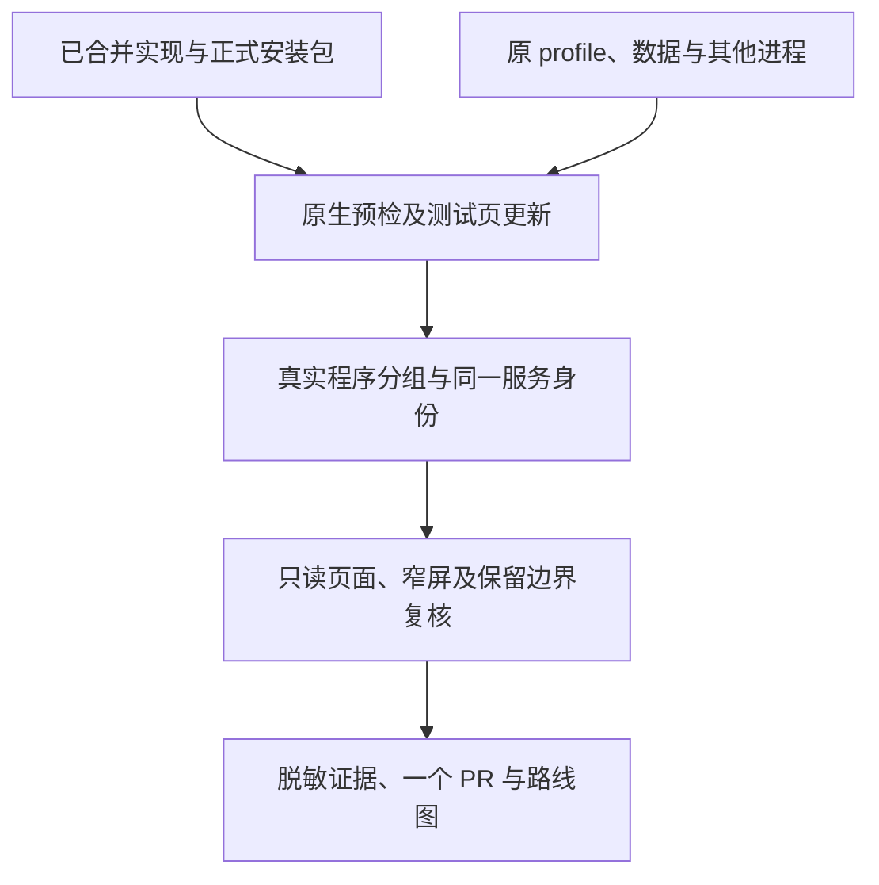

# Mac 隔离测试页程序分组与连贯名称验收

- 状态：`已完成`；仅在本阶段证据 PR 最新完整 CI 成功并合并后生效
- 主写分支：`chore/mac-program-view`
- 基线：`34f1589391bd54c8f2aa3b76565ff059c52b15ac`
- 对应总流程：程序分组与跨页面名称一致后的实机只读复核。

## 结果与用户影响

Mac 原有隔离测试页更新到已合并的程序分组版本，保持原地址、profile 和数据目录。
用户可直接查看真实程序及各入口，不用自行更新、重新配置或逐项命名。

## 当前证据与缺口

- PR #123、#124、#125 均已合并，各自最终完整 CI 8/8 通过。
- 使用 [PR #125 正式 macOS arm64 包](https://github.com/Sugarfarmeriod/TunnelMinion/actions/runs/38464850832)，
  源码摘要与基线主线一致，143 个文件的闭合集合及逐文件摘要通过。
- [脱敏实机证据](../../../evaluations/reports/mac-program-view-2026-10-14.json) 记录包摘要、
  原生启动、全部服务身份、实际程序分组、保留进程及双浏览器四项只读检查；不是 fixture。
- 本次不发调查、临时访问或批准请求，因此不将更新过的跨页面名称能力视为真实完整操作链验收。

## 范围

- 用户已明确允许合并后只更新隔离测试页，不再次询问同一范围。
- 使用正式 macOS arm64 包，核对已验证源码、归档及原生预检；保留旧程序目录作为回退。
- 新程序目录为 `/Users/mac/Working-Env/tunnelminion-20261014-program-view`。
- 只停止原 profile 能证明归属的测试进程，复用声明的数据目录和本机 18767。
- 只读核验真实程序分组、原服务身份、完整技术清单、桌面与窄屏，并保存脱敏证据。
- 保留 Qwen、旧页和既有 8787，不改网络、凭据或业务文件，不发模型、访问或批准请求。
- 不把本次更新和只读浏览当作完整调查/操作闭环、真实访问或老人用户易用性验收。

## 依赖与顺序

## 完成标准

- [x] 正式包源码与归档可核对，原生 package/profile/data-dir 校验通过。
- [x] 测试页使用原 profile、数据及 18767，其他指定进程不变。
- [x] 真实程序分组、入口身份和完整清单有证据；23 项用途未知记录保留。本次没有不可用服务，不冒充现场故障验收。
- [x] 双浏览器桌面和窄屏只读核验通过，无写请求，自有验证资源清理完成。
- 合并门禁：证据保存并通过相称检查；一个 PR 最新完整 CI 通过并合并，路线图完成状态仅在此后生效。

## 完成结果

北京时间 2026-10-14 09:59，新版在原 profile 和数据目录上启动，仍仅监听 Mac 本机 18767。
首页 10 个有名称入口收成 7 个程序，展开后各入口的名称、端口和服务 ID 保持原值：

| 程序 | 实际入口 | 首页占用 |
| --- | --- | --- |
| `baota` | 80、443、8888 | 1 行，展开查看 3 项 |
| `nanobot` | 8765、18790 | 1 行，展开查看 2 项 |
| `app.py`、`llama.cpp` 及其他 3 个 Docker 容器 | 各 1 项 | 各 1 行 |

全部 33 项服务的 ID、名称、端口、状态和新鲜度前后相同，23 项没有可靠名称的后台记录保留在默认收起的
完整清单里。本次记录均为 `available`、`fresh`；这表示已发现，页面仍明确提示访问待确认，不推断业务用途。

### 原生启动与保留边界

正式归档 SHA-256 为 `0e96a125c5613991b2ef0bcf6c5d98401a32355eefaa1cbd3ccf8dce94d0a548`，
源码摘要为 `bf4e394849bdf832638b4f550af51976d5bc97cfddd3e33754ec28e979346843`。
包内构建提交为 CI 合并检出提交，不冒称主线提交；源输入摘要与基线 `34f1589` 一致。

原生 `package`、`profile`、`data-dir` 校验和空闲端口检查通过。启动前 `deterministic_ready=false`，
原因是旧进程已停止但保留记录仍在（`existing_instance_record`）；既有启动器从停止记录恢复，
启动和后续状态为 `running`、退出码 0。没有删除状态记录或把启动前报告写成全项通过。

隔离测试进程由 `57426` 更新为 `13189`；Qwen `33870`、旧页 `95881`、8787 `79774` 保持原进程和监听。
原 profile 摘要和声明数据目录摘要前后相同，旧程序目录保留；没有复制或读取凭据内容。
`lsof` 对既有 OrbStack 挂载有不完整枚举警告，所核对的四个监听均可见；没有处理该无关挂载。

### 只读页面验证与清理

Chromium/WebKit 在 1280px 和 320px 四项检查通过：7 个程序可见，每组展开后保留准确入口，完整清单
仍为 33 项且每个服务 ID 各出现一次，搜索 `nanobot` 返回 2 项；无结果有说明，无横向溢出和脚本错误。
浏览器仅请求同源 GET，没有写入、外部或模型请求。页面使用 `/api/ui/overview` 的
`resource-overview-programs/v1` 表示，不改变公开 v1 契约。

截图来自 Windows 测试浏览器经本机 SSH 通道读取真实 Mac 页面，不是 Mac 屏幕截图或 fixture：
自有工作树 `build/mac-program-view/chromium-1280.png`、`chromium-320.png`、
`program-entries-expanded.png`；双浏览器回执为同目录 `browser-receipt.json`。
临时验证连接和监听已关闭，Mac 本次上传归档已清理；测试程序及回退目录按用户查看目的保留。
Mac 的 `open` 已成功打开原地址。未代替用户认可易用性，不宣称老人用户实测或完整调查/操作链验收。

本地文档定向测试 13 项通过，实机 JSON 自检、3 个 Mermaid 源和 3 个变更文件秘密扫描通过。
证据 PR 继续执行标准完整 CI，不用本地文档检查替代实现门禁。

当前测试页包含连接说明小修；其正式包、只读复核和停止命令见
[程序入口阶段的实机结果](2026-10-14-application-service-groups.md#mac-连接说明只读复核)。
