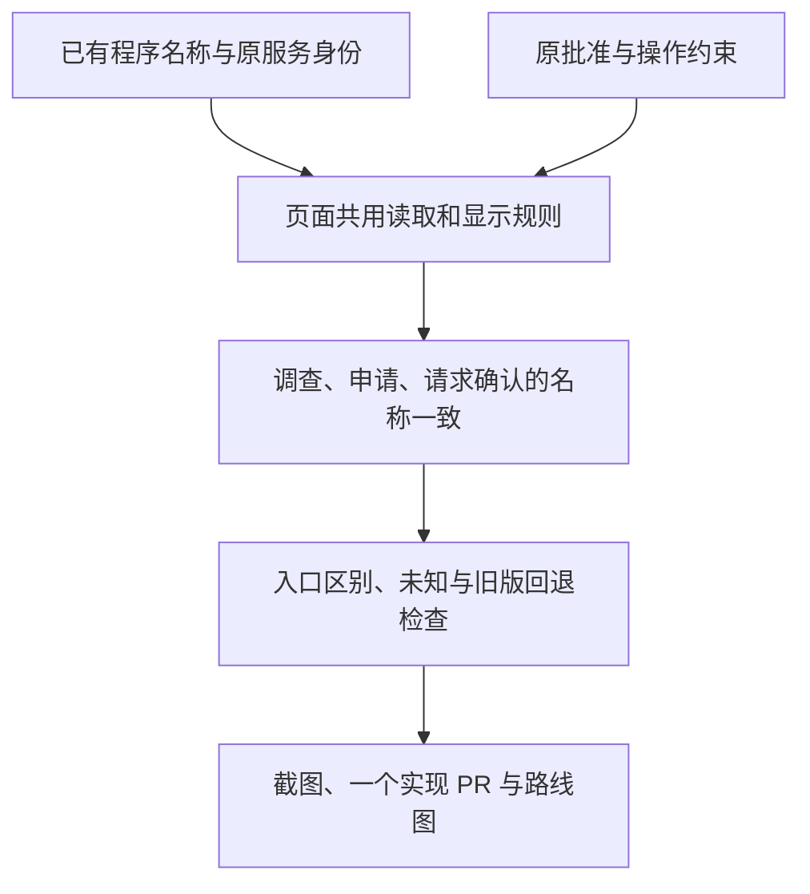

# 程序名称贯穿调查与访问请求

- 状态：`已完成`
- 主写分支：`feature/program-context`
- 基线：`e543ddf6ced209b6b44a190214ac82f104a15231`
- 实现 PR：[PR #124](https://github.com/Sugarfarmeriod/TunnelMinion/pull/124)
- 合并提交：`45d63c7663ad8f62194f2217106dcf05cfe1d506`
- 最终门禁：[完整 CI](https://github.com/Sugarfarmeriod/TunnelMinion/actions/runs/38462436685)，8/8 通过。
- 对应总流程：程序分组之后的调查、申请和批准上下文。

## 结果与用户影响

首页、调查、申请及批准确认沿用同一个程序名称，不要求用户重新辨认技术标签。
同一程序的不同入口仍用次要文字区分，具体申请与批准始终绑定原服务及请求。

## 当前证据与缺口

首页、调查、申请及请求确认已共用页面总览的程序名称；本地固定数据覆盖过期、重复和不同设备的归属。
Mac 隔离页尚未部署该版本，真实服务场景下的连贯名称路径未验收。
程序名只辅助辨认，不代表业务用途或访问权限。

## 范围

- 首页、调查、申请、请求详情及批准确认共用已有页面总览读取和名称规则。
- 程序名称优先，具体入口与所属电脑按需显示；未知、过期和不唯一的名称不冒充已确认对象。
- 旧服务端仅在页面总览返回 404 时回退公开总览；其他读取失败保留已有失败提示。
- 不改变服务 ID、申请参数、批准指纹、动作校验和返回定位，不新增后台栏目、依赖或模型请求。
- 只做本地实现及固定数据验证，不部署 Mac、不发真实访问或批准请求、不改网络和采集范围。

## 依赖与顺序

## 完成标准

- [x] 同一程序在首页、调查、申请、请求详情及确认框名称一致，各入口仍可区分。
- [x] 旧版、未知、过期及归属不唯一时不误认名称，不因显示名称改变操作对象。
- [x] 浏览器固定数据路径包含键盘和窄屏；只打开确认框而不提交时没有写请求。
- [x] 前端必要门禁通过，证据保存；实现 PR 最终完整 CI 通过且已合并，状态已回写。

## 完成结果

三个页面共用已有页面总览读取，公开总览和设置页不变；旧端仅在 404 时回退。
程序名只辅助显示，调查链接、申请字段、服务 ID、批准依据和写请求仍按原流程校验。
请求详情在记录重复、归属不符或名称过期时使用请求自身的原程序信息，不借用其他入口的名称。

前端 168 项组件检查通过。新产品路径在 Chromium 与 WebKit 通过，完整浏览器检查 83 项通过，
另 1 项初始数据读取发生连接中断后定向复核通过；实现 PR 最终完整 CI 的 8 项门禁均通过。
格式、类型、生产构建和体积检查通过，CSS/JS gzip 合计 157.38 KiB，未增加依赖或调整预算。
本次没有后端代码或契约变更，不重复本地后端全量检查，完整 CI 仍按仓库规则执行。

`frontend/e2e/incident-operation-handoff.spec.ts` 生成调查与 320 像素批准确认截图，
本地副本位于忽略目录 `build/program-context/`。固定数据检查涵盖同程序两个入口、
名称过期、重复记录及其他设备的同名程序；打开和取消批准框没有 POST 请求。
这不是 Mac 新版现场使用验收；本阶段没有部署、模型推理、真实访问或批准。
