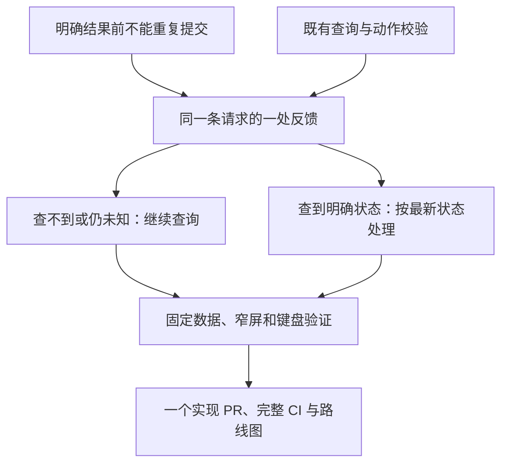

# 请求结果待确认时的反馈与下一步

- 状态：`已完成`；以本阶段 PR 最新完整 CI 成功且合并为生效条件
- 主写分支：`feature/request-result-feedback`
- 基线：`8622597dd53306e7f9065621d646a71eb5e9bf13`
- 对应总流程：请求处理与批准决策后的异常反馈收敛。

## 用户影响与现有证据

用户需要知道刚才的处理有没有办成，以及现在该按哪个按钮，不需要理解写入、状态字段或操作编号。
基线本地隔离页面的两个来源均有复现：服务端报告结果待确认，以及批准响应丢失后查询仍未得到明确结果。
基线 320px 页面同时出现两块提示、第二个查询按钮和固定在底部的说明，底部说明覆盖正文；顶部却仍写“等待你决定”。
基线服务端报告待确认时，默认内容仍出现 `operation ID`，相同意思在三处说明。

前后截图在自有工作树忽略目录 `build/request-feedback/`，是固定数据，不是 Mac 或普通用户实测。
常规调查到申请、名称到批准的两项 Chromium 路径已在本轮同步主线上通过。

## 范围

- 待确认结果显示一条说明、一个查询当前请求的按钮，不展示再次批准、开始或打开访问的入口。
- 首页待办、请求列表和详情使用一致的“结果待确认”，不继续提示用户作出已经尝试过的决定。
- 查询进行中有反馈；查询失败、状态未改变和随后获得明确状态分别说明，不因响应丢失猜测成功。
- 原编号、服务端状态、允许动作、证据、错误及清理记录保留在技术详情；访问对象、身份提醒和风险仍可读。
- 复用既有查询、未知结果标记、动作校验和原生折叠，不修改后端、权限、自动重试、网络或依赖。
- 本轮只实现及验证本地隔离页面，不更新 Mac，不发真实模型、访问或批准请求。
- 唯一主写者为当前总协调任务，无其他文件或图纸写入者。

## 依赖与顺序

## 完成标准

- [x] 两种待确认来源及提交后详情不可读均有覆盖；只读查询不重放原动作，不创造新的请求编号。
- [x] 待确认时只见一个说明和一个查询入口，常规批准建议及遮挡正文的空动作栏不出现。
- [x] 查询中的按钮禁用，失败及未变化保留待确认；明确状态恢复既有允许动作，不宣称丢失的响应证明成功。
- [x] 名称、身份提醒、访问风险和技术记录保留，普通内容不依赖机器字段解释下一步。
- [x] 组件、双浏览器桌面/窄屏、构建、类型、格式和体积的本地门禁通过；截图有来源说明。
- 合并门禁：实现 PR 最新完整 CI 通过并合并，路线图完成状态随合并生效；固定数据不代替实机全链或老人用户验收。

## 结果

首页待办、列表及详情在结果不明确时提示“结果待确认”，只留下“查询这条请求”这一条下一步。
提交响应丢失、服务端标记结果未知、提交后详情不可读使用同一呈现。单次查询未得到明确结果时继续保留限制；
读到明确状态后恢复既有允许动作。准备批准或开始时重新读到未知标记，不再打开确认框；没有修改后端动作校验或重试策略。

待确认期间复用原本的紧凑说明组件，保留对象、身份提醒、时长和风险，不再重复正常批准建议。
无可执行动作时不显示底部固定提示，窄屏正文不再被遮挡。入口关闭失败及人工处理提醒仍优先保留。
原始编号、上次读取的服务端状态及允许动作可在技术详情查看，服务端错误、资源和清理记录未删。

### 验证与截图

- 188 项组件检查通过，含单次提交、同一请求查询、查询中禁用、读取失败、未知转明确及动作准备时的未知标记。
- 本地 Chromium/WebKit 90 项浏览器范围已复核：完整集 89 项通过，1 项 Chromium 启动超时后单项复核通过。
  新增 6 项覆盖三个待确认来源，每项检查 1280px 和 320px、
  键盘技术折叠、唯一查询入口、原请求编号、状态恢复、无横向溢出和无严重无障碍问题。
- 类型、格式、生产构建、5 项供应链脚本检查通过；初始 JS+CSS gzip 为 157.61 KiB，低于既有相对与绝对预算，未改比较基线。
- 基线截图：`build/request-feedback/before-desktop.png`、`before-narrow.png`；结果截图：
  `after-desktop.png`、`after-narrow.png`。均来自本地生产构建及固定隔离数据，不是 Mac 实机。
- 文档定向 13 项、3 个 Mermaid 源及 10 个变更文件秘密扫描通过；最终完整 CI 作为合并门禁，不以局部检查替代。
- 本轮不更新 Mac，不发真实模型对话、临时访问或批准请求，也不将自动检查等同普通用户实际使用反馈。
