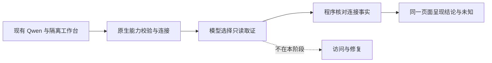

# 现有 Qwen 的只读 Agent 体验

- 状态：`已完成`（完成状态在 PR #132 最新完整 CI 成功并合并后生效）
- 主写分支：`fix/qwen-structured-response`
- 基线：`e8000c4b8e761e88fc7f19257ece37e857517cbc`
- 对应总流程：`Q24`

## 结果与用户影响

Mac 18767 隔离工作台已连接现有 Qwen。选中程序后，模型在允许的只读工具中选择取证步骤，
确定性程序根据本次实际结果生成可核对的连接结论；模型草稿和旧说明保留，但默认收起并标为未核对。
运行结束只表示本次检查结束，不表示网页、跨电脑访问或整个程序都正常。

同一句“这个程序为什么在另一台电脑上打不开？”在真实工作台约 63 秒完成。公开回答只说明所选
Wireguard Panel 入口限本机连接，并明确网页和跨电脑访问没有验证；独立监听复核一致。

## 验收证据与边界

- 基线：PR #130 的统一工作台及 PR #131 的实机名称复核已合并；本阶段沿用原页面、配置和数据。
- 模型：保留现有 `Qwen3.6-35B-A3B-uncensored-heretic-Q4_K_M.gguf`，未重启或修改 Qwen。
  原生工具调用与结构化能力校验通过，没有绕过能力门卫。
- 真调查：运行 `run_c599a0203f064ed0b12fbdcd5fdde05a` 使用两轮模型、两次只读工具，
  由模型选择监听和节点摘要；公开用量 6,031 tokens，成本未知，不推算金额。
- 真事实：已确认事实只引用实际监听工具 ID，并匹配所选节点和服务身份。Mac 独立检查确认
  面板仍是原 PID 79774、`127.0.0.1:8787`；没有打开业务网页或验证跨电脑访问。
- 最终页面：Mac 正式包来自 `027fed3`，实现 CI 8/8。实际模型调查在 `b9d4352` 的包上完成；
  两版 `src/` Git 树一致，最后仅删除重复的运行中提示。更新后只读恢复同一结果，模型轮数、
  工具次数、用量和原始说明摘要不变，不把页面复核说成新模型调查。
- 数据与资源：四段旧对话原文摘要一致，当前保留五段对话、零项操作；受保护的 Qwen、8787 面板和
  18765 旧页保持原进程。五份自有上传归档、自建浏览器标签和 Windows 自有 SSH 转发已清理，
  测试程序、配置、数据和回退程序保留。
- 启动边界：包、profile、数据目录、模型配置和端口检查通过；启动器处理了已有实例记录，
  原 preflight 的 `deterministic_ready=false` 与实例记录失败项保留，不宣称全部预检通过。
  未启用 Gateway 或受管网络。
- 失败证据：报告保留超时、工具交接失败及提示约束下仍产生未经验证断言的记录，不计为调查成功。
  单次实机通过不是通用成功率，也不证明模型原始说明可靠。

## 范围与当前实现

- 结构化兼容只去除一个完整、独立的 `json` 代码框，再交给原解析器与领域校验；夹杂说明、多个
  代码框或非法 JSON 仍拒绝，不从任意正文提取对象，不改变工具参数或普通模型正文。
- 保留 `readonly-agent@v1`、`v2` 原文及摘要供冻结记录解析，新对话使用 `v3`。
  提示约束不是可靠性保证；历史评测数据、评分器和既有 OpenAPI 结构不变。
- 上下文始终采用最近的用户问题作为当前意图。大型工具信封复用既有本机制品管理，只向模型提供
  标明执行状态的相关预览；缓存仅在同次调查内使用，原结果、截断状态和制品引用保留。
- 工作台专用请求只传所选服务 ID；服务端从当前清单解析名称、类型、协议、端口和节点。失效、
  缺字段及非本机对象在调用模型前拒绝。用户问题原文保存，程序背景单独注入，不按端口猜归属。
- 只有本次最新、完整、可用的监听记录匹配同一节点和服务身份时，才生成所选入口的连接事实。
  部分结果、失败、畸形数据、没有匹配或没有所选对象时保留未知，不回退旧成功记录。
- TCP 环回入口只说明本机连接限制，非环回入口不证明远端可达，UDP 不当作已验证网页。
  当前核对不是任意问题的通用事实验证，也不证明程序整体健康。
- 原始模型说明保留在本机调查记录，普通界面收起并标明未核对。历史记录缺少核对标记时采用相同
  保守显示，不重写原文；实时结束消息不能绕过最终结果核对。界面按实际停止原因呈现超时、上限、
  取消或结束，不重复保留“正在检查”提示。
- 六个只读工具与默认 8 轮、12 次、120 秒预算不扩大。普通对话不冒称使用 Incident Skill，
  不增加 MCP、依赖或第二个评判模型。
- 不修改 Qwen、业务服务、旧页面或网络，不创建访问或批准请求；完整模型标识仅在 Mac 本机
  配置流程使用，证据只保留文件名及摘要，不导出完整命令、环境变量、凭据、业务内容或隐藏推理。

## 依赖与顺序

## 完成标准

以下完成标记随 PR #132 最新完整 CI 成功且合并生效。

- [x] 原生工具调用、结构化输出校验通过；失败不得绕过校验或改模型服务。
- [x] 真实工作台提交原自然问题，保留实际工具选择、结果、终止状态和可获取的用量。
- [x] 公开事实与独立监听检查一致，网页、跨设备访问和整体程序状态保留未知。
- [x] 模型草稿与旧记录保留；最终页面只读复核不重复调用模型。
- [x] 受保护进程、程序身份、模型配置、profile 和网络边界保留，无访问或批准请求。
- [x] 自有验证连接、标签和上传归档清理；原测试页与对话结果保留。
- [x] 定向、全量门禁和实现 CI 通过；本阶段一个实现 PR，最新 CI 成功后合并并同步总路线。

## 完成结果

证据保存在
[`qwen-readonly-experience-2026-10-15.json`](../../../evaluations/reports/qwen-readonly-experience-2026-10-15.json)。
本地 1,751 项后端检查通过，6 项平台条件跳过，全仓 100% 行与分支覆盖，格式与类型检查通过；
203 项组件、桌面/窄屏双浏览器 8 项、生产构建及体积门禁通过。
初始 JS+CSS gzip 160.73 KiB，低于已有 171.16 KiB 门槛。实现正式包完整 CI 8/8，最终实机
页面复核只含 GET 请求；最终截图及摘要在报告中引用，不将固定数据浏览器检查冒充实机模型证据。
