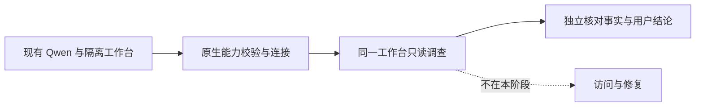

# 现有 Qwen 的只读 Agent 体验

- 状态：`进行中`
- 主写分支：`fix/qwen-structured-response`
- 基线：`e8000c4b8e761e88fc7f19257ece37e857517cbc`
- 对应总流程：`Q24`

## 结果与用户影响

让 Mac 隔离工作台使用已经运行的 Qwen，实际回答一个程序连接问题。验收重点是模型是否选择允许的
只读工具、是否根据真实结果解释问题，以及用户能否在原工作台看懂结论；不把能够聊天等同于调查可靠。

## 当前证据与缺口

- 已有：PR #130 的统一工作台已合并并更新到 Mac 18767；PR #131 保存实机名称和四项双浏览器只读
  验收，最终 CI 8/8，合并提交 `e8000c4`。
- 已有：用户明确允许连接 Mac 现有 Qwen 做只读调查；模型接口公开名称为
  `Qwen3.6-35B-A3B-uncensored-heretic-Q4_K_M.gguf`，模型服务与 Wireguard Panel 保持原进程。
- 已有：真实工具调用返回有效结构；结构化校验返回单独的 JSON 代码框，框内数据正确，但当前解析器
  不接受包装，因此原生配置校验拒绝保存。兼容修复只去除一个完整 `json` 代码框，仍由原解析器和
  下游领域校验判断内容；夹杂说明、多个代码框或非法 JSON 不接受。
- 已有：用户明确允许检查通过后仅更新 18767 隔离测试程序，再连接现有 Qwen 做只读调查。
- 已有：兼容修复正式包的 CI 8/8，通过后在原 18767 更新，原生模型配置经两项校验成功，模型处于
  `available`；Qwen、8787 面板、旧页面仍是原进程，未创建访问或批准请求。
- 已有：真实工作台的首次调查选择监听、可达性和 Docker 三个工具，均返回成功；120 秒上限生效，
  未形成完整结论，不能计为调查成功。页面把该终态标成“已完成”且暴露编号，属于需要修正的表达问题。
- 已有：收敛提示正式包的 CI 8/8；自然提问“这个程序为什么在另一台电脑上打不开？”约 37 秒失败，
  两个工具成功后没有形成结论。页面如实显示失败，不能将该记录计为调查成功。
- 已有：离线测试复现工具正文被错误作为 `current_intent`、超过 20,000 字符校验上限的问题。
  Mac 只读长度检查显示，允许的 200 项进程清单信封约 21,939 字符、监听信封约 3,705 字符；
  这些是独立长度检查，不冒充失败调查的实际工具参数或结果正文。
- 已有：上下文修复正式包的 CI 8/8，同一句自然提问在约 77 秒完成，两轮模型、两次只读工具调用。
  回答正确识别本机连接限制，但术语和排版标记过多，并主动建议扩大访问范围、未说明网页和跨设备连接
  尚未验证；执行成功不等于产品验收通过。
- 已有：`readonly-agent@v3` 正式包 CI 8/8，运行进程、提示版本与真实输入摘要均确认生效；自然提问
  约 65 秒完成两轮模型、两次工具调用。Qwen 仍输出“程序本身状态正常”以及扩大访问的建议，未交代
  网页和跨设备访问未验证，普通语言和事实边界验收未通过，PR 暂不合并。
- 当前分支已实现所选程序的连接事实核对：使用本次实际工具结果与服务身份匹配，普通界面只显示
  可证实的连接范围；网页、跨设备访问和整个程序是否正常仍保留未知。原始模型说明和旧回答收起并
  标为未核对，不重写历史记录。正式包及实机验收待完成。

## 范围

- 本阶段完成：只通过已有模型配置接口连接现有环回模型服务；保留原能力校验，使用原工作台与允许的
  六个只读工具，核对一次真实调查的工具、结论、停止原因、预算及可获取的用量，保存安全投影与截图。
- 必需兼容：结构化结果允许单独的 JSON 代码框；不从任意正文提取对象，不改变工具参数解析、普通回答、
  能力校验或领域证据门，正式包只更新获准的隔离测试程序。
- 必需体验：普通对话沿用可靠且新鲜的程序类型，不按端口猜归属；只调查当前问题需要的对象。
  `readonly-agent@v3` 要求普通语言、纯文本短结论、明确未验证部分，不主动提供服务、网络或防火墙
  的修改步骤，原六个允许工具与 8 轮、12 次、120 秒预算不扩大。界面按真实
  停止原因显示未完成状态；编号按需展开，原证据结构与历史记录保留，不隐去失败提示。
- 版本兼容：既有快照引用的 `readonly-agent@v1`、`v2` 原文与摘要原样注册，新对话默认使用 `v3`；
  不改历史数据或评分器来适配新提示。
- 上下文交接：始终用最近的用户问题表示当前意图，不能用工具正文代替；通过既有制品管理保存大型
  工具信封，只向模型提供标明执行状态的相关预览。原工具结果、权限和预算不变；相同结果在同一次
  调查中复用制品，新调查不共享预览缓存，已有截断结果与制品编号原样保留。
- 事实边界：工作台专用请求只传所选服务 ID，服务端从当前清单解析名称、类型、协议、端口和节点；
  失效、缺字段及非本机对象在调用模型前拒绝。用户问题原文保存，程序背景单独注入，不从模型文字
  或端口号猜归属。只有本次最新、完整、可用的监听记录与同一节点和服务身份匹配时才生成连接事实；
  部分结果、失败、畸形数据或未匹配均保留未知，不回退到更旧的成功记录。
- 职责区分：Qwen 在允许工具中选择取证步骤，确定性程序核对并生成公开连接结论；不是另一个模型
  给回答打分，也不是任意问题的通用事实验证。没有所选对象的模型说明不直接作为结论；运行结束
  不表示程序正常。旧 OpenAPI 结构、历史评测数据和评分器保持不变。
- 本阶段不做：重启或修改 Qwen、业务服务、旧页面、网络配置；不创建访问或批准请求，不增加依赖或
  MCP，也不把普通对话标为使用了 Incident Skill。完整模型标识只在 Mac 本机配置流程使用，证据仅
  保留文件名和不可逆摘要，不输出路径、完整命令、环境变量、密钥或业务内容。

## 依赖与顺序

## 完成标准

- [x] 配置经已有工具调用、结构化输出校验成功；失败不得绕过校验或改模型服务。
- [x] 在真实工作台提交问题，保留实际工具选择、结果和终止状态，不只验证直接模型请求。
- [ ] 结论与独立的监听事实一致，未证实的跨设备可达性明确保留未知。
- [x] 只发生获准的模型配置及只读调查，受保护进程、服务身份和网络配置未改动。
- [ ] 自有验证连接清理，原测试页和对话结果保留，证据可追溯。
- [ ] 定向门禁、最终 CI 和一个阶段 PR 合并完成，路线图同步。

## 完成结果

真实接入及首个有界调查的证据保存在
[`qwen-readonly-experience-2026-10-15.json`](../../../evaluations/reports/qwen-readonly-experience-2026-10-15.json)。
当前分支的本地全量门禁通过：1,751 项后端检查、6 项平台条件跳过，全仓 100% 行与分支覆盖，
格式与类型检查通过；203 项组件、桌面/窄屏双浏览器 8 项、生产构建和体积门禁通过。
初始 JS+CSS gzip 160.77 KiB，低于已有 171.16 KiB 门槛。原有接口冻结检查通过，历史基线未修改。

浏览器证据是固定数据验收，不能替代 Mac 上同一自然问题的真实模型验收。当前运行的旧正式包仍有
未验证的断言和扩大访问建议；事实核对正式包及最终 CI 待验收，当前不宣称阶段完成。
