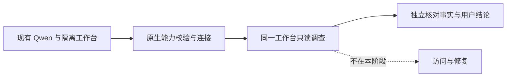

# 现有 Qwen 的只读 Agent 体验

- 状态：`进行中`
- 主写分支：`fix/qwen-structured-response`
- 基线：`e8000c4b8e761e88fc7f19257ece37e857517cbc`
- 对应总流程：`Q24`

## 结果与用户影响

让 Mac 隔离工作台使用已经运行的 Qwen，实际回答一个程序连接问题。验收重点是模型是否选择允许的
只读工具、是否根据真实结果解释问题，以及用户能否在原工作台看懂结论；不把能够聊天等同于调查可靠。

## 当前证据与缺口

- 已有：PR #130 的统一工作台已合并并更新到 Mac 18767；PR #131 保存实机名称和四项双浏览器只读
  验收，最终 CI 8/8，合并提交 `e8000c4`。
- 已有：用户明确允许连接 Mac 现有 Qwen 做只读调查；模型接口公开名称为
  `Qwen3.6-35B-A3B-uncensored-heretic-Q4_K_M.gguf`，模型服务与 Wireguard Panel 保持原进程。
- 已有：真实工具调用返回有效结构；结构化校验返回单独的 JSON 代码框，框内数据正确，但当前解析器
  不接受包装，因此原生配置校验拒绝保存。兼容修复只去除一个完整 `json` 代码框，仍由原解析器和
  下游领域校验判断内容；夹杂说明、多个代码框或非法 JSON 不接受。
- 已有：用户明确允许检查通过后仅更新 18767 隔离测试程序，再连接现有 Qwen 做只读调查。
- 缺口：兼容修复的正式运行包、真实工作台调查结果及等待体验未验收。

## 范围

- 本阶段完成：只通过已有模型配置接口连接现有环回模型服务；保留原能力校验，使用原工作台与允许的
  六个只读工具，核对一次真实调查的工具、结论、停止原因、预算及可获取的用量，保存安全投影与截图。
- 必需兼容：结构化结果允许单独的 JSON 代码框；不从任意正文提取对象，不改变工具参数解析、普通回答、
  能力校验或领域证据门，正式包只更新获准的隔离测试程序。
- 本阶段不做：重启或修改 Qwen、业务服务、旧页面、网络配置；不创建访问或批准请求，不增加依赖或
  MCP，也不把普通对话标为使用了 Incident Skill。完整模型标识只在 Mac 本机配置流程使用，证据仅
  保留文件名和不可逆摘要，不输出路径、完整命令、环境变量、密钥或业务内容。

## 依赖与顺序

## 完成标准

- [ ] 配置经已有工具调用、结构化输出校验成功；失败不得绕过校验或改模型服务。
- [ ] 在真实工作台提交问题，保留实际工具选择、结果和终止状态，不只验证直接模型请求。
- [ ] 结论与独立的监听事实一致，未证实的跨设备可达性明确保留未知。
- [ ] 只发生获准的模型配置及只读调查，受保护进程、服务身份和网络配置未改动。
- [ ] 自有验证连接清理，原测试页和对话结果保留，证据可追溯。
- [ ] 定向门禁、最终 CI 和一个阶段 PR 合并完成，路线图同步。

## 完成结果

待真实模型接入、调查与事实复核后填写；当前不宣称模型调查成功。
