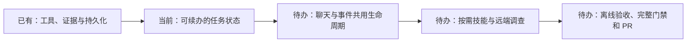

# 持续任务与按需调查技能

- 状态：`进行中`
- 主写分支：`feature/agent-task-harness`
- 基线：`a82a968715a11d6591a277b2f055125d1108b154`
- 对应总流程：程序观察／用户提问 → 持续调查任务 → 有证据的结果 → 既有受控操作。

## 结果与用户影响

本阶段目标是让用户交代的调查和后台发现的问题进入同一套任务生命周期。任务保留对象、目标、
已经执行的检查和结果；用户明确继续时，从保存的进度推进。Agent 按任务需要使用可用的调查技能，
工具权限和结论确认继续由现有程序边界控制。以上能力在验收完成前均为规划。

## 当前证据与缺口

- 已有：聊天使用 LangChain／LangGraph 工具循环；工具执行、上下文预算、证据校验和公开状态存储齐备。
- 已有：自动调查拥有独立的持久化证据步骤，远端只读工具有能力发现和授权预检。
- 已有：`service.local-only@1` 明确规定四项事实与三个取证步骤。
- 缺口：聊天只保存最终结果和事件，中途工具结果未形成可续办输入；重启后只能标为中断。
- 缺口：自动调查与聊天各自调度；事件追问将报告注入本机聊天，无法继续原远端调查。
- 缺口：主调查循环直接引用唯一内置技能；聊天没有按需读取技能的入口。

## 范围

- 本阶段完成：
  - 统一用户提问、后台事件和事件追问的任务生命周期，保留稳定的对象与任务关联。
  - 保存完成的检查、公开结果及原始目标，提供显式续办路径；重启不自动调用模型或重放工具。
  - 续办重新验证当前工具权限、执行节点和对象身份，历史结果保留时间与来源，不冒充实时事实。
  - 通过统一技能目录选择／读取适用方法，保留技能的证据要求和完成检查；无适用技能仍可调查。
  - 接通既有已授权远端工具，保持聊天、事件与继续调查的目标一致。
  - 为中断续办、工具失败、预算耗尽、技能选择和授权变化提供离线回归证据。
- 本阶段不做：界面重设计、真实机器部署、真实模型调用、新网络配置、放宽写操作权限、任意 Shell，
  或批量新增未经需求证明的技能。不更换现有 Agent 框架。

## 依赖与顺序

采用现有 LangChain 循环与专用事件调查执行器，统一管理它们的任务身份、运行、进度与续办。
保留专用证据检查；技能提供方法与完成要求，不能扩大工具权限。状态保存借鉴 OpenHands 的
[会话持久化](https://docs.openhands.dev/sdk/guides/convo-persistence)；任务方法参考 Goose 的
[可复用 Recipe](https://goose-docs.ai/docs/guides/recipes/session-recipes/)。

## 完成标准

- [ ] 用户提问与后台事件经过同一套任务生命周期，事件追问关联原调查。
- [ ] 进程重建后可显式继续未完任务，保留对象、目标及已完成检查；读取历史不触发执行。
- [ ] 续办对授权变化、失效对象、失败工具、取消和预算上限给出明确结果。
- [ ] Agent 可按需使用适用技能；不匹配、不可用技能及没有技能的任务都有确定行为。
- [ ] 已授权远端调查与追问使用原目标，无法借技能或历史进度越权。
- [ ] 既有公开接口、只读预览、证据确认及受控操作回归通过。
- [ ] 定向验证、完整质量门禁和离线 Agent 评测通过；PR 合并并回写路线图。

## 实施约束

进度只保存公开输入、已执行动作和可审查结果，不保存隐藏推理或恢复授权。恢复后的检查结果标明
历史来源；新的实时结论仍需当前证据。已有记录按兼容字段读取，不通过数据迁移覆写历史任务。

## 完成结果

待实现与验收。
