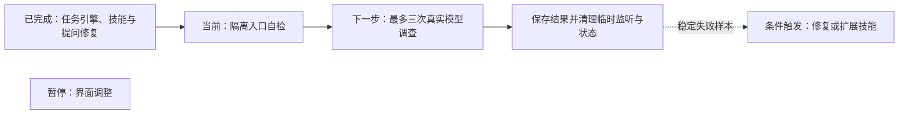

# 持续任务的本机真实模型验收

- 状态：`进行中`
- 主写分支：`test/agent-task-live-acceptance`
- 基线：`1b9244b1f9c5337969cc9a32599467720e10db47`
- 对应总流程：持续任务与按需调查技能 → 持续任务真实使用验收

## 结果与用户影响

本阶段用当前已配置模型检查实际工具调用、技能查阅和原任务续办，给出每项是否成功的证据。
本机临时案例能确认任务引擎与真实模型之间的行为，不代表界面、真实业务服务或跨设备完整体验。

## 当前证据与缺口

- 任务引擎与技能目录已随 PR #145 合并；提问误拒绝修复已随 PR #146 合并，最终 CI 8/8。
- 已明确范围：Windows 本机临时案例，沿用现有模型，最多三次调查，不修改现有服务。
- 验收明确读取 `TunnelMinion-test-20261002/data` 中已有的 `deepseek-flash` 档案，系统密钥状态可用。
  模型配置只读，凭据由既有 Provider 路径使用，不导出或重配。
- [首次实际调查](../../../evaluations/platform/agent-task-live-2026-10-20-initial.json)在模型请求阶段报告
  `model_network_unreachable`，没有执行取证工具；本轮最多三次调查已用一次，剩余两次接续该报告执行。
- 配置来源已核对：Windows 默认目录保存 7 月的 Qwen `8082` 旧地址；当前 `18768` 页面使用另一个
  `TunnelMinion-local-preview` 目录，该目录没有模型配置。DeepSeek 档案仍在，Qwen 当前 `8080`
  模型目录可读。这些是不同数据目录，不代表模型配置被删除；本阶段不改写当前页面配置。
- 临时数据库清理发现 SQLite 连接没有在操作结束时关闭；初次进程退出后，临时目录已清理，端口重新绑定复核通过。
  连接释放修复通过独立 PR #147 处理。既有离线替身测试不计作本轮真实模型证据。

## 范围

- 复用 LangChain 只读 Agent、ConversationService、SQLite checkpoint、Skill 目录及监听适配器。
- 新建本进程回环临时监听；模型只能调用该端口的监听工具与既有技能查阅工具。
- 总计最多三次调查，首次连接失败完整保留；剩余两次组合覆盖状态提问、显式请求技能并在实际工具
  返回后取消、重建任务服务后显式续办。
- 保存公开回答、实际工具身份、预算、模型工具名和历史标记；不保存隐藏推理或凭据。
- 不部署应用、不修改真实服务或网络，不调用 SSH、Docker、WireGuard 或跨节点调查工具。

## 依赖与顺序

## 完成标准

- [x] 隔离入口自检通过，仅暴露本次端口，不调用模型。
- [ ] 实际调用已配置模型，记录成功、失败或未执行项目，不追加调查掩盖失败。
- [ ] 检查实际工具、技能读取、已保存进度、重建无自动重放及同一目标续办。
- [ ] 临时监听和状态已清理，原模型配置摘要不变。
- [ ] 检查与报告可追溯，最终 CI 成功，PR 合并并回写路线图。

## 完成结果

当前技能与续办尚未获得真实模型证据，不能标为实际效果通过。入口为
`scripts/run_task_harness_live_acceptance.py`，`--self-check` 仅验证隔离范围；真实执行必须显式提供
`--model-data-dir` 与 `--output`，不猜测当前页面的数据来源。剩余调查使用 `--prior-failure` 接续初次
失败报告并遵守总计三次的上限；新结果只评定当前源码的剩余检查，不把初次失败改为成功。
任务服务重建不等于操作系统重启，技能查阅是显式请求路径。
