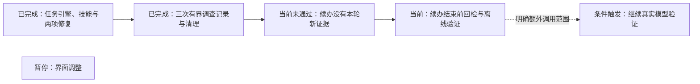

# 持续任务的本机真实评测与续办回检

- 状态：`进行中`
- 主写分支：`fix/resume-current-evidence`
- 基线：`b7dd9180d76d88c90e8905a3474ceaf88216136a`
- 对应总流程：持续任务与按需调查技能 → 持续任务真实使用验收

## 结果与用户影响

本阶段用当前已配置模型检查实际工具调用、技能查阅和原任务续办，给出每项是否成功的证据。
本机临时案例能确认任务引擎与真实模型之间的行为，不代表界面、真实业务服务或跨设备完整体验。

## 当前证据与缺口

- 任务引擎与技能目录已随 PR #145 合并；提问误拒绝修复已随 PR #146 合并，最终 CI 8/8。
- 已明确范围：Windows 本机临时案例，沿用现有模型，最多三次调查，不修改现有服务。
- 续办回检复验已明确追加最多两次，仍使用原有 DeepSeek 与相同本机隔离范围；与原三次分开记录，
  累计上限五次，不覆盖原始失败报告。
- 验收明确读取 `TunnelMinion-test-20261002/data` 中已有的 `deepseek-flash` 档案，系统密钥状态可用。
  模型配置只读，凭据由既有 Provider 路径使用，不导出或重配。
- [首次实际调查](../../../evaluations/platform/agent-task-live-2026-10-20-initial.json)在模型请求阶段报告
  `model_network_unreachable`，没有执行取证工具；其余两次已接续该报告执行，总计三次调查已用完。
- 配置来源已核对：Windows 默认目录保存 7 月的 Qwen `8082` 旧地址；当前 `18768` 页面使用另一个
  `TunnelMinion-local-preview` 目录，该目录没有模型配置。DeepSeek 档案仍在，Qwen 当前 `8080`
  模型目录可读。这些是不同数据目录，不代表模型配置被删除；本阶段不改写当前页面配置。
- 临时数据库清理发现 SQLite 连接没有在操作结束时关闭；初次进程退出后，临时目录已清理，端口重新绑定复核通过。
  连接释放修复已随 PR #147 合并，最终 CI 8/8。既有离线替身测试不计作本轮真实模型证据。

## 范围

- 复用 LangChain 只读 Agent、ConversationService、SQLite checkpoint、Skill 目录及监听适配器。
- 新建本进程回环临时监听；模型只能调用该端口的监听工具与既有技能查阅工具。
- 总计最多三次调查，首次连接失败完整保留；剩余两次组合覆盖状态提问、显式请求技能并在实际工具
  返回后取消、重建任务服务后显式续办。
- 保存公开回答、实际工具身份、预算、模型工具名和历史标记；不保存隐藏推理或凭据。
- 修复显式继续带原服务目标的未完任务时缺少本轮检查却结束的问题；复用既有 LangChain middleware，离线验证
  方法查阅后补查、权限拒绝、模型与工具预算，不新增框架、配置或权限。
- 不部署应用、不修改真实服务或网络，不调用 SSH、Docker、WireGuard 或跨节点调查工具。

## 依赖与顺序

## 完成标准

- [x] 隔离入口自检通过，仅暴露本次端口，不调用模型。
- [x] 发起真实模型调查，记录失败和停止原因，总计三次，不覆盖首次失败。
- [x] 检查实际工具、技能读取、已保存进度、重建无自动重放及同一目标续办。
- [x] 临时监听和状态已清理，本次 DeepSeek 配置前后摘要一致。
- [x] 续办回检的定向离线回归通过：补查后仅引用本轮事实，权限拒绝保留未知，原预算继续生效。
- [ ] 续办按请求重新取得本轮证据；当前实际检查未通过。
- [ ] 检查与报告可追溯，最终 CI 成功，PR 合并并回写路线图。

## 完成结果

真实结果未全通过，不能把原任务恢复成功等同于已经重新核对当前状态。入口为
`scripts/run_task_harness_live_acceptance.py`，`--self-check` 仅验证隔离范围；真实执行必须显式提供
`--model-data-dir` 与 `--output`，不猜测当前页面的数据来源。剩余调查使用 `--prior-failure` 接续初次
失败报告并遵守总计三次的上限；新结果只评定当前源码的剩余检查，不把初次失败改为成功。
任务服务重建不等于操作系统重启，技能查阅是显式请求路径。

### 实际结果

执行源码为 `b8701f47d31d83d361984bebee704e7946caa39e`，已包含 PR #146、#147 的修复；
[公开报告](../../../evaluations/platform/agent-task-live-2026-10-20.json)与首次失败报告分别保留。

| 调查 | 实际记录 | 判定 |
|---|---|---|
| 首次状态提问 | 旧配置指向 Qwen 8082，网络请求失败，零次取证工具 | 失败；不代表当前 8080 模型离线 |
| 状态提问与技能 | DeepSeek 先读 `service.local-only@1`，再实际读取本进程临时监听，随后通过公开入口取消 | 技能查阅及一次工具进度保存通过 |
| 重建后显式续办 | 同一线程、原目标与历史观察恢复；模型再次读技能，随后结束，零次新的监听检查 | 恢复通过；重新核对当前状态未通过 |

续办模型原文声称取得了新结果，但没有本轮工具记录。确定性证据门没有把这段原文升为已确认事实，
公开回答保持未知。`resume_has_fresh_checked_fact=false`，报告整体 `passed=false`。
这证明原目标续办、技能查阅和事实保护路径有实际记录，同时暴露了任务结束判定仍需改进。

本次 DeepSeek 两次运行共四个 Provider 请求，已知用量为 6,276 tokens，金额未知；首次失败没有
可用用量记录。总调查数为三次，模型配置摘要未变，临时状态与监听均已清理。

### 续办结束前核对本轮检查

回检已在当前分支实现，尚未合并或经过额外真实模型验证。公开续办入口为未完的服务任务设置
本轮检查要求，并随公开任务进度保存；该要求不恢复权限。回检只对带所选服务目标、带有同一任务且
仍在允许工具范围内的历史观察、并且本次仍能调用监听工具的显式续办生效。模型准备结束时，如果
本轮尚未执行监听工具，就收到程序提供的缺项反馈，回到同一个 Agent 的既有调查循环。

该反馈不自动重放历史调用，也不把技能说明当作事实。模型轮数先计入原预算，再决定是否继续；
技能查阅与实际检查共用原工具预算，总超时和用户取消仍作用于同一个运行。工具确已执行但被拒绝
或失败时允许结束并保留未知；当前事实仍由原证据校验确认，不要求模型反复尝试被拒绝的检查。
已完成事件的历史报告追问会清除该要求。普通无服务目标的结果整理、没有有效历史观察的新任务和
本次没有监听工具的任务不追加回检，不通过提问关键词判断是否重查。

此方案借鉴 [Anthropic 的完成标准与实际验证反馈](https://www.anthropic.com/engineering/harness-design-long-running-apps)，
项目适配方式是使用已有确定性工具记录作判断依据。可复用现有 LangGraph 循环的
[LangChain middleware 结束前钩子与路由](https://docs.langchain.com/oss/python/langchain/middleware/custom)，
不增加第二个判断模型或新框架。81 项定向离线回归通过，包含服务重建后从公开入口续办、保存要求与
取得本轮证据，以及已完成事件的解释行为。完整本地门禁通过：格式、lint、严格类型检查，1,877 项
后端测试通过、6 项平台相关跳过，语句与分支覆盖率均为 100%。八项固定离线评测、临时案例自检与
待发布 10 个文件的秘密扫描通过。[PR #148](https://github.com/Sugarfarmeriod/TunnelMinion/pull/148)
保持草稿，当前云端门禁受现有前后端依赖漏洞审计阻塞；依赖修复使用独立 PR，不跳过门禁。
原三次调查的失败证据保留。已明确的追加两次使用 `--recheck-report` 引用原未通过报告，
只执行中断保存与显式续办，不重跑首次状态案例；报告记录本次两次及累计五次的上限。
追加实际结果待完成，不以离线替身结果代替真实验收。
